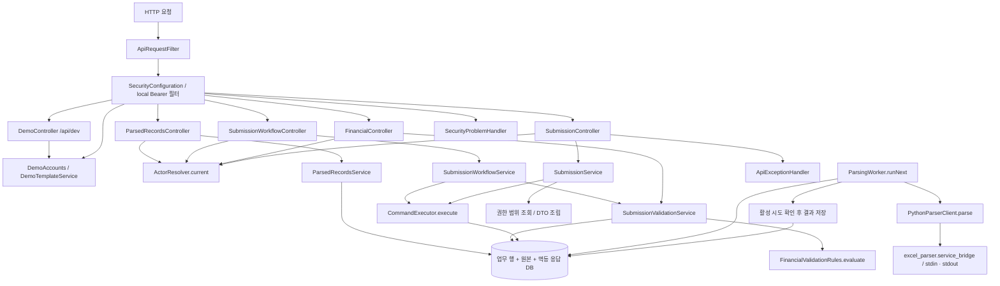

# 백엔드 함수 명세 인덱스

이 문서는 `backend/src/main/java`와 `backend/src/test/java`의 직접 작성한 메서드·생성자를 찾기 위한 인덱스다. **각 코드의 한국어 Javadoc이 상세 명세의 기준**이며 표는 목적·Args·Returns·Raises·Side Effects를 함께 수록한다. 코드 변경 시 해당 행과 호출 관계를 갱신한다.

시그니처에서 annotation은 생략한다. `compact`는 직접 작성한 record compact 생성자를 동등한 canonical 시그니처로 풀어 쓴 표시다. 자동 생성되는 record 접근자·기본 생성자·`equals/hashCode/toString`과 람다는 별도 함수 행으로 세지 않는다. 람다의 작업과 부작용은 소유 메서드에 포함한다. 생성자는 반환형이 없고 `void`/“없음”은 반환값이 없다는 뜻이다.

호출 관계 열은 프로젝트 내부의 직접 호출을 중심으로 정리한다. 외부 JDK·Spring API 호출 전체를 나열하지 않으며, 프레임워크 진입점과 DB·HTTP·프로세스 경계는 각 타입 설명 및 부작용에 명시한다. 같은 이름의 오버로드는 호출 대상 이름을 공유한다. 테스트 표는 검증 범위를 설명하며 실행 결과를 주장하지 않는다.

서비스 [API 계약](api-contract.md)은 0.6-draft이며 전체 설계 35개 중 17개를 구현했다. 개발 전용 /api/dev 2개 경로는 제외한다. 최초 연간 PLAN의 검증·적재·최종 제출과 적재값·보고 집계·정확한 원본 셀 조회를 연결한다. 파싱 성공만으로는 DRAFT/NOT_RUN이며 명시적 검증 후 최종 제출이 PENDING을 만든다. 변경 소명·월간 비교·승인·연간 확정·공식 마스터는 후속 범위이며 준비되지 않은 업무는 차단한다.

관련 문서: [프런트 흐름·함수](frontend-guide.md), [로컬 실행·검증](local-environment.md), [demo·파싱 후보 계약](demo-api.md). 개발 세션과 후보 조회는 아래 각 타입 표에 포함한다.

## 주요 호출 흐름

Python 실행은 접수 커밋 뒤 워커가 담당한다. 결과 저장은 작업·제출·시도·원본 해시·DRAFT 상태가 일치할 때만 수행한다. 원본과 결과는 DB에 저장하며 이 흐름에 임시 파일·파일 로그 쓰기를 추가하지 않는다.

## record와 자동 생성 멤버

| 형식 | 값과 경계 | 직접 작성한 멤버 |
| --- | --- | --- |
| `Actor` / `Organization` | 인증 DB의 사용자·역할·조직; 토큰 미보관 | `Actor` compact 생성자·권한 메서드; `Organization`은 자동 멤버만 사용 |
| `ApiException.FieldError` | 공개 필드명·오류 코드 | compact 생성자 |
| `CommandExecutor.Result` | HTTP 상태·JSON·Location·재전달 여부 | 3인자 생성자·compact 생성자 |
| `CommandExecutor.LockedActor` / `SavedResult` | 내부 권한·저장 응답 | 자동 멤버만 사용 |
| `SubmissionService.RequestInput` / `RetryInput` | 생성 입력·재파싱 기대 상태 | 자동 멤버와 Bean Validation; HTTP 검증은 MVC 담당 |
| `SubmissionService.OriginalFile` | 권한 확인한 원본 이름·바이트 | 자동 멤버; 추가 방어적 바이트 복사 없음 |
| `ApiExceptionHandlerTest.TestRequest` | 검증용 이름 | 자동 멤버와 `@NotBlank` |
| `DemoController.SessionInput` | 개발 체험 역할·선택 organizationCode | 자동 멤버와 Bean Validation; 실제 로그인 자격 증명 아님 |

## 기동

### [BackendApplication.java](../../backend/src/main/java/io/skala/backend/BackendApplication.java)

JVM 진입점. SpringApplication.run이 서버·설정된 DB 마이그레이션·스케줄 구성을 시작한다.

| 시그니처 | 역할·입력·출력 | 예외·부작용 | 호출 관계 |
| --- | --- | --- | --- |
| `public static void main(String[] args)` | Spring 애플리케이션을 시작한다. **입력:** args 실행 설정. **출력:** 없음. | **예외:** 시작 구성 오류. **부작용:** 서버 시작, 설정된 DB의 Flyway 마이그레이션 및 파서 워커 등록. | 내부 명시 호출 없음; 외부 API/값 처리 |

## 인증과 권한

### [Actor.java](../../backend/src/main/java/io/skala/backend/security/Actor.java)

ActorResolver가 생성하고 SubmissionService가 역할·조직 범위를 검사한다.

| 시그니처 | 역할·입력·출력 | 예외·부작용 | 호출 관계 |
| --- | --- | --- | --- |
| `public Actor(String id, String email, String name, String role, Organization organization)` (compact) | 두 역할과 조직 소속의 불변식을 검증해 사용자를 구성한다. **입력:** id·email·name은 DB 사용자 정보, role은 PLANNER 또는 ORG_MANAGER, organization은 조직 담당자의 활성 조직이며 경영기획 담당자는 null이다. **출력:** 생성자이므로 반환값이 없다. | **예외:** 역할 또는 역할별 조직 소속이 잘못되면 IllegalArgumentException. **부작용:** 없음. 입력값을 변경하거나 외부 자료를 읽지 않는다. | 내부 명시 호출 없음; 외부 API/값 처리 |
| `public void requireRole(String requiredRole)` | 현재 사용자에게 지정 역할이 있는지 확인한다. **입력:** requiredRole은 업무 명령이 요구하는 역할 문자열이다. **출력:** 역할이 같으면 정상 반환하며 값은 없다. | **예외:** 역할이 다르면 AccessDeniedException. **부작용:** 없음. | 내부 명시 호출 없음; 외부 API/값 처리 |
| `public boolean canAccessOrganization(String organizationId)` | 조직 ID가 현재 사용자의 조회·수정 범위에 속하는지 판단한다. **입력:** organizationId는 대상 조직의 십진 문자열 ID다. **출력:** PLANNER는 지정 조직, ORG_MANAGER는 본인 조직이면 true다. null 또는 빈 조직 ID는 false다. | **예외:** 없음. **부작용:** 없음. 조직의 실제 존재 여부는 호출 서비스가 별도로 확인한다. | 내부 명시 호출 없음; 외부 API/값 처리 |

### [Organization.java](../../backend/src/main/java/io/skala/backend/security/Organization.java)

직접 작성한 메서드·생성자가 없는 record다. 값의 의미와 자동 멤버는 타입 Javadoc을 따른다.

### [ActorResolver.java](../../backend/src/main/java/io/skala/backend/security/ActorResolver.java)

HTTP 컨트롤러와 local Bearer 필터에서 호출한다. SecurityContext의 이메일 또는 고정 조직 Actor와 현재 DB 상태를 대조한다.

| 시그니처 | 역할·입력·출력 | 예외·부작용 | 호출 관계 |
| --- | --- | --- | --- |
| `public ActorResolver(JdbcClient jdbc)` | 사용자 조회에 사용할 JDBC 클라이언트를 연결한다. **입력:** jdbc는 애플리케이션 데이터소스의 JdbcClient다. **출력:** 생성자이므로 반환값이 없다. | **예외:** 없음. **부작용:** 참조만 보관하며 생성 시 DB를 조회하지 않는다. | 내부 명시 호출 없음; 외부 API/값 처리 |
| `public Actor current()` | 인증 principal의 이메일 또는 고정 조직 Actor를 현재 DB와 대조한다. **입력:** SecurityContext 인증. **출력:** 현재 DB Actor. | **예외:** 미인증·비활성·고정 사용자/역할/조직 불일치, DB 오류. **부작용:** DB 읽기. | `ActorResolver.resolveEmail` |
| `Actor resolveEmail(String email)` | 인증된 이메일과 일치하는 활성 사용자 한 명을 조회한다. **입력:** email은 검증된 인증 수단에서 받은 이메일이며 HTTP role/org 입력이 아니다. **출력:** 검증된 Actor. | **예외:** 계정 미존재·비활성·소속 오류는 BadCredentialsException, DB 접근 오류는 Spring DataAccessException 계열로 전파한다. **부작용:** app_user와 organization을 읽으며 아무 값도 변경하지 않는다. | `ActorResolver.mapActor` |
| `private Actor mapActor(ResultSet result, int rowNumber) throws SQLException` | DB 행의 활성 상태와 역할별 조직 소속을 검사한다. **입력:** result는 조회 행, rowNumber는 JDBC 행 번호이며 업무 판단에 사용하지 않는다. **출력:** 인증에 사용할 Actor. | **예외:** 비활성 계정·조직이나 잘못된 역할/소속은 BadCredentialsException, JDBC 컬럼 읽기 실패는 SQLException. **부작용:** 현재 ResultSet 행만 읽는다. | `Actor.Actor` |

### [LocalBearerAuthenticationFilter.java](../../backend/src/main/java/io/skala/backend/security/LocalBearerAuthenticationFilter.java)

SecurityConfiguration이 local 보안 체인에서만 생성한다. 성공은 다음 FilterChain으로, 인증 실패는 SecurityProblemHandler로 전달한다.

| 시그니처 | 역할·입력·출력 | 예외·부작용 | 호출 관계 |
| --- | --- | --- | --- |
| `LocalBearerAuthenticationFilter(Environment environment, ActorResolver actors, SecurityProblemHandler problems)` | 환경 설정의 개발 인증 정보를 검사하고 토큰 다이제스트만 보관한다. **입력:** environment는 app.local-auth 설정, actors는 DB 사용자 조회, problems는 공통 인증 오류 출력기다. 이메일이나 토큰이 없으면 해당 자격은 비활성이다. **출력:** 생성자이므로 반환값이 없다. | **예외:** 제공된 토큰이 32자 미만·공백 포함·서로 같으면 IllegalArgumentException. **부작용:** 환경 설정을 읽고 메모리에서 해시를 계산한다. 토큰을 로깅하지 않는다. | `LocalBearerAuthenticationFilter.configuredDigest` |
| `protected void doFilterInternal(HttpServletRequest request, HttpServletResponse response, FilterChain chain) throws ServletException, IOException` | 기존 두 자격 또는 demo 허용 사업부 자격을 검증한다. **입력:** HTTP 교환·뒤 필터. **출력:** 인증 후 진행, 실패 시 401. | **예외:** 뒤 필터의 ServletException/IOException·DB 오류. **부작용:** SecurityContext 설정. 추가 조직은 토큰 없는 고정 Actor principal을 사용한다. | `LocalBearerAuthenticationFilter.digest`, `DemoAccounts.actorForOrganizationToken`, `ActorResolver.resolveEmail`, `SecurityProblemHandler.commence` |
| `private static byte[] configuredDigest(String token)` | 제공된 개발 토큰의 최소 형식을 검사한다. **입력:** token은 환경 설정에서 읽은 값이다. **출력:** 없거나 빈 값이면 null, 유효하면 SHA-256 다이제스트. | **예외:** 32자 미만 또는 공백이 섞이면 IllegalArgumentException. **부작용:** 메모리에서만 검사하며 값 자체를 오류에 넣지 않는다. | `LocalBearerAuthenticationFilter.digest` |
| `private static byte[] digest(String token)` | 토큰 비교에 사용할 일정 길이의 다이제스트를 만든다. **입력:** token은 비교 대상 문자열이다. **출력:** UTF-8 입력의 SHA-256 바이트 배열. | **예외:** JVM의 필수 SHA-256 구현이 없으면 IllegalStateException. **부작용:** 메모리에서 해시만 계산하고 원본을 보관하지 않는다. | 내부 명시 호출 없음; 외부 API/값 처리 |
| `LocalBearerAuthenticationFilter(Environment environment, ActorResolver actors, SecurityProblemHandler problems, DemoAccounts demoAccounts)` | 기존 local 자격과 선택적 demo 사업부 자격을 구성한다. **입력:** 환경·DB 조회·오류 처리·demo 자격 또는 null. **출력:** 없음. | **예외:** 잘못된 기존 토큰. **부작용:** 환경 읽기·메모리 다이제스트 생성. | `LocalBearerAuthenticationFilter.configuredDigest` |

### [SecurityConfiguration.java](../../backend/src/main/java/io/skala/backend/security/SecurityConfiguration.java)

Spring Bean 구성 진입점. 기본 환경은 health 외 거부하며 local에서만 개발 Bearer 필터를 연결한다.

| 시그니처 | 역할·입력·출력 | 예외·부작용 | 호출 관계 |
| --- | --- | --- | --- |
| `AuthenticationManager authenticationManager()` | 설정되지 않은 로그인 방식과 자동 생성 기본 계정의 사용을 막는다. **입력:** 없음. **출력:** 항상 인증을 거부하는 AuthenticationManager. | **예외:** 반환된 관리자를 호출하면 BadCredentialsException. **부작용:** 기본 사용자 자동 구성을 대체하며 토큰·비밀번호를 생성하지 않는다. | 내부 명시 호출 없음; 외부 API/값 처리 |
| `SecurityFilterChain defaultSecurityFilterChain(HttpSecurity http, SecurityProblemHandler problems) throws Exception` | local 이외 환경에서는 상태 확인을 제외한 요청을 모두 차단한다. **입력:** http는 Spring 보안 빌더, problems는 보안 오류 출력기다. **출력:** 익명 /actuator/health만 허용하는 보안 체인. | **예외:** 보안 체인 구성 실패는 Exception. **부작용:** HTTP 보안 규칙을 등록하며 파일·DB를 변경하지 않는다. | `SecurityConfiguration.configureStatelessBoundary` |
| `SecurityFilterChain localSecurityFilterChain(HttpSecurity http, Environment environment, ActorResolver actors, SecurityProblemHandler problems, ObjectProvider<DemoAccounts> demoAccounts) throws Exception` | local 인증과 선택적 demo 추가 자격을 구성한다. **입력:** 보안 빌더·환경·사용자 조회·오류 처리·demo 공급자. **출력:** local 보안 체인. | **예외:** 토큰 설정·보안 구성 오류. **부작용:** 필터 등록. local+demo의 POST session만 익명 허용한다. | `LocalBearerAuthenticationFilter.LocalBearerAuthenticationFilter`, `SecurityConfiguration.configureStatelessBoundary` |
| `private void configureStatelessBoundary(HttpSecurity http, SecurityProblemHandler problems) throws Exception` | 세션·폼·Basic 인증을 끄고 보안 오류 계약을 공통 적용한다. **입력:** http는 현재 체인의 빌더, problems는 고정 ProblemDetail 출력기다. **출력:** 반환값이 없다. | **예외:** 빌더 설정 실패는 Exception. **부작용:** 인증 상태를 세션에 저장하지 않도록 구성한다. 자동 전송 쿠키 인증을 사용하지 않는 Bearer 전용 경계이므로 CSRF를 비활성화한다. 향후 쿠키 로그인을 도입할 때 이 선택을 재검토해야 한다. | 내부 명시 호출 없음; 외부 API/값 처리 |

### [SecurityProblemHandler.java](../../backend/src/main/java/io/skala/backend/security/SecurityProblemHandler.java)

Spring Security의 AuthenticationEntryPoint/AccessDeniedHandler와 local 필터에서 호출한다.

| 시그니처 | 역할·입력·출력 | 예외·부작용 | 호출 관계 |
| --- | --- | --- | --- |
| `public SecurityProblemHandler(ObjectMapper mapper)` | 공통 JSON 직렬화기를 연결한다. **입력:** mapper는 Spring의 ProblemDetail 설정을 적용한 ObjectMapper다. **출력:** 생성자이므로 반환값이 없다. | **예외:** 없음. **부작용:** 전용 직렬화기를 메모리에 복사하며 공통 mapper는 변경하지 않는다. | 내부 명시 호출 없음; 외부 API/값 처리 |
| `public void commence(HttpServletRequest request, HttpServletResponse response, AuthenticationException exception) throws IOException` | 인증이 없거나 실패한 요청에 고정된 401 오류를 쓴다. **입력:** request·response는 현재 HTTP 교환, exception은 공개하지 않을 인증 예외다. **출력:** 반환값이 없다. | **예외:** 응답 쓰기가 실패하면 IOException. **부작용:** 응답 상태·헤더·본문을 기록하며 인증값이나 예외 내용을 로깅하지 않는다. | `SecurityProblemHandler.write` |
| `public void handle(HttpServletRequest request, HttpServletResponse response, AccessDeniedException exception) throws IOException` | 인증된 사용자의 권한 부족을 고정된 403 오류로 쓴다. **입력:** request·response는 현재 HTTP 교환, exception은 공개하지 않을 권한 예외다. **출력:** 반환값이 없다. | **예외:** 응답 쓰기가 실패하면 IOException. **부작용:** 응답 상태·헤더·본문을 기록한다. | `SecurityProblemHandler.write` |
| `private void write(HttpServletRequest request, HttpServletResponse response, HttpStatus status, String code, String detail) throws IOException` | 보안 오류의 공개 필드만 JSON으로 출력한다. **입력:** request·response는 HTTP 교환, status·code·detail은 서버의 고정 오류 표현이다. **출력:** 이미 응답이 확정됐으면 쓰지 않고 반환한다. | **예외:** JSON 출력 실패는 IOException. **부작용:** 공통 필터의 안전한 requestId를 재사용하고 응답을 기록한다. | `ApiRequestFilter.requestId` |

## 공통 HTTP 오류와 추적

### [ApiException.java](../../backend/src/main/java/io/skala/backend/common/ApiException.java)

업무 서비스가 생성하고 ApiExceptionHandler가 읽는다. FieldError compact 생성자도 포함한다.

| 시그니처 | 역할·입력·출력 | 예외·부작용 | 호출 관계 |
| --- | --- | --- | --- |
| `public ApiException(HttpStatus status, String code, String publicMessage)` | 필드 오류가 없는 공개 업무 오류를 만든다. **입력:** status는 4xx/5xx, code는 대문자 오류 코드, publicMessage는 공개용 설명이다. **출력:** 없음. 생성된 예외에 전달값을 보존한다. | **예외:** IllegalArgumentException — 상태·코드·공개 설명이 유효하지 않을 때. **부작용:** 없음. 파일·로그·DB를 쓰지 않는다. | `ApiException.ApiException (다른 생성자)` |
| `public ApiException(HttpStatus status, String code, String publicMessage, List<FieldError> errors)` | 필드별 오류를 함께 보존하는 공개 업무 오류를 만든다. **입력:** status는 4xx/5xx, code는 오류 코드, publicMessage는 공개 설명, errors는 null 원소가 없는 필드 오류 목록이다. **출력:** 없음. 목록은 불변 복사본으로 보존한다. | **예외:** IllegalArgumentException — 상태·코드·설명·목록이 유효하지 않을 때. **부작용:** 없음. 원인 예외나 내부 경로를 자동 수집하지 않는다. | `ApiException.requireCode`, `ApiException.requireMessage` |
| `public HttpStatus status()` | 오류의 HTTP 상태를 반환한다. **입력:** 없음. **출력:** 생성 시 검증한 4xx/5xx 상태. | **예외:** 없음. **부작용:** 없음. | 내부 명시 호출 없음; 외부 API/값 처리 |
| `public String code()` | 기계 판별용 오류 코드를 반환한다. **입력:** 없음. **출력:** 검증된 대문자 오류 코드. | **예외:** 없음. **부작용:** 없음. | 내부 명시 호출 없음; 외부 API/값 처리 |
| `public List<FieldError> errors()` | 응답에 사용할 불변 필드 오류 목록을 반환한다. **입력:** 없음. **출력:** 오류가 없으면 빈 목록. | **예외:** 없음. **부작용:** 없음. | 내부 명시 호출 없음; 외부 API/값 처리 |
| `private static String requireCode(String value)` | 외부에 제공할 오류 코드의 형식을 확인한다. **입력:** value는 검증할 오류 코드다. **출력:** 검증된 입력 코드. | **예외:** IllegalArgumentException — 대문자·숫자·밑줄 형식이나 64자 제한 위반. **부작용:** 없음. | 내부 명시 호출 없음; 외부 API/값 처리 |
| `private static String requireMessage(String value)` | 호출자가 마련한 공개 설명의 빈 값과 길이를 확인한다. **입력:** value는 원본 예외 메시지를 포함하지 않는 공개 설명이다. **출력:** 검증된 설명. 업무 내용을 추론하거나 수정하지 않는다. | **예외:** IllegalArgumentException — null·공백이거나 512자를 초과할 때. **부작용:** 없음. 내용의 공개 적합성은 호출자가 보장해야 한다. | 내부 명시 호출 없음; 외부 API/값 처리 |
| `public FieldError(String field, String code)` (compact) | 공개할 필드 오류를 검증하고 내부 이름 노출을 제한한다. **입력:** field는 DTO 필드 경로, code는 대문자 오류 코드다. **출력:** 없음. 자동 접근자는 정리된 두 값을 반환한다. | **예외:** IllegalArgumentException — 오류 코드 형식이 유효하지 않을 때. **부작용:** 없음. 허용 형식 밖 필드명은 request로 바꾼다. | `ApiException.requireCode` |

### [ApiRequestFilter.java](../../backend/src/main/java/io/skala/backend/common/ApiRequestFilter.java)

Servlet 필터 체인이 shouldNotFilter/doFilterInternal을 호출한다. requestId는 MVC·보안 오류 출력기에서도 재사용한다.

| 시그니처 | 역할·입력·출력 | 예외·부작용 | 호출 관계 |
| --- | --- | --- | --- |
| `protected boolean shouldNotFilter(HttpServletRequest request)` | 버전 API 경로에만 공통 헤더 처리를 적용한다. **입력:** request는 현재 Servlet 요청이다. **출력:** /api/v1 및 그 하위 경로가 아니면 true. | **예외:** 없음. **부작용:** 없음. 요청 URI만 읽는다. | 내부 명시 호출 없음; 외부 API/값 처리 |
| `protected void doFilterInternal(HttpServletRequest request, HttpServletResponse response, FilterChain filterChain) throws ServletException, IOException` | 응답 전 추적·캐시 헤더를 설정하고 다음 필터를 호출한다. **입력:** request와 response는 HTTP 교환, filterChain은 나머지 처리 경로다. **출력:** 없음. | **예외:** ServletException·IOException — 이후 필터·요청 처리의 오류를 전파한다. **부작용:** 요청 속성과 응답 헤더를 변경하며 파일·로그를 쓰지 않는다. | `ApiRequestFilter.requestId` |
| `public static String requestId(HttpServletRequest request)` | 한 요청에서 동일하게 사용할 검증된 추적 ID를 구한다. **입력:** request는 추적 속성과 X-Request-ID 헤더를 읽을 요청이다. **출력:** 단일 헤더의 1~64자 ASCII 식별자 또는 새 UUID 문자열. | **예외:** 없음. **부작용:** 최초 호출 때 요청 속성에 ID를 저장한다. 중복·잘못된 헤더는 재사용하지 않는다. | 내부 명시 호출 없음; 외부 API/값 처리 |

### [ApiExceptionHandler.java](../../backend/src/main/java/io/skala/backend/common/ApiExceptionHandler.java)

Spring MVC exception resolver가 각 handler를 호출하고 ResponseEntityExceptionHandler가 handleExceptionInternal로 위임한다.

| 시그니처 | 역할·입력·출력 | 예외·부작용 | 호출 관계 |
| --- | --- | --- | --- |
| `public ResponseEntity<Object> handleApiException(ApiException exception, HttpServletRequest request)` | 검증된 업무 오류의 상태·코드·공개 설명을 응답한다. **입력:** exception은 공개용 ApiException, request는 현재 요청이다. **출력:** application/problem+json 오류 응답. | **예외:** 없음. **부작용:** 필요하면 요청 추적 속성을 만들며 파일·로그를 쓰지 않는다. | `ApiException.code`, `ApiException.errors`, `ApiException.status`, `ApiExceptionHandler.problem` |
| `public ResponseEntity<Object> handleSecurityException(Exception exception, HttpServletRequest request)` | 컨트롤러·서비스에서 발생한 인증·권한 오류를 고정 설명으로 응답한다. **입력:** exception은 Spring Security 예외, request는 현재 요청이다. **출력:** 인증 오류는 401, 권한 오류는 403의 안전한 ProblemDetail. | **예외:** 없음. **부작용:** 추적 속성 외 없음. 자격 증명과 원본 예외 메시지를 기록하지 않는다. | `ApiExceptionHandler.problem` |
| `public ResponseEntity<Object> handleMultipartException(MultipartException exception, HttpServletRequest request)` | 해석 불가능한 multipart 요청을 입력 형식 오류로 반환한다. **입력:** exception은 파일 경로 등을 포함할 수 있는 원본 예외, request는 현재 요청이다. **출력:** 원문을 포함하지 않는 400 오류 응답. 크기 초과는 MVC의 413 처리 경로를 따른다. | **예외:** 없음. **부작용:** 추적 속성 외 없음. 예외 원문을 기록하지 않는다. | `ApiExceptionHandler.problem` |
| `public ResponseEntity<Object> handleUnexpectedException(Exception exception, HttpServletRequest request)` | 예상 밖 서버 오류의 내부 내용을 제거한다. **입력:** exception은 공개하지 않을 원본 예외, request는 현재 요청이다. **출력:** 일반 설명과 추적 ID만 포함하는 500 오류 응답. | **예외:** 없음. **부작용:** 추적 속성 외 없음. 스택·원본 경로·파일 로그를 만들지 않는다. | `ApiExceptionHandler.problem` |
| `protected ResponseEntity<Object> handleExceptionInternal(Exception exception, Object body, HttpHeaders headers, HttpStatusCode statusCode, WebRequest request)` | Spring MVC의 입력·라우팅·업로드 오류를 안전한 공통 응답으로 바꾼다. **입력:** exception은 MVC 예외, body는 사용하지 않을 기본 본문, headers는 프로토콜 헤더, statusCode는 MVC가 정한 HTTP 상태, request는 ServletWebRequest다. **출력:** 안전한 오류 응답. 응답이 이미 전송됐으면 null. | **예외:** 없음. 기본 예외 메시지는 응답에 사용하지 않는다. **부작용:** 요청 추적 속성을 만들 수 있으며 파일·로그를 쓰지 않는다. | `ApiException.FieldError`, `ApiExceptionHandler.defaultCode`, `ApiExceptionHandler.defaultMessage`, `ApiExceptionHandler.problem` |
| `private ResponseEntity<Object> problem(HttpStatusCode status, String code, String message, List<ApiException.FieldError> errors, HttpHeaders sourceHeaders, HttpServletRequest request)` | ProblemDetail와 추적·캐시 헤더를 일관되게 구성한다. **입력:** status는 상태, code는 공개 코드, message는 공개 설명, errors는 필드 오류, sourceHeaders는 유지할 MVC 헤더, request는 현재 요청이다. **출력:** 확장 필드 code·requestId·errors를 가진 오류 응답. | **예외:** 없음. 요청 URI 문법이 잘못되면 일반 API 경로를 사용한다. **부작용:** 요청 추적 속성 외 없음. 입력 헤더와 오류 목록은 변경하지 않는다. | `ApiExceptionHandler.instance`, `ApiRequestFilter.requestId` |
| `private URI instance(HttpServletRequest request)` | 쿼리 문자열을 제외한 요청 경로를 오류 발생 위치로 변환한다. **입력:** request는 URI를 읽을 Servlet 요청이다. **출력:** 요청 경로 URI 또는 문법 오류 시 /api/v1. | **예외:** 없음. IllegalArgumentException은 일반 경로로 대체한다. **부작용:** 없음. | 내부 명시 호출 없음; 외부 API/값 처리 |
| `private String defaultCode(HttpStatusCode status)` | 프레임워크 상태를 입력값이 없는 고정 오류 코드로 연결한다. **입력:** status는 Spring MVC가 결정한 HTTP 상태다. **출력:** 해당 상태의 공개 코드. 세부 업무 코드는 ApiException에서 지정한다. | **예외:** 없음. **부작용:** 없음. | 내부 명시 호출 없음; 외부 API/값 처리 |
| `private String defaultMessage(HttpStatusCode status)` | 프레임워크의 원문을 사용하지 않고 상태별 공개 설명을 고른다. **입력:** status는 응답 HTTP 상태다. **출력:** 값·파일 경로·스택을 포함하지 않는 고정 한국어 설명. | **예외:** 없음. **부작용:** 없음. | 내부 명시 호출 없음; 외부 API/값 처리 |

## 멱등 명령과 트랜잭션

### [CommandExecutor.java](../../backend/src/main/java/io/skala/backend/foundation/CommandExecutor.java)

SubmissionService의 생성·업로드·재파싱 명령을 감싼다. action 콜백과 멱등 성공 응답을 같은 DB 트랜잭션으로 기록한다.

| 시그니처 | 역할·입력·출력 | 예외·부작용 | 호출 관계 |
| --- | --- | --- | --- |
| `public CommandExecutor(JdbcTemplate jdbc, PlatformTransactionManager transactionManager)` | 운영 DB와 UTC 시계로 명령 실행기를 구성한다. **입력:** jdbc는 업무 DB 접근 객체, transactionManager는 같은 DataSource의 관리자다. **출력:** 없음. 생성한 실행기는 DB에 접속하거나 스키마를 생성하지 않는다. | **예외:** IllegalArgumentException — 트랜잭션 관리자 구성이 올바르지 않을 때. **부작용:** 메모리 설정만 생성하며 파일·로그·DB를 쓰지 않는다. | `CommandExecutor.CommandExecutor (다른 생성자)` |
| `CommandExecutor(JdbcTemplate jdbc, PlatformTransactionManager transactionManager, Clock clock)` | 만료 정책을 검증할 수 있도록 시계를 주입한다. **입력:** jdbc와 transactionManager는 같은 DB 연결을 사용하고 clock은 현재 시각 제공자다. **출력:** 없음. | **예외:** NullPointerException — jdbc·clock이 null일 때. **부작용:** 메모리 설정만 생성하며 DB 연결을 열지 않는다. | 내부 명시 호출 없음; 외부 API/값 처리 |
| `public Result execute(Actor actor, String route, String key, String fingerprint, Supplier<Result> action)` | 현재 권한 확인 후 같은 사용자·경로·키의 명령을 한 번만 실행한다. **입력:** actor는 인증한 사용자, route는 메서드를 포함한 서버의 정규 경로, key는 8~128자 멱등키, fingerprint는 요청 내용의 SHA-256 소문자 hex, action은 같은 DB에 성공 결과를 만드는 콜백이다. 외부 파일 쓰기를 넣지 않는다. **출력:** 새 성공 결과 또는 24시간 내 같은 요청의 성공 결과(replayed=true). | **예외:** ApiException — 입력·권한·동시 실행·키 충돌·DB 제약 충돌; 런타임 예외 — 콜백 실패는 전체 트랜잭션을 롤백하고 전파한다. **부작용:** 사용자 행 잠금, 해당 키의 만료 기록 삭제, 콜백 및 성공 응답 DB 저장. 실패 시 콜백의 같은 DB 변경도 롤백하며 파일·로그는 쓰지 않는다. | `ApiException.ApiException`, `CommandExecutor.Result`, `CommandExecutor.lockActor`, `CommandExecutor.validateInput` |
| `private void validateInput(Actor actor, String route, String key, String fingerprint, Supplier<Result> action)` | DB 접근 전 인증 객체와 멱등 식별자의 최소 형식을 검증한다. **입력:** actor는 인증 사용자, route는 서버의 정규 경로, key는 멱등키, fingerprint는 소문자 SHA-256, action은 실행할 콜백이다. **출력:** 없음. | **예외:** ApiException — 미인증은 401, 키·경로·fingerprint·콜백 오류는 400. **부작용:** 없음. 입력값을 오류 메시지로 복사하지 않는다. | `ApiException.ApiException` |
| `private long lockActor(Actor actor)` | 사용자 행을 대기 없이 잠그고 인증 이후 권한 변경을 확인한다. **입력:** actor는 이번 요청에서 인증한 사용자와 역할·조직 정보다. **출력:** 잠근 사용자의 양수 DB ID. | **예외:** ApiException — 삭제·비활성·역할/조직 변경으로 권한이 유효하지 않을 때; DB 잠금 예외는 execute에서 안전한 충돌 응답으로 변환한다. **부작용:** 현재 트랜잭션이 끝날 때까지 해당 사용자 행만 잠근다. | `CommandExecutor.forbidden` |
| `private ApiException forbidden()` | 인증 시점 이후 사용자 상태 변경에 사용할 고정 오류를 만든다. **입력:** 없음. **출력:** 내부 권한값을 노출하지 않는 403 업무 오류. | **예외:** 없음. **부작용:** 없음. | `ApiException.ApiException` |
| `public Result(int status, String body, String location)` | 새로운 명령의 성공 결과를 만든다. **입력:** status는 2xx 상태, body는 JSON 문자열, location은 API 경로나 null이다. **출력:** 없음. replayed=false로 생성한다. | **예외:** IllegalArgumentException — 상태·본문·경로가 허용 범위를 벗어날 때. **부작용:** 없음. | `CommandExecutor.Result (다른 생성자)` |
| `public Result(int status, String body, String location, boolean replayed)` (compact) | DB 저장 전 응답의 최소 형태와 헤더 경로를 검증한다. **입력:** status는 2xx, body는 null이 아닌 JSON, location은 없거나 API 경로, replayed는 기존 성공 응답인지 나타낸다. **출력:** 없음. null location은 DB 계약에 따라 빈 문자열로 바꾼다. | **예외:** IllegalArgumentException — 성공 상태·본문·Location 형식 위반. **부작용:** 없음. JSON 문법의 정확성은 호출자의 직렬화기가 보장한다. | 내부 명시 호출 없음; 외부 API/값 처리 |

## 제출 요청·접수·조회

### [ApiData.java](../../backend/src/main/java/io/skala/backend/submission/ApiData.java)

SubmissionService가 정적 import로 호출하는 메모리 DTO·ID·시각·해시·커서 변환이다.

| 시그니처 | 역할·입력·출력 | 예외·부작용 | 호출 관계 |
| --- | --- | --- | --- |
| `private ApiData()` | 인스턴스 생성을 막는다. **입력:** 없음. **출력:** 없음. | **예외:** 없음. **부작용:** 없음. | 내부 명시 호출 없음; 외부 API/값 처리 |
| `public static Map<String, Object> object(Object... entries)` | null을 유지하는 순서 있는 DTO를 만든다. **입력:** entries 키/값 쌍. **출력:** JSON용 맵. | **예외:** IllegalArgumentException 홀수 인자. **부작용:** 없음. | 내부 명시 호출 없음; 외부 API/값 처리 |
| `public static long id(String value)` | 양수 bigint 문자열을 검증한다. **입력:** value 외부 ID. **출력:** bigint 값. | **예외:** ApiException 잘못된 ID. **부작용:** 없음. | `ApiException.ApiException` |
| `public static String instant(Object value)` | DB 날짜를 UTC 문자열로 변환한다. **입력:** value nullable JDBC 시각. **출력:** UTC 시각 또는 null. | **예외:** IllegalArgumentException 미지원 JDBC 타입. **부작용:** 없음. | 내부 명시 호출 없음; 외부 API/값 처리 |
| `public static String hash(byte[] bytes)` | SHA-256을 계산한다. **입력:** bytes 원본. **출력:** 소문자 hex. | **예외:** IllegalStateException SHA-256 부재. **부작용:** 없음. | 내부 명시 호출 없음; 외부 API/값 처리 |
| `public static int offset(String cursor, String scope)` | 필터·권한 범위에 결합된 커서를 해석한다. 목록은 스냅샷을 보장하지 않는다. **입력:** cursor nullable 커서, scope 정규화된 조회 범위. **출력:** 행 오프셋. | **예외:** ApiException 잘못된/다른 범위 커서. **부작용:** 없음. | `ApiData.hash`, `ApiException.ApiException` |
| `public static String cursor(int offset, String scope)` | 다음 조회 커서를 만든다. **입력:** offset 다음 오프셋, scope 조회 범위. **출력:** URL 안전 커서. | **예외:** 없음. **부작용:** 없음. | `ApiData.hash` |

### [SubmissionController.java](../../backend/src/main/java/io/skala/backend/submission/SubmissionController.java)

Spring MVC의 /api/v1 요청 진입점. 인증 사용자 조회 후 SubmissionService로 위임한다.

| 시그니처 | 역할·입력·출력 | 예외·부작용 | 호출 관계 |
| --- | --- | --- | --- |
| `public SubmissionController(SubmissionService service, ActorResolver actors)` | HTTP와 서비스 경계를 연결한다. **입력:** service 업무 서비스, actors 인증 해석기. **출력:** 없음. | **예외:** 없음. **부작용:** 없음. | 내부 명시 호출 없음; 외부 API/값 처리 |
| `public Actor me(Map<String, String> query)` | 현재 사용자·역할·조직을 반환한다. **입력:** query 빈 쿼리. **출력:** 인증 사용자. | **예외:** 인증/쿼리 오류. **부작용:** DB 읽기. | `ActorResolver.current`, `SubmissionService.checkQuery` |
| `public Map<String, Object> organizations(Map<String, String> query)` | 접근 가능한 조직을 조회한다. **입력:** query 목록 필터. **출력:** 조직 페이지. | **예외:** 인증/필터 오류. **부작용:** DB 읽기. | `ActorResolver.current`, `SubmissionService.organizations` |
| `public ResponseEntity<String> createRequest(String key, SubmissionService.RequestInput input, Map<String, String> query)` | 전 조직 대상 요청을 등록한다. **입력:** key 멱등키, input 요청 DTO, query 빈 쿼리. **출력:** 201/재전달 응답. | **예외:** 권한/검증/상태 오류. **부작용:** DB 생성. | `ActorResolver.current`, `SubmissionController.command`, `SubmissionService.checkQuery`, `SubmissionService.createRequest` |
| `public Map<String, Object> requests(Map<String, String> query)` | 권한별 요청함을 조회한다. **입력:** query 목록 필터. **출력:** 요청 페이지. | **예외:** 인증/필터 오류. **부작용:** DB 읽기. | `ActorResolver.current`, `SubmissionService.requests` |
| `public Map<String, Object> request(String requestId, Map<String, String> query)` | 요청 상세와 권한 내 대상 현황을 조회한다. **입력:** requestId ID, query 빈 쿼리. **출력:** 요청 상세. | **예외:** 인증/404. **부작용:** DB 읽기. | `ActorResolver.current`, `SubmissionService.checkQuery`, `SubmissionService.request` |
| `public ResponseEntity<String> upload(String requestId, String key, MultipartFile file, MultipartHttpServletRequest request) throws IOException` | 한 개의 전체 XLSX 파일을 접수한다. **입력:** requestId 요청, key 멱등키, file 유일 파일 part, request multipart 요청. **출력:** 202/재전달 응답. | **예외:** IOException 입력 읽기 오류, ApiException 잘못된 parts. **부작용:** DB 원본/작업 저장; multipart는 설정된 17MiB 메모리 임계값 내에서 처리. | `ActorResolver.current`, `ApiException.ApiException`, `SubmissionController.command`, `SubmissionService.upload` |
| `public Map<String, Object> submissions(Map<String, String> query)` | 제출 이력을 조회한다. **입력:** query 목록 필터. **출력:** 제출 페이지. | **예외:** 인증/필터 오류. **부작용:** DB 읽기. | `ActorResolver.current`, `SubmissionService.submissions` |
| `public Map<String, Object> submission(String submissionId, Map<String, String> query)` | 파싱·검증 준비 상태를 폴링한다. **입력:** submissionId 제출, query 빈 쿼리. **출력:** 제출 상세. | **예외:** 인증/404. **부작용:** DB 읽기. | `ActorResolver.current`, `SubmissionService.checkQuery`, `SubmissionService.submission` |
| `public ResponseEntity<String> retry(String submissionId, String key, SubmissionService.RetryInput input, Map<String, String> query)` | 운영 오류의 동일 원본 재파싱을 접수한다. **입력:** submissionId 제출, key 멱등키, input 기대 상태, query 빈 쿼리. **출력:** 202/재전달 응답. | **예외:** 권한/상태 오류. **부작용:** DB 작업 갱신. | `ActorResolver.current`, `SubmissionController.command`, `SubmissionService.checkQuery`, `SubmissionService.retry` |
| `public Map<String, Object> diagnostics(String submissionId, Map<String, String> query)` | 현재 시도의 안전한 진단을 조회한다. **입력:** submissionId 제출, query 진단 필터. **출력:** 진단 페이지. | **예외:** 인증/상태 오류. **부작용:** DB 읽기. | `ActorResolver.current`, `SubmissionService.diagnostics` |
| `public ResponseEntity<byte[]> original(String submissionId, Map<String, String> query)` | 원본을 재계산 없이 내려준다. **입력:** submissionId 제출, query 빈 쿼리. **출력:** attachment 바이트. | **예외:** 인증/404. **부작용:** DB 읽기. | `ActorResolver.current`, `SubmissionService.checkQuery`, `SubmissionService.original` |
| `private ResponseEntity<String> command(CommandExecutor.Result result)` | 저장된 성공 응답의 HTTP 헤더를 복구한다. **입력:** result 트랜잭션 결과. **출력:** JSON HTTP 응답. | **예외:** 없음. **부작용:** 없음. | 내부 명시 호출 없음; 외부 API/값 처리 |

### [SubmissionService.java](../../backend/src/main/java/io/skala/backend/submission/SubmissionService.java)

SubmissionController와 서비스 테스트에서 호출한다. SQL/DTO 보조 메서드는 같은 클래스 내부에서만 호출한다.

| 시그니처 | 역할·입력·출력 | 예외·부작용 | 호출 관계 |
| --- | --- | --- | --- |
| `public SubmissionService(JdbcClient jdbc, ObjectMapper mapper, CommandExecutor commands)` | 주입된 DB·직렬화·멱등 경계를 연결한다. **입력:** jdbc DB 접근, mapper JSON 변환, commands 트랜잭션 명령. **출력:** 없음. | **예외:** 없음. **부작용:** 없음. | 내부 명시 호출 없음; 외부 API/값 처리 |
| `public Map<String, Object> organizations(Actor actor, Map<String, String> query)` | 현재 행위자의 조직 조회 범위를 반환한다. **입력:** actor 인증 행위자, query active/limit/cursor 필터. **출력:** 조직 페이지. | **예외:** ApiException 잘못된 필터. **부작용:** DB 읽기. | `ApiData.id`, `ApiData.object`, `SubmissionService.checkQuery`, `SubmissionService.invalid`, `SubmissionService.page` |
| `public CommandExecutor.Result createRequest(Actor actor, String key, RequestInput input)` | 전 조직을 고정한 제출 요청을 생성한다. **입력:** actor 기획 담당자, key 멱등키, input 검증된 입력. **출력:** 최초 생성 또는 동일 명령의 저장 응답. | **예외:** ApiException 계획/중복/대상 오류. **부작용:** 계획·요청·대상·멱등 응답을 한 DB 트랜잭션에서 생성. | `Actor.requireRole`, `ApiData.hash`, `ApiData.id`, `CommandExecutor.Result`, `CommandExecutor.execute`, `SubmissionService.conflict`, `SubmissionService.count`, `SubmissionService.insert`, `SubmissionService.invalid`, `SubmissionService.json`, `SubmissionService.now`, `SubmissionService.request`, `SubmissionService.rows` |
| `public Map<String, Object> requests(Actor actor, Map<String, String> query)` | 요청함을 권한과 필터에 따라 조회한다. **입력:** actor 인증 행위자, query 명세의 목록 필터. **출력:** 요청 페이지. | **예외:** ApiException 잘못된 필터. **부작용:** DB 읽기. | `ApiData.id`, `SubmissionService.checkQuery`, `SubmissionService.filters`, `SubmissionService.page`, `SubmissionService.requestView` |
| `public Map<String, Object> request(Actor actor, String requestId)` | 단일 요청과 본인 권한 범위의 대상 현황을 조회한다. **입력:** actor 인증 행위자, requestId 요청 ID. **출력:** 요청 DTO. | **예외:** ApiException 없는/권한 밖 요청. **부작용:** DB 읽기. | `ApiData.id`, `SubmissionService.requestRow`, `SubmissionService.requestView` |
| `public CommandExecutor.Result upload(Actor actor, String requestId, String key, String filename, byte[] bytes)` | 바이트 원본과 QUEUED 작업을 함께 접수한다. **입력:** actor 조직 담당자, requestId 대상 요청, key 멱등키, filename 검증할 이름, bytes 전체 원본. **출력:** 202 응답과 조회 위치. | **예외:** ApiException 권한/파일/요청/계획/대기 상태 오류. **부작용:** DB 원본·초안·파싱 작업·성공 응답 생성; 파일시스템 쓰기 없음. | `Actor.requireRole`, `ApiData.hash`, `ApiData.id`, `ApiException.ApiException`, `CommandExecutor.Result`, `CommandExecutor.execute`, `SubmissionService.conflict`, `SubmissionService.count`, `SubmissionService.insert`, `SubmissionService.json`, `SubmissionService.now`, `SubmissionService.requestRow`, `SubmissionService.submission` |
| `public Map<String, Object> submissions(Actor actor, Map<String, String> query)` | 요청·조직·기간·상태로 제출 이력을 조회한다. **입력:** actor 인증 행위자, query 목록 필터. **출력:** 제출 요약 페이지. | **예외:** ApiException 잘못된 필터/다른 조직 필터. **부작용:** DB 읽기. | `Actor.canAccessOrganization`, `ApiData.id`, `ApiException.ApiException`, `SubmissionService.checkQuery`, `SubmissionService.filters`, `SubmissionService.page`, `SubmissionService.submissionSummary` |
| `public Map<String, Object> submission(Actor actor, String submissionId)` | 활성 파싱 시도와 제출 준비 상태를 조회한다. **입력:** actor 인증 행위자, submissionId 제출 ID. **출력:** DRAFT/파싱/검증 전 상태 DTO. | **예외:** ApiException 권한 밖/없는 제출. **부작용:** DB 읽기. | `ApiData.id`, `SubmissionService.submissionRow`, `SubmissionService.submissionView` |
| `public Map<String, Object> diagnostics(Actor actor, String submissionId, Map<String, String> query)` | 활성 파싱 시도의 안전한 진단만 반환한다. **입력:** actor 인증 행위자, submissionId 제출 ID, query 진단 필터. **출력:** 진단 페이지. | **예외:** ApiException 파싱 미완료/잘못된 필터. **부작용:** DB 읽기. | `ApiData.cursor`, `ApiData.id`, `ApiData.object`, `ApiData.offset`, `SubmissionService.checkQuery`, `SubmissionService.conflict`, `SubmissionService.invalid`, `SubmissionService.limit`, `SubmissionService.readResult`, `SubmissionService.scope`, `SubmissionService.submissionRow` |
| `public OriginalFile original(Actor actor, String submissionId)` | 권한을 확인한 뒤 최초 원본 바이트를 반환한다. **입력:** actor 인증 행위자, submissionId 제출 ID. **출력:** 이름과 바이트. | **예외:** ApiException 권한 밖/없는 제출. **부작용:** DB 읽기. | `ApiData.id`, `SubmissionService.submissionRow` |
| `public CommandExecutor.Result retry(Actor actor, String submissionId, String key, RetryInput input)` | 운영 오류로 끝난 동일 원본의 재파싱을 등록한다. **입력:** actor 조직 담당자, submissionId 제출 ID, key 멱등키, input 기대 토큰·시도. **출력:** 새 활성 시도의 202 응답. | **예외:** ApiException 권한/토큰/시도/종료 상태 충돌. **부작용:** 기존 작업의 시도 증가·결과 참조 제거·멱등 기록 저장. | `Actor.requireRole`, `ApiData.hash`, `ApiData.id`, `CommandExecutor.Result`, `CommandExecutor.execute`, `SubmissionService.conflict`, `SubmissionService.json`, `SubmissionService.retryAllowed`, `SubmissionService.submission`, `SubmissionService.submissionRow`, `SubmissionService.token` |
| `private Map<String, Object> requestRow(Actor actor, long requestId)` | 공통 요청 행과 조직 대상 소속을 확인한다. **입력:** actor 인증 행위자, requestId 정수 ID. **출력:** 내부 DB 행. | **예외:** ApiException 없는/권한 밖 요청. **부작용:** DB 읽기. | `ApiData.id`, `SubmissionService.count`, `SubmissionService.notFound`, `SubmissionService.rows` |
| `private Map<String, Object> submissionRow(Actor actor, long submissionId)` | 단일 제출 접근 범위를 확인한다. **입력:** actor 인증 행위자, submissionId 정수 ID. **출력:** 내부 DB 행. | **예외:** ApiException 없는/권한 밖 제출. **부작용:** DB 읽기. | `Actor.canAccessOrganization`, `SubmissionService.notFound`, `SubmissionService.rows` |
| `private Map<String, Object> requestView(Actor actor, Map<String, Object> row, boolean detail)` | 요청·권한 범위 집계를 DTO로 조립한다. **입력:** actor 인증 행위자, row 내부 행, detail 대상 상세 포함 여부. **출력:** 요청 DTO. | **예외:** DB 접근 오류. **부작용:** 대상/제출 현황 DB 읽기. | `ApiData.hash`, `ApiData.id`, `ApiData.instant`, `ApiData.object`, `SubmissionService.json` |
| `private Map<String, Object> submissionSummary(Map<String, Object> row)` | 저장된 제출 헤더를 공개 요약으로 변환한다. **입력:** row 내부 행. **출력:** 제출 요약. | **예외:** 없음. **부작용:** 없음. | `ApiData.instant`, `ApiData.object` |
| `private Map<String, Object> submissionView(Map<String, Object> row)` | 파싱 결과와 업무 검증 미구현 경계를 명시한다. **입력:** row 내부 행. **출력:** 제출 상세 DTO. | **예외:** 없음. **부작용:** 없음. | `ApiData.object`, `SubmissionService.retryAllowed`, `SubmissionService.submissionSummary`, `SubmissionService.token` |
| `private String token(Map<String, Object> row)` | 활성 작업 변경을 탐지하는 불투명 토큰을 계산한다. **입력:** row 내부 제출·작업 행. **출력:** SHA-256 토큰. | **예외:** 없음. **부작용:** 없음. | `ApiData.hash`, `ApiData.object`, `SubmissionService.json` |
| `private boolean retryAllowed(Map<String, Object> row)` | 동일 바이트를 다시 실행할 수 있는 운영 오류만 허용한다. **입력:** row 내부 행. **출력:** 재시도 가능 여부. | **예외:** 없음. **부작용:** 없음. | 내부 명시 호출 없음; 외부 API/값 처리 |
| `private JsonNode readResult(Map<String, Object> row)` | 현재 결과 객체를 읽는다. **입력:** row 제출 행. **출력:** 프로토콜 JSON. | **예외:** IllegalStateException 저장 자료 손상. **부작용:** DB 읽기. | `ApiData.object` |
| `private String filters(Map<String, String> query, List<Object> params, boolean submissions)` | 목록 공통 필터를 바인딩한다. **입력:** query 필터, params 바인딩 값, submissions 제출 상태 여부. **출력:** SQL 조건. | **예외:** ApiException 유효하지 않은 필터. **부작용:** params에 바인딩 추가. | `SubmissionService.invalid` |
| `private Map<String, Object> page(Actor actor, Map<String, String> query, String route, String sql, List<Object> params, java.util.function.Function<Map<String, Object>, Map<String, Object>> convert)` | DB 목록을 한 페이지로 제한한다. **입력:** actor 행위자, query 조회, route 범위명, sql 고정 SQL, params 바인딩, convert DTO 변환. **출력:** items/nextCursor. | **예외:** ApiException 커서/limit 오류. **부작용:** DB 읽기. | `ApiData.cursor`, `ApiData.object`, `ApiData.offset`, `SubmissionService.limit`, `SubmissionService.scope` |
| `private int limit(Map<String, String> query)` | 최대 100의 페이지 크기를 적용한다. **입력:** query 필터. **출력:** 기본 50 또는 지정 크기. | **예외:** ApiException 범위 오류. **부작용:** 없음. | `SubmissionService.invalid` |
| `private String scope(Actor actor, Map<String, String> query, String route)` | 커서를 사용자·필터에 결합한다. **입력:** actor 행위자, query 필터, route 범위명. **출력:** 정규 범위. | **예외:** 없음. **부작용:** 없음. | `SubmissionService.json` |
| `public void checkQuery(Map<String, String> query, Set<String> allowed)` | 알 수 없는 쿼리 이름을 거부한다. **입력:** query 실제 쿼리, allowed 허용 이름. **출력:** 없음. | **예외:** ApiException 미정의 필드. **부작용:** 없음. | `SubmissionService.invalid` |
| `private long insert(String sql, Object... params)` | 생성된 identity를 반환한다. **입력:** sql INSERT, params 바인딩. **출력:** 새 ID. | **예외:** DB 오류. **부작용:** DB 행 추가. | 내부 명시 호출 없음; 외부 API/값 처리 |
| `private List<Map<String, Object>> rows(String sql, Object... params)` | 내부 행을 조회한다. **입력:** sql 고정 조회, params 바인딩. **출력:** 행 목록. | **예외:** DB 오류. **부작용:** DB 읽기. | 내부 명시 호출 없음; 외부 API/값 처리 |
| `private long count(String sql, Object... params)` | 조건에 맞는 행 수를 조회한다. **입력:** sql COUNT 조회, params 바인딩. **출력:** 개수. | **예외:** DB 오류. **부작용:** DB 읽기. | 내부 명시 호출 없음; 외부 API/값 처리 |
| `private String json(Object value)` | 응답·요청을 JSON 문자열로 직렬화한다. **입력:** value 직렬화 대상. **출력:** JSON. | **예외:** IllegalStateException 계약 직렬화 실패. **부작용:** 없음. | 내부 명시 호출 없음; 외부 API/값 처리 |
| `private OffsetDateTime now()` | UTC 서버 시각을 반환한다. **입력:** 없음. **출력:** 현재 시각. | **예외:** 없음. **부작용:** 시계 읽기. | 내부 명시 호출 없음; 외부 API/값 처리 |
| `private ApiException invalid(String message)` | 400 오류를 만든다. **입력:** message 공개 메시지. **출력:** 오류. | **예외:** 없음. **부작용:** 없음. | `ApiException.ApiException` |
| `private ApiException conflict(String code, String message)` | 409 오류를 만든다. **입력:** code 코드, message 공개 메시지. **출력:** 오류. | **예외:** 없음. **부작용:** 없음. | `ApiException.ApiException` |
| `private ApiException notFound()` | 리소스 존재를 숨기는 404 오류를 만든다. **입력:** 없음. **출력:** 오류. | **예외:** 없음. **부작용:** 없음. | `ApiException.ApiException` |

## 업무 검증·적재·원본 셀 조회

아래 검증 명령은 `SubmissionWorkflowService → CommandExecutor`의 조직·제출 잠금 및 트랜잭션 안에서 실행한다. 원본·파서 결과·과거 검증 객체는 보존하고 DRAFT의 현재 선택 적재행과 참조만 바꾼다. 읽기 API의 요약·적재행·커서는 read-only REPEATABLE_READ의 동일 DB 스냅샷에서 반환한다. 코드 Javadoc이 개별 인수·예외의 기준이다.

### [FinancialController.java](../../backend/src/main/java/io/skala/backend/submission/FinancialController.java)

| 메서드·생성자 | 목적·Args → Returns | Raises·Side Effects | 주요 내부 호출 |
| --- | --- | --- | --- |
| `FinancialController(service, actors)` | 검증 조회·인증 경계를 주입 → 반환 없음 | 없음; HTTP·DB 처리 없음 | 생성자 주입 |
| `financialValues(submissionId, query)` | 제출·필터 → 선택된 상세 월별 금액 페이지와 요약 | 권한·검증·필터 오류; DB 읽기 | `actors.current`, `service.financialValues` |
| `reportValues(submissionId, query)` | 제출·필터 → 보고 항목별 월별 집계 페이지 | 권한·검증·필터 오류; DB 읽기 | `actors.current`, `service.reportValues` |
| `sourceCell(submissionId, query)` | 제출·sheet/cell → 보존한 한 셀과 확인된 공유 수식 기준 | 권한·주소·미수집 오류; DB 읽기 | `actors.current`, `service.sourceCell` |

### [FinancialValidationRules.java](../../backend/src/main/java/io/skala/backend/submission/FinancialValidationRules.java)

| 메서드·생성자 | 목적·Args → Returns | Raises·Side Effects | 주요 내부 호출 |
| --- | --- | --- | --- |
| `FinancialValidationRules(mapper)` | JSON 직렬화기 → 반환 없음 | 없음; 의존성 보관만 | 생성자 주입 |
| `evaluate(data, sourceHash, organizationCode, year, requestType)` | 내부 적재 근거·원본 해시·인증 조직·요청 연도/종류 → 보고 분류·유효 상세·진단·보고값·구성 지문 | 직렬화 오류; 메모리 검증만, 원본 JSON 불변 | `resolved`, `domain`, `text`, `upper`, `amount`, `controlAmount`, `bounded`, `fingerprint`, `firstSource`, `sourceSheet`, `sourceCell`, `issue`, `json` |
| `resolved(status)` | 조직·보고 상태 → RESOLVED 여부 | 없음; 부작용 없음 | 없음 |
| `domain(value)` | 원본 도메인 → REVENUE/COST | 없음; 부작용 없음 | 없음 |
| `text(node, field)` | nullable scalar → 문자열/null | 없음; 부작용 없음 | 없음 |
| `upper(node, field)` | 상태 필드 → 대문자/빈 문자열 | 없음; 부작용 없음 | `text` |
| `amount(value)` | 확정된 십진 문자열 → 정확한 BigDecimal/null | 잘못된 금액은 null; 반올림·0 보정 없음 | `upper` |
| `controlAmount(value)` | DB에 적재하지 않는 원본 합계 캐시 → 정수24자리·소수16자리 이내 BigDecimal/null | 잘못된 금액은 null; 상세 금액 정밀도와 별개이며 반올림 없음 | `upper` |
| `controlAmount(value)` | 원 단위 합계 캐시 → 최대 정수 24자리·소수 16자리 Decimal/null | 반올림·DB 적재 없음; 캐시 대조에만 사용 | `upper` |
| `bounded(line)` | 적재 문자열 → 컬럼 길이 허용 여부 | 없음; 부작용 없음 | `text` |
| `fingerprint(line, report, month, amount)` | 원천 의미·보고키·월·금액 → 정규화 JSON | 직렬화 오류; 위치·수정차수 제외, 중복은 호출자의 목록에 보존 | `text`, `json` |
| `firstSource(line)` | 상세행 → 첫 금액 셀/null | 없음; 부작용 없음 | `text` |
| `sourceSheet(node)` | 합계 근거 → 원본 시트/null | 없음; 부작용 없음 | `text` |
| `sourceCell(node)` | 합계 근거 → 원본 셀/null | 없음; 부작용 없음 | `text` |
| `issue(items, code, message, sheet, cell, reportKey, month)` | 확인 위치·원인 → 반환 없음 | 없음; 메모리 ERROR 진단 목록 추가 | `ApiData.object` |
| `json(value)` | 내부 자료 → JSON 문자열 | IllegalStateException; 부작용 없음 | ObjectMapper |

`evaluate`는 요청 연도의 PLAN 1~12월, 조직, 보고 분류, 업무키, 중복 위치/식별자/월, 원 금액의 NUMERIC(30,6) 적합성, 원본 보고 말단·매출·비용·OP 합계를 확인한다. ERROR가 하나라도 있으면 보고값을 UNRESOLVED/null로 반환한다. 합계 캐시와 상세 합계의 차이가 0 초과·0.00001원 이하인 경우만 근거를 보존한 WARNING으로 구분한다. 일부 상세를 적재 가능으로 분리해도 이를 전체 제출 가능으로 판단하지 않는다.

### [SubmissionValidationService.java](../../backend/src/main/java/io/skala/backend/submission/SubmissionValidationService.java)

| 메서드·생성자 | 목적·Args → Returns | Raises·Side Effects | 주요 내부 호출 |
| --- | --- | --- | --- |
| `SubmissionValidationService(jdbc, mapper, rules)` | DB·JSON·순수 규칙 연결 → 반환 없음 | 없음; 의존성 보관만 | 생성자 주입 |
| `validateLocked(actor, submissionId)` | 잠긴 본인 초안 → 반환 없음 | 권한·상태·저장 오류; 현재 상세/금액·검증 참조 교체 및 불변 결과 객체 추가 | `accessible`, `result`, `rules.evaluate`, `previous`, `validationResult`, `reportId`, `accountId`, `insert`, `json`, `blocker` |
| `assertReadyForSubmit(actor, submissionId)` | 잠긴 초안 → 반환 없음 | 문맥 변경·제출 불가 409; 읽기만 | `accessible`, `readiness`, `conflict` |
| `readiness(submissionRow)` | 내부 제출 ID → 준비 상태·검증 현재성·차단 사유 | 저장 손상; DB 읽기, 금액·소명 생성 없음 | `row`, `rows`, `objectResult`, `nullableId`, `previous`, `blocker` |
| `validationFingerprint(submissionId)` | 제출 → 검증 결과 참조·직전 제출 문맥 JSON | 조회 오류; DB 읽기 | `rows`, `row`, `previous`, `json` |
| `comparisonContext(submissionId)` | 제출 → 고정 비교본·정책 DTO | 저장 손상; DB 읽기 | `validationResult`, `stringNode` |
| `diagnostics(submissionId)` | 제출 → 현재 검증 진단 | 저장 손상; STALE이면 옛 진단 대신 재검증 진단 | `validationResult`, `readiness`, `row`, `blocker` |
| `financialValues(actor, submissionId, query)` | 행위자·제출·필터 → 실제 적재 금액·전체 요약·cursor | 권한·NOT_RUN/STALE·필터 오류; read-only REPEATABLE_READ | `accessible`, `currentResult`, `checkFilters`, `filterValue`, `limit`, `scope`, `ApiData.offset/cursor` |
| `reportValues(actor, submissionId, query)` | 행위자·제출·필터 → 검증 스냅샷 집계 페이지 | 권한·NOT_RUN/STALE·필터 오류; read-only REPEATABLE_READ | `accessible`, `currentResult`, `checkFilters`, `limit`, `scope`, `ApiData.offset/cursor` |
| `sourceCell(actor, submissionId, query)` | 행위자·제출·sheet/cell → 보존 셀·공유 기준 JSON | 권한·주소·파싱 전·미수집 오류; 재계산·빈칸 추정 없음 | `accessible`, `result`, `sourceEvidence`, `invalid`, `conflict` |
| `sourceEvidence(parsed, source)` | 불변 파서 결과·선택 셀 → nullable sharedFormulaBase를 붙인 복사본 | 예외 없음; 메모리 복사만, 동일 shared si의 보존 기준만 사용. 상대참조 전개·수식 실행·저장 객체 변경 없음 | `stringNode`, ObjectMapper |
| `currentResult(row)` | 내부 제출 → 현재 검증 JSON | 409 VALIDATION_REQUIRED/VALIDATION_STALE; DB 읽기 | `readiness`, `validationResult`, `conflict` |
| `reportId(report)` | 확인한 보고 분류 → DB ID | 분류 충돌; 없는 보고 항목만 INSERT | `rows`, `insert`, `conflict` |
| `accountId(line)` | 원본 계정 → ID/null | DB 오류; 유형·코드·표시명 조합 재사용/INSERT | `rows`, `insert` |
| `previous(row)` | 제출 문맥 → 같은 요청의 직전 최종 제출 ID/null | DB 오류; DRAFT 제외·반려 포함 조회 | `rows` |
| `accessible(actor, submissionId)` | 행위자·제출 → 권한 확인 내부 행 | 다른 조직/없는 제출 404; DB 읽기 | `row`, `actor.canAccessOrganization` |
| `row(submissionId)` | ID → 제출·요청·파싱 문맥 | 없는 제출 404; DB 읽기 | `rows`, `ApiData.id` |
| `validationResult(submissionId)` | ID → 현재 검증 객체/null | 저장 손상; DB 읽기 | `rows`, `objectResult` |
| `result(row)` | 파서 참조를 가진 내부 행 → JSON | 저장 손상; DB 읽기 | `objectResult` |
| `objectResult(key)` | 서버가 선택한 객체 키 → JSON | IllegalStateException; DB 읽기, 내부 키/원문 예외 미노출 | ObjectMapper, JdbcClient |
| `rows(sql, params)` | 고정 SQL·바인딩 → 행 목록 | DB 오류; 읽기 | JdbcClient |
| `insert(sql, params)` | 고정 INSERT·바인딩 → 생성 ID | DB 오류; 현재 트랜잭션 쓰기 | JdbcClient, GeneratedKeyHolder |
| `nullableId(node)` | nullable JSON → ID/null | 잘못된 ID; 부작용 없음 | `ApiData.id` |
| `stringNode(node)` | nullable JSON → 문자열/null | 없음; 부작용 없음 | 없음 |
| `string(value)` | nullable 값 → 문자열/null | 없음; 부작용 없음 | 없음 |
| `json(value)` | 내부 값 → JSON | IllegalStateException; 부작용 없음 | ObjectMapper |
| `blocker(code, message, stage)` | 규정 안내 → 차단 진단 | 없음; 메모리 객체만 생성 | `ApiData.object` |
| `checkFilters(query)` | 연월·시나리오·보고항목·cursor/limit → 반환 없음 | 미지원/잘못된 입력 400; 부작용 없음 | `filterValue`, `limit`, `invalid` |
| `filterValue(key, value)` | 허용 필터 → 안전한 바인딩 값 | 범위·enum·ID 오류 400; 부작용 없음 | `ApiData.id`, `invalid` |
| `limit(query)` | 페이지 크기 → 1~100 | 범위 오류 400; 부작용 없음 | `invalid` |
| `scope(actor, submissionId, query, name)` | 사용자·제출·검증·조회명·필터 → cursor 범위 JSON | 조회 오류; 검증 문맥 DB 읽기 | `validationFingerprint`, `json` |
| `invalid(message)` | 안전한 안내 → 400 ApiException | 없음; 부작용 없음 | ApiException |
| `conflict(code, message)` | 코드·안내 → 409 ApiException | 없음; 부작용 없음 | ApiException |

## 파서 연결과 작업 처리

### [PythonParserClient.java](../../backend/src/main/java/io/skala/backend/parser/PythonParserClient.java)

ParsingWorker.runNext가 parse를 호출한다. Python 프로세스를 stdin/stdout으로 연결하고 운영 실패를 FAILED 프로토콜로 바꾼다.

| 시그니처 | 역할·입력·출력 | 예외·부작용 | 호출 관계 |
| --- | --- | --- | --- |
| `public PythonParserClient(ObjectMapper mapper, String python, String sourceDirectory, int timeoutSeconds, int maxOutputBytes)` | 실행 구성을 고정한다. **입력:** mapper JSON 변환기, python 실행 파일, sourceDirectory 모듈 경로, timeoutSeconds 제한 초, maxOutputBytes 출력 한도. **출력:** 없음. | **예외:** IllegalArgumentException 잘못된 한도. **부작용:** 없음. | 내부 명시 호출 없음; 외부 API/값 처리 |
| `public JsonNode parse(String filename, byte[] bytes)` | 원본을 해석하고 엔진 결과를 반환하며 업무 승인·조직 검증은 수행하지 않는다. **입력:** filename 검증된 원본 이름, bytes 원본 OOXML. **출력:** 프로토콜 1.0 결과 또는 안전한 FAILED 결과. | **예외:** 없음; 프로세스 오류는 FAILED로 변환. **부작용:** 제한시간 내 자식 프로세스 실행, 파일 쓰기 없음. | `PythonParserClient.failure`, `PythonParserClient.readBounded`, `PythonParserClient.validResult` |
| `private boolean validResult(JsonNode result)` | 엔진의 성공 주장보다 필수 프로토콜 타입과 범위를 먼저 확인한다. 선택 `unusedTemplateRowCount`는 누락을 허용하고 존재하면 0 이상 int 정수를 요구한다. **입력:** result 엔진 JSON. **출력:** 1.0 필수·선택 필드의 유효 여부. | **예외:** 없음. **부작용:** 없음. | 내부 명시 호출 없음; 외부 API/값 처리 |
| `private byte[] readBounded(Process process) throws IOException` | 출력 상한 초과 시 자식 프로세스를 즉시 종료한다. **입력:** process 실행 중 프로세스. **출력:** 제한 이내 stdout 바이트. | **예외:** IOException 읽기/한도 오류. **부작용:** 프로세스 출력 읽기, 상한 초과 시 종료. | 내부 명시 호출 없음; 외부 API/값 처리 |
| `public JsonNode failure(String code)` | 내부 예외를 노출하지 않는 실패 프로토콜을 만든다. **입력:** code 고정 운영 오류 코드. **출력:** `unusedTemplateRowCount`를 포함해 요약이 0인 FAILED JSON. | **예외:** 없음. **부작용:** 없음. | 내부 명시 호출 없음; 외부 API/값 처리 |

### [ParsingWorker.java](../../backend/src/main/java/io/skala/backend/parser/ParsingWorker.java)

Spring @Scheduled 또는 통합 테스트가 runNext를 호출한다. DB에서 선점한 작업의 원본을 파서에 보내고 유효한 활성 시도에만 결과를 연결한다.

| 시그니처 | 역할·입력·출력 | 예외·부작용 | 호출 관계 |
| --- | --- | --- | --- |
| `public ParsingWorker(JdbcClient jdbc, TransactionTemplate transactions, PythonParserClient parser, ObjectMapper mapper, int timeoutSeconds)` | 워커 의존성과 고아 작업 제한시간을 받는다. **입력:** jdbc DB, transactions 트랜잭션, parser 실행기, mapper JSON, timeoutSeconds 실행 제한 초. **출력:** 없음. | **예외:** 없음. **부작용:** 없음. | 내부 명시 호출 없음; 외부 API/값 처리 |
| `public void runNext()` | 고아 작업을 실패 처리하고 가장 오래된 대기 작업 하나를 실행한다. **입력:** 없음. **출력:** 없음. | **예외:** DB 접근 오류(다음 스케줄에서 재시도). **부작용:** DB 작업 상태·결과 변경, Python 프로세스 실행; 로컬 파일 쓰기 없음. | `ApiData.hash`, `ParsingWorker.now`, `ParsingWorker.persist`, `PythonParserClient.failure`, `PythonParserClient.parse` |
| `private void persist(Map<String, Object> job, JsonNode result)` | 활성 시도·원본·DRAFT가 일치할 때만 결과를 원자적으로 연결한다. **입력:** job 실행 당시 식별자, result 파서 프로토콜. **출력:** 없음. | **예외:** IllegalStateException 결과 직렬화 실패/DB 오류. **부작용:** 결과 객체 저장 및 해당 작업 완료; 지연된 구시도 결과는 버림. | `ParsingWorker.now`, `ParsingWorker.nullable` |
| `private String nullable(JsonNode result, String field)` | 존재하지 않는 엔진 버전을 추정하지 않는다. **입력:** result 프로토콜, field 선택 필드명. **출력:** 문자열 또는 null. | **예외:** 없음. **부작용:** 없음. | 내부 명시 호출 없음; 외부 API/값 처리 |
| `private OffsetDateTime now()` | UTC 서버 시각을 반환한다. **입력:** 없음. **출력:** 현재 시각. | **예외:** 없음. **부작용:** 시계 읽기. | 내부 명시 호출 없음; 외부 API/값 처리 |

### [ParsedRecordsService.java](../../backend/src/main/java/io/skala/backend/parser/ParsedRecordsService.java)

ParsedRecordsController가 호출하는 읽기 전용 후보 조회다. 기존 제출 권한을 확인하고 저장 결과의 요청 페이지를 안전한 표시 DTO로 투영한다.

| 시그니처 | 역할·입력·출력 | 예외·부작용 | 호출 관계 |
| --- | --- | --- | --- |
| `public ParsedRecordsService(JdbcClient jdbc, ObjectMapper mapper, SubmissionService submissions)` | 저장 결과 조회와 기존 제출 권한 서비스를 받는다. **입력:** jdbc DB, mapper JSON, submissions 권한 서비스. **출력:** 없음. | **예외:** 없음. **부작용:** 없음. | 내부 명시 호출 없음; 외부 API/값 처리 |
| `public Map<String, Object> records(Actor actor, String submissionId, Map<String, String> query)` | 같은 조직 권한과 활성 시도에 묶인 표준 후보 페이지를 반환한다. **입력:** actor 인증 사용자, submissionId 제출 ID, query limit/cursor. **출력:** summary·안전한 후보 items·nextCursor. | **예외:** 권한/404/파싱 중/커서/결과 오류. **부작용:** DB 결과 바이트 읽기. 결과 전체 트리 대신 요청 페이지의 후보만 객체화한다. | `ApiData.id`, `ApiData.object`, `ApiData.offset`, `ApiException.ApiException`, `ParsedRecordsService.emptySummary`, `ParsedRecordsService.limit`, `ParsedRecordsService.page`, `SubmissionService.checkQuery`, `SubmissionService.submission` |
| `private Map<String, Object> page(byte[] bytes, int offset, int limit, String scope)` | 저장 JSON에서 요약과 지정 구간의 레코드만 DTO로 투영한다. **입력:** bytes 저장 JSON, offset 시작, limit 페이지 크기, scope 커서 범위. **출력:** 미리보기 페이지; 구버전 결과의 미사용 양식 행 수는 0. | **예외:** IllegalStateException 저장 JSON 손상. **부작용:** 메모리 읽기만 수행하고 파싱·파일 저장·상태 변경 없음. | `ApiData.cursor`, `ApiData.object`, `ParsedRecordsService.emptySummary`, `ParsedRecordsService.project` |
| `private Map<String, Object> project(JsonNode record)` | 내부 경로·객체 키·원본 레코드 ID 없이 표시 필드만 선택한다. **입력:** record 내부 표준 후보. **출력:** 평탄 미리보기 DTO. | **예외:** 없음. **부작용:** 없음; 숫자 금액은 문자열/null로 유지한다. | `ApiData.object`, `ParsedRecordsService.integer`, `ParsedRecordsService.text` |
| `private Map<String, Object> emptySummary()` | 아직 결과가 없는 실패 작업의 빈 요약을 만든다. **입력:** 없음. **출력:** 0 카운트 사전. | **예외:** 없음. **부작용:** 없음. | `ApiData.object` |
| `private String text(JsonNode value)` | nullable 원문·정밀 숫자를 문자열로 읽는다. **입력:** value JSON scalar. **출력:** 문자열 또는 null. | **예외:** 없음. **부작용:** 없음. | 내부 명시 호출 없음; 외부 API/값 처리 |
| `private Integer integer(JsonNode value)` | 확인된 연도·월만 정수로 읽는다. **입력:** value JSON 정수. **출력:** 정수 또는 null. | **예외:** 없음. **부작용:** 없음. | 내부 명시 호출 없음; 외부 API/값 처리 |
| `private int limit(String value)` | 페이지 크기를 서비스 공통 범위로 제한한다. **입력:** value 정수 문자열. **출력:** 1~100 정수. | **예외:** ApiException 잘못된 크기. **부작용:** 없음. | `ApiException.ApiException` |

### [ParsedRecordsController.java](../../backend/src/main/java/io/skala/backend/parser/ParsedRecordsController.java)

GET /api/v1/submissions/{submissionId}/parsed-records 진입점이다. ActorResolver의 현재 사용자와 읽기 서비스로 위임한다.

| 시그니처 | 역할·입력·출력 | 예외·부작용 | 호출 관계 |
| --- | --- | --- | --- |
| `public ParsedRecordsController(ParsedRecordsService service, ActorResolver actors)` | 인증 및 읽기 전용 서비스를 받는다. **입력:** service 조회 서비스, actors DB 인증 해석기. **출력:** 없음. | **예외:** 없음. **부작용:** 없음. | 내부 명시 호출 없음; 외부 API/값 처리 |
| `public Map<String, Object> records(String submissionId, Map<String, String> query)` | 본인 조직 또는 기획 권한의 제출 후보 페이지를 반환한다. **입력:** submissionId 제출, query limit/cursor. **출력:** summary/items/nextCursor. | **예외:** 인증/권한/상태/쿼리 오류. **부작용:** 저장 결과 DB 읽기만 수행. | `ActorResolver.current`, `ParsedRecordsService.records` |

## 개발 체험 전용

### [DemoAccounts.java](../../backend/src/main/java/io/skala/backend/demo/DemoAccounts.java)

local & demo 프로필에서만 활성화한다. 환경의 기존 두 자격과 메모리 난수로 발급한 17개 사업부 자격을 연결한다. 고정 역할·조직을 DB와 대조하며 토큰을 DB·로그에 보관하지 않는다.

| 시그니처 | 역할·입력·출력 | 예외·부작용 | 호출 관계 |
| --- | --- | --- | --- |
| `public DemoAccounts(JdbcClient jdbc, Environment environment)` | 기존 두 자격을 검증하고 추가 17개 난수 자격을 준비한다. **입력:** JDBC·환경. **출력:** 없음. | **예외:** 설정 충돌·필수 암호화 실패. **부작용:** 환경 읽기·메모리 난수/다이제스트 생성. 재시작 시 추가 자격 만료. | `DemoAccounts.required`, `DemoAccounts.organizationEmail`, `DemoAccounts.randomToken`, `DemoAccounts.digest` |
| `public String email(String role)` | 선택한 체험 역할의 설정 이메일을 반환한다. **입력:** role PLANNER/ORG_MANAGER. **출력:** 이메일. | **예외:** IllegalArgumentException 미지원 역할. **부작용:** 없음. | 내부 명시 호출 없음; 외부 API/값 처리 |
| `public String token(String role)` | 검증된 개발 세션 응답에만 사용할 설정 토큰을 반환한다. **입력:** role PLANNER/ORG_MANAGER. **출력:** 서버 환경의 개발 Bearer. | **예외:** IllegalArgumentException 미지원 역할. **부작용:** 없음; 로깅 금지. | 내부 명시 호출 없음; 외부 API/값 처리 |
| `public Actor actor(String role)` | 기존 역할의 기본 계정을 재확인한다. **입력:** 체험 역할. **출력:** 토큰 없는 Actor. | **예외:** 계정·역할·조직 충돌, DB 오류. **부작용:** DB 읽기. | `DemoAccounts.actor(role, null)` |
| `private String required(Environment environment, String key)` | 필수 설정을 값 노출 없이 확인한다. **입력:** environment 환경, key 설정 이름. **출력:** 설정값. | **예외:** IllegalStateException 누락. **부작용:** 환경 읽기. | 내부 명시 호출 없음; 외부 API/값 처리 |
| `public String organizationEmail(String code)` | 허용 사업부 합성 이메일을 만든다. **입력:** 17개 중 코드. **출력:** example.test 이메일. | **예외:** 잘못된 코드 IllegalArgumentException. **부작용:** 없음. | 내부 명시 호출 없음 |
| `public String token(String role, String organizationCode)` | 선택 역할·조직에 고정된 자격을 반환한다. **입력:** 역할·생략 가능한 코드. **출력:** 기존 또는 추가 토큰. | **예외:** 잘못된 조합 400. **부작용:** 없음; 로깅 금지. | `DemoAccounts.selectedOrganization`, `DemoAccounts.token(role)` |
| `public Actor actorForOrganizationToken(String candidate)` | 추가 토큰과 DB의 고정 역할·조직을 확인한다. **입력:** Bearer 후보. **출력:** 허용 Actor 또는 null. | **예외:** 불일치 BadCredentialsException·해시/DB 오류. **부작용:** 메모리 비교·DB 읽기. | `DemoAccounts.digest`, `DemoAccounts.actor(role, code)` |
| `public Actor actor(String role, String organizationCode)` | 선택 계정의 역할·조직·활성을 대조한다. **입력:** 역할·생략 가능한 코드. **출력:** 토큰 없는 Actor. | **예외:** 잘못된 선택 400, 계정 충돌·DB 오류. **부작용:** DB 읽기; 소속 변경 없음. | `DemoAccounts.selectedOrganization`, `DemoAccounts.email`, `DemoAccounts.organizationEmail`, `Actor.Actor` |
| `public List<Organization> organizations(String role)` | 활성 허용 조직 선택 목록을 제공한다. **입력:** 검증된 역할. **출력:** D100 다음 17개 사업부 순서, 기획자는 빈 목록. | **예외:** DB 오류. **부작용:** DB 읽기; 토큰·이메일 미노출. | `DemoAccounts.organizationEmail` |
| `private String selectedOrganization(String role, String code)` | 역할·코드를 허용 목록에 제한한다. **입력:** 역할·선택 코드. **출력:** null, D100 또는 허용 F코드. | **예외:** 잘못된 선택 400. **부작용:** 없음. | `ApiException.ApiException` |
| `private String randomToken(SecureRandom random)` | 다른 개발 자격과 독립된 256비트 Bearer를 발급한다. **입력:** JVM 암호학적 난수 생성기. **출력:** URL 안전 Base64. | **예외:** 없음. **부작용:** 메모리 난수 생성; 출력·영속 저장 없음. | 내부 명시 호출 없음; SecureRandom/Base64 |
| `private byte[] digest(String value)` | 토큰 비교 다이제스트를 만든다. **입력:** Bearer 후보. **출력:** SHA-256 바이트. | **예외:** 필수 해시 실패. **부작용:** 메모리 계산만 수행. | 내부 명시 호출 없음 |

### [DemoBootstrap.java](../../backend/src/main/java/io/skala/backend/demo/DemoBootstrap.java)

local & demo의 ApplicationRunner 진입점이다. 기존 사용자·조직·요청을 덮어쓰지 않고 합성 자료와 2027 연간 요청을 준비한다.

| 시그니처 | 역할·입력·출력 | 예외·부작용 | 호출 관계 |
| --- | --- | --- | --- |
| `public DemoBootstrap(JdbcClient jdbc, TransactionTemplate transactions, DemoAccounts accounts, SubmissionService submissions)` | 부트스트랩 의존성을 받는다. **입력:** jdbc DB, transactions 트랜잭션, accounts 개발 계정, submissions 업무 서비스. **출력:** 없음. | **예외:** 없음. **부작용:** 없음. | 내부 명시 호출 없음; 외부 API/값 처리 |
| `public void run(ApplicationArguments arguments)` | 기본 2027 요청을 확인한 뒤 17개 사업부를 추가한다. **입력:** 시작 인자(미사용). **출력:** 없음. | **예외:** 기존 자료 충돌·업무/DB 오류. **부작용:** 없던 조직·사용자만 INSERT. 기존 이름·소속·요청 대상은 유지하며 2026 요청은 만들지 않는다. | `DemoAccounts.email`, `DemoAccounts.actor`, `DemoAccounts.organizationEmail`, `DemoBootstrap.organization`, `DemoBootstrap.user`, `SubmissionService.createRequest` |
| `private long organization(String code, String name)` | 동일한 조직은 재사용하고 코드 충돌은 덮어쓰지 않는다. **입력:** code 합성 코드, name 합성 이름. **출력:** 조직 ID. | **예외:** IllegalStateException 기존 이름·활성 상태 충돌, DB 오류. **부작용:** 없던 조직만 INSERT. | 내부 명시 호출 없음; 외부 API/값 처리 |
| `private void user(String email, String role, String name, Long organizationId)` | 허용 이메일의 기존 역할·조직·이름을 보존한다. **입력:** 이메일·역할·표시명·조직 ID. **출력:** 없음. | **예외:** 계정 충돌·DB 오류. **부작용:** 없던 사용자만 INSERT. | 내부 명시 호출 없음; JDBC |

### [DemoTemplateService.java](../../backend/src/main/java/io/skala/backend/demo/DemoTemplateService.java)

DemoController.template이 호출한다. 조직 담당자의 연간 요청 권한을 확인하고 합성 XLSX를 메모리로만 생성한다.

| 시그니처 | 역할·입력·출력 | 예외·부작용 | 호출 관계 |
| --- | --- | --- | --- |
| `public DemoTemplateService(SubmissionService submissions)` | 요청 권한 조회 서비스를 받는다. **입력:** submissions 업무 서비스. **출력:** 없음. | **예외:** 없음. **부작용:** 없음. | 내부 명시 호출 없음; 외부 API/값 처리 |
| `public SubmissionService.OriginalFile generate(Actor actor, String requestId)` | 본인 조직의 연간 요청에 맞는 12개월 합성 양식을 반환한다. **입력:** actor 조직 담당자, requestId 접근할 연간 요청. **출력:** 요청 파일명과 XLSX 바이트. | **예외:** 권한/404/미지원 요청/ZIP 구성 오류. **부작용:** 요청 DB 조회, 메모리 ZIP 생성; 디스크·Data·DB 쓰기 없음. | `Actor.requireRole`, `ApiException.ApiException`, `DemoTemplateService.workbook`, `SubmissionService.request` |
| `private byte[] workbook(Actor actor, int year)` | 재무 상세·코드표·집계 근거를 한 메모리 ZIP으로 구성한다. **입력:** actor 조직 정보, year 요청 연도. **출력:** OOXML 바이트. | **예외:** IllegalStateException 메모리 ZIP 실패. **부작용:** 메모리만 사용; 파일 생성 없음. | `DemoTemplateService.financialSheet`, `DemoTemplateService.text`, `DemoTemplateService.worksheet`, `DemoTemplateService.worksheetTypes`, `DemoTemplateService.xml` |
| `private String worksheetTypes(int count)` | 표준 worksheet ContentType 선언을 만든다. **입력:** count 시트 수. **출력:** XML 조각. | **예외:** 없음. **부작용:** 없음. | 내부 명시 호출 없음; 외부 API/값 처리 |
| `private String financialSheet(String organization, int year, boolean revenue)` | 파서가 지원하는 다단 헤더와 12개월 PLAN 상세 한 행을 만든다. **입력:** organization 조직명, year 연도, revenue 매출이면 true. **출력:** worksheet XML. | **예외:** 없음. **부작용:** 합성 숫자를 메모리에서 구성. | `DemoTemplateService.column`, `DemoTemplateService.text`, `DemoTemplateService.worksheet` |
| `private String worksheet(String rows)` | 행 XML을 worksheet로 감싼다. **입력:** rows 행 XML. **출력:** worksheet. | **예외:** 없음. **부작용:** 없음. | 내부 명시 호출 없음; 외부 API/값 처리 |
| `private String text(String address, String value)` | 문자열 셀을 XML 이스케이프하여 만든다. **입력:** address A1 위치, value 문자열. **출력:** inlineStr 셀 XML. | **예외:** 없음. **부작용:** 없음. | `DemoTemplateService.xml` |
| `private String column(int index)` | 고정 양식의 1~26열을 A1 열 문자로 바꾼다. **입력:** index 양식 내 열 번호. **출력:** 열 문자. | **예외:** IllegalArgumentException 범위 밖. **부작용:** 없음. | 내부 명시 호출 없음; 외부 API/값 처리 |
| `private String xml(String value)` | 사용자 조직 문자열과 수식의 XML 특수 문자를 이스케이프한다. **입력:** value 원문. **출력:** XML 텍스트. | **예외:** 없음. **부작용:** 없음. | 내부 명시 호출 없음; 외부 API/값 처리 |

### [DemoController.java](../../backend/src/main/java/io/skala/backend/demo/DemoController.java)

/api/dev의 개발 전용 MVC 진입점이다. session은 Origin·Host를 검사하고 template은 인증된 조직 범위를 확인한다. 서비스 API 35개 집계에는 포함하지 않는다.

| 시그니처 | 역할·입력·출력 | 예외·부작용 | 호출 관계 |
| --- | --- | --- | --- |
| `public DemoController(DemoAccounts accounts, DemoTemplateService templates, ActorResolver actors, SubmissionService submissions, Environment environment)` | 루프백 프런트엔드 Origin·Host만 체험 토큰을 받을 수 있도록 구성한다. **입력:** accounts 개발 자격, templates 합성 양식, actors 인증, submissions 쿼리 검증, environment 설정. **출력:** 없음. | **예외:** IllegalArgumentException 외부 Origin 설정. **부작용:** 환경 읽기; 토큰 출력 없음. | 내부 명시 호출 없음; 외부 API/값 처리 |
| `public ResponseEntity<Map<String, Object>> session(SessionInput input, HttpServletRequest request, Map<String, String> query)` | 허용 Origin·Host에서 역할과 선택 조직의 세션을 반환한다. **입력:** 역할·선택 코드·HTTP 헤더·빈 쿼리. **출력:** token, actor, organizations. | **예외:** 403 Origin/Host, 400 역할/조직/쿼리, 계정 충돌. **부작용:** DB 읽기; 쿠키·토큰 저장·로그 없음. | `DemoAccounts.actor`, `DemoAccounts.token`, `DemoAccounts.organizations`, `SubmissionService.checkQuery` |
| `public ResponseEntity<byte[]> template(Map<String, String> query)` | 본인 조직의 요청에 맞는 합성 XLSX를 메모리로 내려준다. **입력:** query 필수 requestId 한 개. **출력:** XLSX attachment. | **예외:** 인증/권한/쿼리/요청 오류. **부작용:** DB 읽기·메모리 ZIP; 파일 저장 없음. | `ActorResolver.current`, `DemoTemplateService.generate`, `SubmissionService.checkQuery` |

## 테스트

### [ActorResolverTest.java](../../backend/src/test/java/io/skala/backend/security/ActorResolverTest.java)

JUnit이 @BeforeEach/@AfterEach 준비·정리와 @Test/@ParameterizedTest를 호출한다. private 보조 메서드는 같은 테스트 클래스에서 호출한다. 모든 테스트 fixture는 원본 업무 데이터와 분리한다.

| 시그니처 | 역할·입력·출력 | 예외·부작용 | 호출 관계 |
| --- | --- | --- | --- |
| `void setUp()` | 파일 없이 실제 스키마와 가상 계정을 메모리에 준비한다. **입력:** 없음. **출력:** 없음. | **예외:** 메모리 DB 또는 SQL 준비가 실패하면 런타임 예외. **부작용:** 메모리 DB만 생성·수정하고 인증 문맥을 비운다. | `ActorResolver.ActorResolver` |
| `void tearDown()` | 테스트의 인증 문맥과 메모리 DB를 해제한다. **입력:** 없음. **출력:** 없음. | **예외:** DB 종료가 실패하면 런타임 예외. **부작용:** 메모리 자원을 해제하며 파일을 삭제하거나 생성하지 않는다. | 내부 명시 호출 없음; 외부 API/값 처리 |
| `void requiresAuthenticatedEmail()` | 인증 문맥이 없는 조회를 거부하는지 확인한다. **입력:** 없음. **출력:** 없음. | **예외:** 계약이 다르면 AssertionError. **부작용:** 메모리 인증 문맥을 읽는다. | `ActorResolver.current` |
| `void resolvesRoleAndOrganizationFromDatabase()` | 인증 객체의 권한 주장 대신 DB의 역할과 조직을 사용하는지 확인한다. **입력:** 없음. **출력:** 없음. | **예외:** 조회 또는 권한 계약이 다르면 AssertionError. **부작용:** 테스트 인증 문맥을 설정하고 메모리 DB를 읽는다. | `Actor.canAccessOrganization`, `Actor.requireRole`, `ActorResolver.current` |
| `void rejectsUnavailableAccountsAndOrganizations(String email)` | 미등록·비활성 계정과 비활성 조직을 모두 거부하는지 확인한다. **입력:** email은 각 거부 조건에 대응하는 가상 이메일이다. **출력:** 없음. | **예외:** 인증 거부가 없으면 AssertionError. **부작용:** 메모리 DB만 조회한다. | `ActorResolver.resolveEmail` |
| `void rechecksAccountStateInsteadOfCachingPermissions()` | 기획 역할과 요청 중 DB에서 바뀐 활성 상태를 다시 확인하는지 검증한다. **입력:** 없음. **출력:** 없음. | **예외:** DB 갱신 또는 계약 불일치는 런타임 예외·AssertionError. **부작용:** 메모리 DB의 사용자 활성 상태만 변경한다. | `Actor.canAccessOrganization`, `Actor.requireRole`, `ActorResolver.resolveEmail` |
| `void pinnedOrganizationPrincipalRejectsChangesBeforeBusinessLookup()` | 인증 후 업무 조회 사이에 바뀐 소속·역할·코드를 거부한다. **입력:** 없음. **출력:** 없음. | **예외:** DB·검증 오류. **부작용:** 메모리 인증·DB만 변경. | `ActorResolver.resolveEmail`, `ActorResolver.current` |

### [ApiExceptionHandlerTest.java](../../backend/src/test/java/io/skala/backend/common/ApiExceptionHandlerTest.java)

JUnit이 @BeforeEach/@AfterEach 준비·정리와 @Test/@ParameterizedTest를 호출한다. private 보조 메서드는 같은 테스트 클래스에서 호출한다. 모든 테스트 fixture는 원본 업무 데이터와 분리한다. 내부 TestController.failure/echo는 MockMvc의 검증용 HTTP 진입점이다.

| 시그니처 | 역할·입력·출력 | 예외·부작용 | 호출 관계 |
| --- | --- | --- | --- |
| `void setUp()` | 업무 컨트롤러와 독립된 메모리 MVC fixture를 준비한다. **입력:** 없음. **출력:** 없음. | **예외:** 런타임 예외 — MVC fixture 구성이 잘못되면 테스트를 실패시킨다. **부작용:** 메모리 MVC 객체만 생성한다. Spring 진단은 콘솔 설정을 따른다. | 내부 명시 호출 없음; 외부 API/값 처리 |
| `void returnsSafeProblem(String kind, int expectedStatus, String expectedCode) throws Exception` | 업무·라우팅·크기·내부 오류가 같은 안전한 오류 계약을 따르는지 확인한다. **입력:** kind는 fixture 오류 종류, expectedStatus와 expectedCode는 기대 HTTP 결과다. **출력:** 없음. | **예외:** Exception — 메모리 요청 처리 실패, AssertionError — 계약 불일치. **부작용:** 메모리 HTTP 요청만 처리하며 원본·임시 파일을 사용하지 않는다. | 내부 명시 호출 없음; 외부 API/값 처리 |
| `void preservesPublicBusinessFieldErrors() throws Exception` | 허용된 업무 필드 오류만 JSON 확장 필드로 전달되는지 확인한다. **입력:** 없음. **출력:** 없음. | **예외:** Exception — 요청 처리 실패, AssertionError — 필드 오류 불일치. **부작용:** 메모리 요청·응답만 생성한다. | 내부 명시 호출 없음; 외부 API/값 처리 |
| `void providesRetryAfterForInProgressCommand() throws Exception` | 동시에 처리 중인 명령의 안전한 재시도 안내를 확인한다. **입력:** 없음. **출력:** 없음. | **예외:** Exception — 요청 처리 실패, AssertionError — 재시도 헤더 불일치. **부작용:** 메모리 요청만 생성한다. | 내부 명시 호출 없음; 외부 API/값 처리 |
| `void rejectsMalformedAndUnknownJson(String body) throws Exception` | 잘못된 JSON과 미정의 필드가 원문 노출 없이 400인지 확인한다. **입력:** body는 메모리의 잘못된 JSON fixture다. **출력:** 없음. | **예외:** Exception — 요청 처리 실패, AssertionError — 안전 응답 불일치. **부작용:** 메모리 요청만 생성하며 파일을 만들지 않는다. | 내부 명시 호출 없음; 외부 API/값 처리 |
| `void returnsValidationFieldWithoutRejectedValue() throws Exception` | Bean Validation 실패에서 거절된 값 대신 안전한 필드 식별자만 반환하는지 확인한다. **입력:** 없음. **출력:** 없음. | **예외:** Exception — 요청 처리 실패, AssertionError — 검증 응답 불일치. **부작용:** 메모리 요청만 생성한다. | 내부 명시 호출 없음; 외부 API/값 처리 |
| `void preservesMediaAndMethodErrors() throws Exception` | 요청 본문 형식과 메서드 오류의 HTTP 의미가 유지되는지 확인한다. **입력:** 없음. **출력:** 없음. | **예외:** Exception — 요청 처리 실패, AssertionError — 상태·프로토콜 헤더 불일치. **부작용:** 두 메모리 요청만 처리한다. | 내부 명시 호출 없음; 외부 API/값 처리 |
| `void replacesInvalidRequestIds(String supplied) throws Exception` | 잘못되거나 너무 긴 클라이언트 추적 ID를 UUID로 대체하는지 확인한다. **입력:** supplied는 헤더에 사용할 유효하지 않은 식별자다. **출력:** 없음. | **예외:** Exception — 요청 처리 실패, AssertionError — 추적 ID 계약 불일치. **부작용:** 메모리 요청 속성과 응답 헤더만 생성한다. | 내부 명시 호출 없음; 외부 API/값 처리 |
| `void replacesDuplicateIdsAndProtectsSuccessfulResponses() throws Exception` | 중복 추적 헤더를 반사하지 않고 성공 응답에도 캐시 제한을 적용하는지 확인한다. **입력:** 없음. **출력:** 없음. | **예외:** Exception — 요청 처리 실패, AssertionError — 헤더 계약 불일치. **부작용:** 메모리 요청·응답만 생성한다. | 내부 명시 호출 없음; 외부 API/값 처리 |
| `public void failure(String kind) throws NoResourceFoundException` | 지정한 안전성 검증용 예외를 발생시킨다. **입력:** kind는 원본 데이터가 아닌 고정 fixture 이름이다. **출력:** 없음. 항상 예외를 던진다. | **예외:** ApiException·NoResourceFoundException 등 선택한 fixture 예외. **부작용:** 없음. 파일을 읽거나 쓰지 않는다. | `ApiException.ApiException`, `ApiException.FieldError` |
| `public Map<String, String> echo(TestRequest body)` | 유효한 요청이 공통 필터를 거쳐 성공하는 경로를 제공한다. **입력:** body는 이름이 비어 있지 않은 JSON fixture다. **출력:** 입력 이름만 담은 메모리 응답. | **예외:** 없음. 입력 변환·검증 예외는 MVC가 발생시킨다. **부작용:** 없음. | 내부 명시 호출 없음; 외부 API/값 처리 |

### [BackendApplicationTests.java](../../backend/src/test/java/io/skala/backend/BackendApplicationTests.java)

JUnit이 @BeforeEach/@AfterEach 준비·정리와 @Test/@ParameterizedTest를 호출한다. private 보조 메서드는 같은 테스트 클래스에서 호출한다. 모든 테스트 fixture는 원본 업무 데이터와 분리한다.

| 시그니처 | 역할·입력·출력 | 예외·부작용 | 호출 관계 |
| --- | --- | --- | --- |
| `void contextLoads()` | 기본 보안·DB 마이그레이션 구성이 시작되는지 확인한다. **입력:** 없음. **출력:** 없음. | **예외:** 시작 오류. **부작용:** 메모리 H2만 초기화. | 내부 명시 호출 없음; 외부 API/값 처리 |

### [CommandExecutorTest.java](../../backend/src/test/java/io/skala/backend/foundation/CommandExecutorTest.java)

JUnit이 @BeforeEach/@AfterEach 준비·정리와 @Test/@ParameterizedTest를 호출한다. private 보조 메서드는 같은 테스트 클래스에서 호출한다. 모든 테스트 fixture는 원본 업무 데이터와 분리한다.

| 시그니처 | 역할·입력·출력 | 예외·부작용 | 호출 관계 |
| --- | --- | --- | --- |
| `void setUp()` | 각 검증에 독립 메모리 DB와 실제 초기 스키마를 준비한다. **입력:** 없음. **출력:** 없음. | **예외:** DB 스키마나 고정 계정 초기화에 실패하면 데이터 접근 예외. **부작용:** 메모리 DB만 만들며 파일·캐시·로그를 쓰지 않는다. | `Actor.Actor`, `CommandExecutor.CommandExecutor` |
| `void tearDown()` | 검증에서 사용한 메모리 DB를 해제한다. **입력:** 없음. **출력:** 없음. | **예외:** 메모리 DB 종료 실패 시 데이터 접근 예외. **부작용:** 해당 검증의 DB 연결과 메모리만 해제한다. | 내부 명시 호출 없음; 외부 API/값 처리 |
| `void replaysExactSuccessWithoutExecutingAgain()` | 같은 요청의 재시도는 원본 성공 응답을 반환하고 콜백을 다시 실행하지 않는다. **입력:** 없음. **출력:** 없음. | **예외:** 기대 응답·실행 횟수가 다르면 AssertionError. **부작용:** 메모리 DB에 멱등 성공 기록 한 건을 저장한다. | `CommandExecutor.Result`, `CommandExecutor.execute`, `CommandExecutorTest.success` |
| `void rejectsDifferentFingerprintForSameKey()` | 동일 키의 요청 내용 변경을 업무 콜백 실행 전에 거부한다. **입력:** 없음. **출력:** 없음. | **예외:** 충돌 코드가 다르거나 콜백이 실행되면 AssertionError. **부작용:** 최초 메모리 성공 기록만 남긴다. | `ApiException.code`, `ApiException.status`, `CommandExecutor.execute`, `CommandExecutorTest.success` |
| `void rollsBackBusinessWritesAndIdempotencyTogether()` | 콜백의 업무 저장 뒤 실패하면 업무 값과 멱등 기록을 함께 롤백한다. **입력:** 없음. **출력:** 없음. | **예외:** 실패가 전파되지 않거나 DB 변경이 남으면 AssertionError. **부작용:** 메모리 DB에 쓰기를 시도한 뒤 전체 롤백한다. | `CommandExecutor.execute`, `CommandExecutorTest.success` |
| `void rechecksActorBeforeReplay()` | 인증 이후 비활성화된 사용자는 저장된 성공 응답도 재전달받지 못한다. **입력:** 없음. **출력:** 없음. | **예외:** 권한 오류가 아니면 AssertionError. **부작용:** 메모리 사용자 상태와 최초 멱등 기록을 변경한다. | `ApiException.code`, `CommandExecutor.execute`, `CommandExecutorTest.success` |
| `void rechecksOrganizationActivity()` | 조직 비활성화가 인증 이후 발생했어도 명령을 거부한다. **입력:** 없음. **출력:** 없음. | **예외:** 비활성 조직에 명령이 허용되면 AssertionError. **부작용:** 메모리 담당자·조직 상태만 변경한다. | `Actor.Actor`, `ApiException.code`, `CommandExecutor.execute`, `CommandExecutorTest.success` |
| `void replacesOnlyExpiredMatchingKey()` | 만료 시 같은 키의 새 실행은 허용하고 다른 키의 기록은 삭제하지 않는다. **입력:** 없음. **출력:** 없음. | **예외:** 만료 범위 또는 새 실행 여부가 다르면 AssertionError. **부작용:** 메모리 멱등 기록의 시각을 조정하고 한 키만 교체한다. | `CommandExecutor.Result`, `CommandExecutor.execute`, `CommandExecutorTest.success` |
| `void locksOnlyTheExecutingActor() throws Exception` | 한 사용자의 실행 중 잠금은 즉시 충돌하며 다른 사용자의 명령은 막지 않는다. **입력:** 없음. **출력:** 없음. | **예외:** 잠금 범위·충돌 코드가 다르면 AssertionError; 스레드 실패는 테스트에 전파한다. **부작용:** 메모리 DB 행 잠금과 별도 스레드를 만들고 반드시 해제한다. | `Actor.Actor`, `ApiException.code`, `CommandExecutor.execute`, `CommandExecutorTest.await`, `CommandExecutorTest.success` |
| `private CommandExecutor.Result success()` | 검증에 재사용할 성공 응답을 만든다. **입력:** 없음. **출력:** 새 제출 접수의 201 JSON 결과. | **예외:** 없음. **부작용:** 메모리 객체만 만들고 DB는 변경하지 않는다. | `CommandExecutor.Result` |
| `private void await(CountDownLatch latch)` | 잠금 검증의 해제 신호를 한정된 시간 동안 기다린다. **입력:** latch는 주 스레드가 해제할 신호다. **출력:** 없음. | **예외:** 신호 지연 또는 인터럽트 시 AssertionError. **부작용:** 현재 테스트 스레드를 최대 5초 대기시키고 인터럽트 상태를 보존한다. | 내부 명시 호출 없음; 외부 API/값 처리 |

### [DefaultSecurityConfigurationTest.java](../../backend/src/test/java/io/skala/backend/security/DefaultSecurityConfigurationTest.java)

JUnit이 @BeforeEach/@AfterEach 준비·정리와 @Test/@ParameterizedTest를 호출한다. private 보조 메서드는 같은 테스트 클래스에서 호출한다. 모든 테스트 fixture는 원본 업무 데이터와 분리한다. 내부 ProbeController.probe는 검증용 HTTP 진입점이다.

| 시그니처 | 역할·입력·출력 | 예외·부작용 | 호출 관계 |
| --- | --- | --- | --- |
| `void permitsOnlyHealthWithoutLocalProfile() throws Exception` | 기본 보안 경계가 상태 확인만 익명으로 허용하는지 확인한다. **입력:** 없음. **출력:** 없음. | **예외:** 메모리 HTTP 처리 실패는 Exception, 결과 불일치는 AssertionError. **부작용:** 테스트 서버 소켓 없이 MVC 요청을 처리한다. | 내부 명시 호출 없음; 외부 API/값 처리 |
| `void deniesEvenAnAuthenticatedPlannerOutsideLocalProfile() throws Exception` | 인증 객체에 기획 역할이 있어도 기본 거부 규칙을 우회하지 못하는지 확인한다. **입력:** 없음. **출력:** 없음. | **예외:** 메모리 HTTP 처리 실패는 Exception, 우회가 허용되면 AssertionError. **부작용:** 해당 요청에만 테스트 인증 문맥을 설정한다. | 내부 명시 호출 없음; 외부 API/값 처리 |
| `Map<String, String> probe()` | 허용 경로와 보호 경로에 동일한 메모리 응답을 제공한다. **입력:** 없음. **출력:** 고정된 테스트 상태 맵. | **예외:** 없음. **부작용:** 없음. | 내부 명시 호출 없음; 외부 API/값 처리 |

### [DemoDisabledTests.java](../../backend/src/test/java/io/skala/backend/demo/DemoDisabledTests.java)

JUnit이 @BeforeEach/@AfterEach 준비·정리와 @Test/@ParameterizedTest를 호출한다. private 보조 메서드는 같은 테스트 클래스에서 호출한다. 모든 테스트 fixture는 원본 업무 데이터와 분리한다.

| 시그니처 | 역할·입력·출력 | 예외·부작용 | 호출 관계 |
| --- | --- | --- | --- |
| `void noDemoBeansDataOrAnonymousSessionWithoutDemoProfile() throws Exception` | demo가 없으면 빈 DB를 보존하고 익명 체험 세션을 열지 않는다. **입력:** 없음. **출력:** 없음. | **예외:** HTTP/DB/검증 오류. **부작용:** 메모리 DB·HTTP 조회만 수행. | 내부 명시 호출 없음; 외부 API/값 처리 |

### [DemoIntegrationTests.java](../../backend/src/test/java/io/skala/backend/demo/DemoIntegrationTests.java)

JUnit이 @BeforeEach/@AfterEach 준비·정리와 @Test/@ParameterizedTest를 호출한다. private 보조 메서드는 같은 테스트 클래스에서 호출한다. 모든 테스트 fixture는 원본 업무 데이터와 분리한다.

| 시그니처 | 역할·입력·출력 | 예외·부작용 | 호출 관계 |
| --- | --- | --- | --- |
| `void bootstrapIsIdempotentAndDoesNotCreateApprovals()` | 재기동이 합성 조직·사용자·요청을 중복 생성하지 않음을 확인한다. **입력:** 없음. **출력:** 없음. | **예외:** 검증/DB 오류. **부작용:** 메모리 DB 조회 및 멱등 부트스트랩 실행; 테스트 후 롤백. | `DemoBootstrap.run` |
| `void bootstrapRejectsExistingEmailConflictWithoutOverwriting()` | 설정 이메일에 기존 다른 사용자가 있으면 이름을 덮어쓰지 않고 실패한다. **입력:** 없음. **출력:** 없음. | **예외:** 검증/DB 오류. **부작용:** 메모리 DB의 테스트 이름만 바꾸며 테스트 후 롤백. | `DemoBootstrap.run` |
| `void sessionRequiresAllowedOriginHostAndJson() throws Exception` | 허용된 역할·Origin·Host·JSON 요청만 체험 자격을 받는지 확인한다. **입력:** 없음. **출력:** 없음. | **예외:** HTTP/검증 오류. **부작용:** 메모리 HTTP·DB 읽기; 실제 토큰이나 파일을 저장하지 않는다. | 내부 명시 호출 없음; 외부 API/값 처리 |
| `void templateRunsRealParserAndPreviewKeepsAmountsAsStrings() throws Exception` | 합성 양식이 실제 파서에서 12개월 계획·정밀 금액·0을 보존하는지 확인한다. **입력:** 없음. **출력:** 없음. | **예외:** HTTP/파서/검증 오류. **부작용:** 메모리 ZIP·DB·-B Python 프로세스. 파일 fixture 생성 없음. | `DemoIntegrationTests.requestId`, `DemoIntegrationTests.template`, `DemoIntegrationTests.upload`, `ParsingWorker.ParsingWorker`, `ParsingWorker.runNext`, `PythonParserClient.parse` |
| `void templateAndPreviewKeepRoleAndOrganizationBoundaries() throws Exception` | 기획자의 대리 양식 다운로드·타 조직 후보 조회와 잘못된 페이지를 차단한다. **입력:** 없음. **출력:** 없음. | **예외:** HTTP/검증 오류. **부작용:** 메모리 DB·HTTP만 사용하며 테스트 후 롤백. | `DemoIntegrationTests.requestId`, `DemoIntegrationTests.template`, `DemoIntegrationTests.upload` |
| `void previewPreservesUnusedTemplateCountAndReadsLegacyResults() throws Exception` | 미사용 행 수·후보 보존과 구버전/결과 없는 실패의 0 호환을 확인한다. **입력/출력:** 없음. | **예외:** HTTP/JSON/DB/검증 오류. **부작용:** 메모리 합성 결과만 변경 후 롤백; 파일 생성 없음. | `DemoIntegrationTests.requestId`, `DemoIntegrationTests.template`, `DemoIntegrationTests.upload`, `ParsingWorker.runNext` |
| `void parserValidatesOptionalUnusedTemplateCount() throws Exception` | 선택 행 수의 누락·0·양수 허용과 음수·소수·문자열·null·범위 초과 거부를 확인한다. **입력/출력:** 없음. | **예외:** JSON/검증 오류. **부작용:** 메모리 JSON 검증만 수행. | `PythonParserClient.failure`, `PythonParserClient.validResult` |
| `private String requestId()` | 합성 연간 요청 ID를 조회한다. **입력:** 없음. **출력:** 요청 ID 문자열. | **예외:** DB 오류. **부작용:** 메모리 DB 읽기. | 내부 명시 호출 없음; 외부 API/값 처리 |
| `private byte[] template(String requestId) throws Exception` | 인증된 합성 양식 응답을 메모리에 받는다. **입력:** requestId 요청. **출력:** XLSX 바이트. | **예외:** HTTP/검증 오류. **부작용:** 메모리 HTTP·DB 읽기. | 내부 명시 호출 없음; 외부 API/값 처리 |
| `private String upload(String requestId, byte[] bytes) throws Exception` | 실제 업로드 API로 합성 원본을 접수한다. **입력:** requestId 요청, bytes 메모리 양식. **출력:** DRAFT ID. | **예외:** HTTP/검증 오류. **부작용:** 메모리 DB에 원본·작업 등록. | 내부 명시 호출 없음; 외부 API/값 처리 |
| `void organizationSelectionKeepsEachTokenAndExistingRequestIsolated() throws Exception` | 별도 토큰·기존 D100 및 요청 대상 두 개 보존을 확인한다. **입력/출력:** 없음. | **예외:** HTTP/DB/검증 오류. **부작용:** 메모리 HTTP·DB 읽기. | `DemoIntegrationTests.organizationSession`, `DemoIntegrationTests.requestId` |
| `void addedOrganizationsUploadThroughNormalRequestAndSubmissionApis() throws Exception` | 새 요청 19개 대상·F10 접수·F12 조회 차단을 확인한다. **입력/출력:** 없음. | **예외:** HTTP/DB/검증 오류. **부작용:** 메모리 요청·초안 생성 후 롤백. | `DemoIntegrationTests.organizationSession` |
| `void invalidOrganizationSelectionAndInactiveCredentialsAreRejected() throws Exception` | 잘못된 선택 400·비활성 자격 401을 확인한다. **입력/출력:** 없음. | **예외:** HTTP/DB/검증 오류. **부작용:** 메모리 계정 비활성 후 롤백. | `DemoIntegrationTests.organizationSession` |
| `void issuedOrganizationTokenCannotFollowChangedRoleOrOrganization() throws Exception` | 발급 후 소속·기획 역할·조직 코드 변경으로 권한이 전이되지 않음을 확인한다. **입력/출력:** 없음. | **예외:** HTTP/DB/검증 오류. **부작용:** 메모리 사용자·조직 변경 후 롤백. | `DemoIntegrationTests.organizationSession` |
| `private JsonNode organizationSession(String code) throws Exception` | 허용 Origin에서 조직 세션을 메모리로 받는다. **입력:** 코드. **출력:** 세션 JSON. | **예외:** HTTP/JSON/검증 오류. **부작용:** 메모리 HTTP·DB 읽기, 토큰 출력·파일 저장 없음. | 내부 명시 호출 없음; MockMvc |

### [LocalBearerAuthenticationFilterTest.java](../../backend/src/test/java/io/skala/backend/security/LocalBearerAuthenticationFilterTest.java)

JUnit이 @BeforeEach/@AfterEach 준비·정리와 @Test/@ParameterizedTest를 호출한다. private 보조 메서드는 같은 테스트 클래스에서 호출한다. 모든 테스트 fixture는 원본 업무 데이터와 분리한다.

| 시그니처 | 역할·입력·출력 | 예외·부작용 | 호출 관계 |
| --- | --- | --- | --- |
| `void clearContext()` | 각 검증이 설정한 인증 문맥을 해제한다. **입력:** 없음. **출력:** 없음. | **예외:** 없음. **부작용:** 현재 스레드의 테스트 인증 문맥을 비운다. | 내부 명시 호출 없음; 외부 API/값 처리 |
| `void authenticatesEmailWithDatabaseRoleWithoutRetainingToken() throws Exception` | 토큰 설정 이름과 관계없이 DB 역할만 사용하고 비밀값을 저장하지 않는지 확인한다. **입력:** 없음. **출력:** 없음. | **예외:** 필터 처리 실패는 Exception, 계약 불일치는 AssertionError. **부작용:** 메모리 인증 문맥·HTTP 객체만 변경한다. | `Actor.Actor`, `ActorResolver.resolveEmail`, `LocalBearerAuthenticationFilter.LocalBearerAuthenticationFilter`, `SecurityProblemHandler.SecurityProblemHandler` |
| `void rejectsUnknownTokenWithSanitizedProblemDetail() throws Exception` | 알 수 없는 토큰을 DB 조회 없이 안전한 401로 거부하는지 확인한다. **입력:** 없음. **출력:** 없음. | **예외:** 응답 처리 실패는 Exception, 정보 노출이나 계약 불일치는 AssertionError. **부작용:** 메모리 HTTP 응답만 기록한다. | `LocalBearerAuthenticationFilter.LocalBearerAuthenticationFilter`, `SecurityProblemHandler.SecurityProblemHandler` |
| `void rejectsDatabaseAccountFailureAndClearsAuthentication() throws Exception` | 올바른 토큰이어도 DB의 비활성 계정 판단을 우회하지 못하는지 확인한다. **입력:** 없음. **출력:** 없음. | **예외:** 필터 처리 실패는 Exception, 인증 우회는 AssertionError. **부작용:** 메모리 HTTP 응답과 인증 문맥만 변경한다. | `ActorResolver.resolveEmail`, `LocalBearerAuthenticationFilter.LocalBearerAuthenticationFilter`, `SecurityProblemHandler.SecurityProblemHandler` |
| `void rejectsWeakOrDuplicateConfiguredTokens()` | 약한 토큰과 역할별로 재사용한 같은 토큰을 시작 시 거부하는지 확인한다. **입력:** 없음. **출력:** 없음. | **예외:** 설정이 허용되면 AssertionError. **부작용:** 메모리 환경값만 사용하고 실제 환경을 수정하지 않는다. | `LocalBearerAuthenticationFilter.LocalBearerAuthenticationFilter`, `SecurityProblemHandler.SecurityProblemHandler` |
| `void rejectsMultipleAuthorizationHeaders() throws Exception` | 여러 Authorization 헤더를 임의 선택하지 않고 거부하는지 확인한다. **입력:** 없음. **출력:** 없음. | **예외:** 필터 처리 실패는 Exception, 헤더가 허용되면 AssertionError. **부작용:** 메모리 HTTP 객체만 변경한다. | `LocalBearerAuthenticationFilter.LocalBearerAuthenticationFilter`, `SecurityProblemHandler.SecurityProblemHandler` |

### [SubmissionIntegrationTests.java](../../backend/src/test/java/io/skala/backend/submission/SubmissionIntegrationTests.java)

JUnit이 @BeforeEach/@AfterEach 준비·정리와 @Test/@ParameterizedTest를 호출한다. private 보조 메서드는 같은 테스트 클래스에서 호출한다. 모든 테스트 fixture는 원본 업무 데이터와 분리한다.

| 시그니처 | 역할·입력·출력 | 예외·부작용 | 호출 관계 |
| --- | --- | --- | --- |
| `void prepare()` | 각 테스트의 업무 자료를 메모리 DB에만 준비한다. **입력:** 없음. **출력:** 없음. | **예외:** DB 오류. **부작용:** H2 행 초기화, 파일 쓰기 없음. | 내부 명시 호출 없음; 외부 API/값 처리 |
| `void realParserRoundTripPreservesOriginalAndNeverApproves() throws Exception` | 실제 파서의 십진 정밀도 보존과 미검증 차단·원본 동일성을 확인한다. **입력:** 없음. **출력:** 없음. | **예외:** 검증/실행 오류. **부작용:** 메모리 H2 및 stdin Python 프로세스, fixture 파일 없음. | `ParsingWorker.ParsingWorker`, `ParsingWorker.runNext`, `SubmissionIntegrationTests.createRequest`, `SubmissionIntegrationTests.upload`, `SubmissionIntegrationTests.workbook` |
| `void uploadRejectsWrongRoleFilenameAndExtraParts() throws Exception` | 파일명·대리 업로드·미정의 입력 및 금액 제출 경계를 확인한다. **입력:** 없음. **출력:** 없음. | **예외:** 검증 오류. **부작용:** 메모리 DB. | `SubmissionIntegrationTests.createRequest`, `SubmissionIntegrationTests.workbook` |
| `void anotherOrganizationsResourcesAreHidden() throws Exception` | 다른 조직의 존재·파일·진단이 개별 조회로 드러나지 않음을 확인한다. **입력:** 없음. **출력:** 없음. | **예외:** 검증 오류. **부작용:** 메모리 DB. | `SubmissionIntegrationTests.createRequest`, `SubmissionIntegrationTests.upload`, `SubmissionIntegrationTests.workbook` |
| `void interruptedJobCanRetryAndOldTokenCannotMutate() throws Exception` | 처리 중단 복구와 토큰 검사 후 재시도를 검증한다. **입력:** 없음. **출력:** 없음. | **예외:** 검증 오류. **부작용:** 메모리 DB·Python 실행. | `ApiData.object`, `ParsingWorker.ParsingWorker`, `ParsingWorker.runNext`, `SubmissionIntegrationTests.createRequest`, `SubmissionIntegrationTests.upload`, `SubmissionIntegrationTests.workbook` |
| `void monthlyRequestRequiresConfirmedAnnualPlanAndUnknownFieldsFail() throws Exception` | 월간 요청과 알 수 없는 쓰기 필드를 차단한다. **입력:** 없음. **출력:** 없음. | **예외:** 검증 오류. **부작용:** 메모리 DB. | 내부 명시 호출 없음; 외부 API/값 처리 |
| `void detectsStoredSourceCorruption() throws Exception` | 저장 바이트 변조를 원본 해시로 차단하고 재파싱을 허용하지 않는다. **입력:** 없음. **출력:** 없음. | **예외:** 검증 오류. **부작용:** 메모리 DB. | `ParsingWorker.ParsingWorker`, `ParsingWorker.runNext`, `SubmissionIntegrationTests.createRequest`, `SubmissionIntegrationTests.upload`, `SubmissionIntegrationTests.workbook` |
| `void lateAttemptCannotOverwriteNewAttempt() throws Exception` | 구시도 작업의 늦은 완료가 새 활성 시도에 반영되지 않음을 확인한다. **입력:** 없음. **출력:** 없음. | **예외:** 검증 오류. **부작용:** 메모리 DB와 파서 경계 mock. | `ParsingWorker.ParsingWorker`, `ParsingWorker.runNext`, `PythonParserClient.failure`, `SubmissionIntegrationTests.createRequest`, `SubmissionIntegrationTests.upload`, `SubmissionIntegrationTests.workbook` |
| `void validationPersistsFactsAndFinalSubmissionIsVisibleToPlanner() throws Exception` | 합성 근거로 적재·보고·정확한 셀/공유 수식 기준·최종 제출·기획 현황·원본·멱등 연결 확인. Args/Returns 없음. | 검증 실패; H2·메모리 JSON만 사용. | `createRequest`, `upload`, `seedAdapter`, `workflow`, `workbook`, MockMvc |
| `void incompleteFactsExposeDiagnosticsAndCannotBeSubmitted() throws Exception` | 누락 금액·불완전 집계·제출 차단·재검증 cursor 무효화 확인. Args/Returns 없음. | 검증 실패; H2만 변경. | `createRequest`, `upload`, `seedAdapter`, `workflow`, MockMvc |
| `void financialEndpointsEnforceOrganizationAndWriterRole() throws Exception` | 기획자 쓰기 금지·타 조직 적재/보고/셀 조회 404 확인. Args/Returns 없음. | 검증 실패; H2만 변경. | `createRequest`, `upload`, `seedAdapter`, MockMvc |
| `private void seedAdapter(String id, boolean missing) throws Exception` | 제출 ID·금액 누락 여부 → 반환 없음. 독립 합성 적재 근거를 파서 결과에 주입. | JSON·DB 오류; H2 결과 참조만 변경, 원본 보존. | `FinancialValidationRulesTest.fixture`, JdbcClient |
| `private JsonNode workflow(String id, String name, String key) throws Exception` | 제출·명령·멱등키 → 성공 JSON. 최신 상태 토큰으로 HTTP 실행. | 검증 실패; H2 명령 변경. | MockMvc, ObjectMapper |
| `private String createRequest() throws Exception` | 사전 정의한 기획 계정으로 연간 요청을 생성한다. **입력:** 없음. **출력:** 요청 ID. | **예외:** 검증 오류. **부작용:** 메모리 DB. | 내부 명시 호출 없음; 외부 API/값 처리 |
| `private JsonNode upload(String requestId, String key, byte[] bytes) throws Exception` | 합성 원본을 HTTP multipart로 접수한다. **입력:** requestId 요청, key 멱등키, bytes 원본. **출력:** 접수 JSON. | **예외:** 검증 오류. **부작용:** 메모리 DB. | 내부 명시 호출 없음; 외부 API/값 처리 |
| `private byte[] workbook() throws Exception` | 독립 상수의 작은 XLSX를 메모리 ZIP으로 작성한다. **입력:** 없음. **출력:** 원본 바이트. | **예외:** ZIP 생성 오류. **부작용:** 메모리만 사용. | 내부 명시 호출 없음; 외부 API/값 처리 |

### [SubmissionRuleTests.java](../../backend/src/test/java/io/skala/backend/submission/SubmissionRuleTests.java)

JUnit이 @BeforeEach/@AfterEach 준비·정리와 @Test/@ParameterizedTest를 호출한다. private 보조 메서드는 같은 테스트 클래스에서 호출한다. 모든 테스트 fixture는 원본 업무 데이터와 분리한다.

| 시그니처 | 역할·입력·출력 | 예외·부작용 | 호출 관계 |
| --- | --- | --- | --- |
| `void setUp() throws Exception` | 실제 V1 스키마와 조직·사용자·연간 요청 두 개를 메모리에 준비한다. **입력:** 없음. **출력:** 없음. | **예외:** DB·JSON fixture 준비가 실패하면 Exception. **부작용:** 메모리 H2만 생성·수정하며 파서 워커·외부 프로세스·파일을 생성하지 않는다. | `Actor.Actor`, `CommandExecutor.CommandExecutor`, `SubmissionRuleTests.createAnnualRequest`, `SubmissionService.SubmissionService` |
| `void tearDown()` | 각 테스트가 사용한 메모리 DB를 종료한다. **입력:** 없음. **출력:** 없음. | **예외:** DB 종료 실패는 런타임 예외. **부작용:** 메모리 DB 자원을 해제하며 파일을 삭제하거나 만들지 않는다. | 내부 명시 호출 없음; 외부 API/값 처리 |
| `void rejectsUploadWhenAnotherRequestLatestSubmissionIsRejected()` | 다른 요청의 최신 제출 완료본이 반려됐으면 신규 업로드를 차단한다. **입력:** 없음. **출력:** 없음. | **예외:** SQL 오류는 런타임 예외, 제한·롤백이 잘못되면 AssertionError. **부작용:** 메모리 DB에 과거 제출을 준비하고 거부된 명령의 무변경을 확인한다. | `SubmissionRuleTests.seedSubmission`, `SubmissionRuleTests.uploadAnnual` |
| `void allowsUploadAfterNewerApprovedRoundEvenWithOlderRejectedRow() throws Exception` | 과거 반려가 있어도 최신 회차가 승인되면 다른 기간 업로드를 허용한다. **입력:** 없음. **출력:** 없음. | **예외:** 서비스·JSON 처리 실패는 Exception, 허용 결과가 다르면 AssertionError. **부작용:** 메모리 DB의 입력 순서를 회차와 반대로 만들어 최대 ID 의존도 검출한다. | `SubmissionRuleTests.seedSubmission`, `SubmissionRuleTests.uploadAnnual` |
| `void allowsResubmissionToTheRejectedRequestWithoutOverwritingHistory() throws Exception` | 반려된 바로 그 요청에는 새 전체 파일 초안을 올릴 수 있는지 확인한다. **입력:** 없음. **출력:** 없음. | **예외:** 서비스·JSON 처리 실패는 Exception, 기존 이력 손상 또는 거부 시 AssertionError. **부작용:** 메모리 DB에 새 DRAFT·원본·QUEUED 작업만 추가한다. | `SubmissionRuleTests.seedSubmission`, `SubmissionRuleTests.uploadAnnual` |
| `void preservesApprovedSubmissionActorsTimestampsAndVersionLabel()` | 승인본 목록이 저장된 서로 다른 행위자·UTC 시각·연간 버전을 반환하는지 확인한다. **입력:** 없음. **출력:** 없음. | **예외:** DB 조회 실패는 런타임 예외, 이력 DTO가 다르면 AssertionError. **부작용:** 메모리 승인 fixture를 저장한 뒤 목록 API 서비스로 읽는다. | `SubmissionRuleTests.seedSubmission`, `SubmissionService.submissions` |
| `private String createAnnualRequest(int year) throws Exception` | 서비스 명령으로 가상 연도의 전체 조직 연간 요청을 만든다. **입력:** year는 확정 계획이 필요 없는 연간 요청 연도다. **출력:** 생성된 요청의 십진 문자열 ID. | **예외:** 서비스 또는 JSON 해석 실패는 Exception. **부작용:** 메모리 계획·요청·대상·멱등 기록을 생성한다. | `SubmissionService.createRequest` |
| `private CommandExecutor.Result uploadAnnual(String requestId, int year)` | 파서를 실행하지 않고 접수 경계에 필요한 최소 바이트를 새 초안으로 올린다. **입력:** requestId는 조직이 포함된 연간 요청, year는 파일명의 요청 연도다. **출력:** 실제 서비스의 접수 성공 결과. | **예외:** 업무 제한·DB 처리 오류는 런타임 예외. **부작용:** 메모리 DB에 원본과 작업만 접수한다. 바이트는 실제 파서 성공 fixture가 아니다. | `SubmissionService.upload` |
| `private long seedSubmission(String requestId, int year, int seq, String status)` | 최종 제출·검토가 끝난 과거 자료를 실제 스키마에 맞춰 준비한다. **입력:** requestId는 연간 요청, year는 원본 이름의 연도, seq는 양수 회차, status는 이 테스트의 APPROVED 또는 REJECTED다. **출력:** 생성한 제출본의 DB ID. | **예외:** fixture 무결성 또는 DB 접근 오류는 런타임 예외. **부작용:** 메모리 원본·제출·파싱 행을 생성하며 승인 업무 구현을 대신 호출하지 않는다. | 내부 명시 호출 없음; 외부 API/값 처리 |

### [SubmissionWorkflowService.java](../../backend/src/main/java/io/skala/backend/submission/SubmissionWorkflowService.java)

`SubmissionWorkflowController → CommandExecutor → 조직·제출·연간 계획 잠금 → SubmissionValidationService → SubmissionService` 순서다. 같은 연도의 검증은 계획 잠금으로 공통 항목의 최초 생성도 직렬화한다. 검증과 최종 제출은 분리하며 승인·마스터를 생성하지 않는다. V2 마이그레이션은 기존 원본·초안을 수정하지 않고 금융 4테이블과 검증 근거를 추가한다. 세부 Args·Returns·Raises·Side Effects의 기준은 코드 Javadoc이다.

| 시그니처 | 역할·입출력 | 예외·부작용 | 호출 관계 |
| --- | --- | --- | --- |
| `public SubmissionWorkflowService(JdbcClient jdbc, ObjectMapper mapper, CommandExecutor commands, SubmissionService submissions, SubmissionValidationService validation)` | 같은 DB를 사용하는 명령·검증·조회 의존성 연결. 반환 없음. | 예외·외부 부작용 없음. | 생성자 주입 |
| `public CommandExecutor.Result validate(Actor actor, String submissionId, String key, StateInput input)` | 초안·기대 토큰 → 검증된 제출 DTO와 빈 변경 배열. 회차 미발급. | 권한·토큰·상태·DB/JSON 오류. 검증·월 상세·멱등 응답을 동일 트랜잭션에서 저장. | `lockDraft`, `lockAnnualPlan`, `validation.validateLocked`, `submissions.submission`, `fingerprint`, `json` |
| `public CommandExecutor.Result submit(Actor actor, String submissionId, String key, StateInput input)` | 초안·기대 토큰 → 양수 회차가 있는 PENDING DTO/멱등 재전달. | 검증·기준·요청·조직 대기 조건 오류. 제출자·시각·회차와 멱등 응답 원자 갱신. | `lockDraft`, `checkSubmissionWindow`, `validation.assertReadyForSubmit`, `submissions.submission` |
| `private Map<String, Object> lockDraft(Actor actor, String submissionId, StateInput input)` | 조회 권한·토큰·DRAFT·SUCCEEDED 확인 → 잠근 제출 행. | 권한·상태·토큰·파싱 오류. 조직→제출 행 잠금만 수행. | `submissions.submission`, `conflict` |
| `private void checkSubmissionWindow(Actor actor, Map<String, Object> submission)` | 잠근 제출 → 열린 요청·연간 조건·조직 PENDING·다른 기간 반려 제한 검사. 반환 없음. | 업무 충돌. 계획→요청 잠금과 DB 읽기. | `lockAnnualPlan`, `count`, `conflict` |
| `private Map<String, Object> lockAnnualPlan(Map<String, Object> submission)` | 조직·제출이 잠긴 행 → 잠근 계획 id/status. | DB 조회·잠금 오류. 같은 연도의 공통 항목 생성·상태 검사를 직렬화하며 DB 값 변경 없음. | JdbcClient |
| `private String fingerprint(StateInput input)` | 입력 → JSON SHA-256. | 직렬화 실패. 외부 부작용 없음. | `json`, `ApiData.hash` |
| `private long count(String sql, Object... params)` | 고정 COUNT SQL·바인딩 → 행 수. | DB 오류. DB 읽기. | JdbcClient |
| `private String json(Object value)` | 계약 DTO → JSON. | IllegalStateException 직렬화 실패. 외부 부작용 없음. | ObjectMapper |
| `private ApiException conflict(String code, String message)` | 고정 코드·안내 → HTTP 409 예외. | 예외 생성 이외 부작용 없음. | ApiException |

`StateInput(expectedStateToken)`은 `@NotBlank` 입력 record이며 직접 작성한 메서드는 없다.

### [SubmissionWorkflowController.java](../../backend/src/main/java/io/skala/backend/submission/SubmissionWorkflowController.java)

| 시그니처 | 역할·입출력 | 예외·부작용 | 호출 관계 |
| --- | --- | --- | --- |
| `public SubmissionWorkflowController(SubmissionWorkflowService workflow, SubmissionService submissions, ActorResolver actors)` | 명령·쿼리·인증 경계 주입. 반환 없음. | 예외·외부 부작용 없음. | 생성자 주입 |
| `public ResponseEntity<String> validate(String submissionId, String key, StateInput input, Map<String, String> query)` | POST validation → 검증 DTO 200/재전달. | 인증·입력·상태 오류. 서비스 검증·적재 호출. | `submissions.checkQuery`, `actors.current`, `workflow.validate`, `command` |
| `public ResponseEntity<String> submit(String submissionId, String key, StateInput input, Map<String, String> query)` | POST submit → PENDING DTO 200/재전달. | 인증·입력·상태 오류. 서비스 최종 제출 호출. | `submissions.checkQuery`, `actors.current`, `workflow.submit`, `command` |
| `private ResponseEntity<String> command(CommandExecutor.Result result)` | 명령 결과 → JSON 상태·Location·재전달 헤더. | 예외·외부 부작용 없음. | ResponseEntity |

### [SubmissionWorkflowTests.java](../../backend/src/test/java/io/skala/backend/submission/SubmissionWorkflowTests.java)

검증 서비스와 조회 DTO는 대역이며 상태 전이·멱등·락·DB 트랜잭션은 실제 구현을 사용한다. 실제 파서 및 전체 HTTP 연결은 별도 통합 테스트에서 확인한다.

| 시그니처 | 역할·입출력 | 예외·부작용 | 호출 관계 |
| --- | --- | --- | --- |
| `void prepare()` | 입력/반환 없음. V1+V2·조직·초안·대역 준비. | DB/대역 준비 오류. 독립 메모리 H2만 생성. | `seedDraft`, `currentView`, `CommandExecutor`, `SubmissionWorkflowService` |
| `void close()` | 입력/반환 없음. 테스트 DB 종료. | DB 종료 오류. 메모리 자원 해제. | EmbeddedDatabase |
| `void validationKeepsDraftAndDoesNotConsumeSequence() throws Exception` | 입력/반환 없음. 검증 명령과 회차 미발급 검사. | JSON/검증 오류. 메모리 멱등 응답 저장. | `workflow.validate`, `input` |
| `void finalSubmissionIsPendingAndIdempotent() throws Exception` | 입력/반환 없음. 최종 제출·재전달·제출 후 잠금 검사. | JSON/검증 오류. 메모리 초안 갱신. | `workflow.submit`, `workflow.validate`, `input` |
| `void staleUnparsedAndUnvalidatedDraftCannotSubmit()` | 입력/반환 없음. 토큰·파싱·검증 미완료 차단 검사. | 검증 오류. 메모리 파싱 상태 변경. | `workflow.validate`, `workflow.submit`, `assertDraft` |
| `void sequenceFollowsSubmittedHistoryAndPreservesRejectedSource()` | 입력/반환 없음. 완료 회차 증가·반려 이력·다른 초안 보존 검사. | 검증 오류. 메모리 fixture 생성·제출. | `seedDraft`, `workflow.submit`, `assertDraft` |
| `void closedConfirmedAndPendingOrganizationBlockFinalSubmission()` | 입력/반환 없음. 닫힘·확정·다른 PENDING 차단 검사. | 검증 오류. 메모리 요청·계획 상태 변경. | `workflow.submit`, `seedDraft`, `assertDraft` |
| `void validationFailureRollsBackPartialWritesAndCommandRecord()` | 입력/반환 없음. 실패한 검증 부분 쓰기의 롤백 검사. | 검증 오류. 메모리 DB 쓰기 시도 후 롤백. | `workflow.validate`, `assertDraft` |
| `void differentUsersOfOneOrganizationCannotCreateTwoPendingSubmissions() throws Exception` | 입력/반환 없음. 서로 다른 사용자 명령의 조직 잠금 검사. | 스레드/검증 오류. 제한된 테스트 스레드·메모리 DB만 사용. | `workflow.submit`, `seedDraft`, `assertDraft` |
| `void annualPlanLockSerializesValidationAcrossOrganizations() throws Exception` | 입력/반환 없음. 다른 조직의 동일 연도 검증을 계획 잠금으로 직렬화하는지 확인. | 스레드/검증 오류. 합성 초안·제한된 스레드·메모리 DB만 사용. | `workflow.validate`, `seedDraft`, `assertDraft` |
| `void plannerAndOtherOrganizationCannotIssueCommands()` | 입력/반환 없음. 역할·조직 차단 검사. | 검증 오류. 메모리 읽기만 수행. | `workflow.submit`, `workflow.validate`, `assertDraft` |
| `private void seedDraft(long submissionId)` | 합성 ID → 반환 없음. 원본·파싱 참조 초안 생성. | DB 오류. 메모리 행 INSERT. | JdbcClient |
| `private Map<String, Object> currentView(Actor actor, String submissionId)` | 행위자·ID → 최소 제출 DTO·상태 토큰. | 권한 밖/없는 ID. 메모리 읽기. | `ApiData.id`, `hash`, `object` |
| `private StateInput input(Actor actor, String submissionId)` | 행위자·ID → 기대 토큰 입력. | 조회 오류. 메모리 읽기. | `currentView` |
| `private void assertDraft(long submissionId)` | ID → 반환 없음. 초안·NULL 회차/제출자 불변식 확인. | AssertionError. 메모리 읽기. | JdbcClient |

### [FinancialValidationRulesTest.java](../../backend/src/test/java/io/skala/backend/submission/FinancialValidationRulesTest.java)

실제 `FinancialValidationRules`를 사용하며 DB·파일·원본 Data를 읽거나 만들지 않는다. 공유 `fixture()`는 다른 HTTP/H2 테스트에도 사용할 수 있는 독립 메모리 어댑터 계약이다.

원본 합계 캐시는 원 단위 변환 후 소수16자리까지 보존하여 상세 합계와 비교한다. 차이 절댓값이 **0보다 크고 0.00001원 이하**이면 `CONTROL_CACHE_PRECISION` WARNING에 `cachedAmount`, `calculatedAmount`, 부호 있는 `difference`, 원본 셀을 남긴다. 이를 넘으면 ERROR로 보고값·제출을 차단한다. 경고만으로 상세 금액이나 보고 합계를 보정하지 않는다. 상세 금액은 계속 정수24자리·소수6자리 이내여야 하며, 허용치보다 작은 실제 상세 변경도 비교 지문에 반영한다.

| 시그니처 | 역할·입출력 | 예외·부작용 | 호출 관계 |
| --- | --- | --- | --- |
| `void completePlanKeepsExplicitZeroPrecisionAndInput()` | 입력/반환 없음. 24개 월값·0원·소수6자리·입력 불변 확인. | AssertionError. 합성 JSON만 생성·검증. | `fixture`, `evaluate` |
| `void nullAmountAndMissingMonthAreNeverFilledWithZero()` | 입력/반환 없음. null·월 슬롯 누락을 0원으로 보완하지 않음 확인. | AssertionError. 합성 복사본만 변경. | `fixture`, `evaluate`, `assertUnavailable` |
| `void workbookOwnerAndLineOrganizationMustBothMatch()` | 입력/반환 없음. 파일 소유 조직과 행 조직의 독립 검사. | AssertionError. 합성 조직 코드만 변경. | `fixture`, `evaluate`, `assertUnavailable` |
| `void mismatchedAndMissingLeafOrTotalControlsBlockReports()` | 입력/반환 없음. 합계 불일치·말단/총계 근거 누락·원본 위치 확인. | AssertionError. 합성 대조값만 변경; 수식 재계산 없음. | `fixture`, `evaluate`, `assertUnavailable` |
| `void cachePrecisionWarningPreservesEvidenceAndExactBoundary()` | 입력/반환 없음. ±0.000001·±0.00001원 캐시 차이 경고와 원본·적재값·보고값·지문 보존 확인. | AssertionError. 합성 OP 캐시만 변경. | `fixture`, `evaluate` |
| `void cacheDifferenceAboveBoundaryOrOneWonBlocksReports()` | 입력/반환 없음. ±0.0000101·±1원 차이 ERROR 차단 확인. | AssertionError. 합성 OP 캐시만 변경. | `fixture`, `evaluate`, `assertUnavailable` |
| `void cacheToleranceNeverRoundsFinancialValuesOrHidesTheirChanges()` | 입력/반환 없음. 실제 0.000001원 변경의 지문 반영 및 소수7자리 상세 차단 확인. | AssertionError. 합성 상세만 변경; 캐시는 유지. | `fixture`, `evaluate`, `assertUnavailable` |
| `void overPrecisionOverflowNonDecimalAndUnconfirmedAmountsAreRejected()` | 입력/반환 없음. 정밀도·범위·JSON 타입·값 상태 검사. | AssertionError. 합성 금액만 변경. | `fixture`, `evaluate`, `assertUnavailable` |
| `void maximumExactDecimalCanBeValidatedWithoutRounding()` | 입력/반환 없음. 정수24자리·소수6자리 최댓값 수용 확인. | AssertionError. 합성 월 금액과 대조값만 변경. | `fixture`, `evaluate` |
| `void missingMonthHeaderAndMissingExpenseSheetBlockCompleteness()` | 입력/반환 없음. 12개월 헤더와 매출·비용 영역 필수 확인. | AssertionError. 합성 헤더만 변경. | `fixture`, `evaluate` |
| `void duplicateDetailIdSourceRowAndMonthAreRejected()` | 입력/반환 없음. 상세 ID·원본행·월 중복을 마지막 값으로 대체하지 않음 확인. | AssertionError. 메모리 행·월 복제. | `fixture`, `evaluate` |
| `void legacyAdapterHashMismatchAndUnresolvedReportMappingAreBlocked()` | 입력/반환 없음. 이전 계약·다른 해시·미확정 분류 차단. | AssertionError. 합성 계약 메타데이터만 변경. | `fixture`, `evaluate` |
| `void fingerprintIgnoresLocationsAndRevisionButKeepsAmounts()` | 입력/반환 없음. 좌표·수정차수 불변과 실제 금액 변화 구별. | AssertionError. 합성 위치·설명·금액만 변경. | `fixture`, `evaluate` |
| `static ObjectNode fixture()` | 입력 없음 → 2031/D100/hash a×64, 2상세행×12월·2보고항목·60대조값의 독립 JSON. | 예외·외부 부작용 없음. 메모리 생성만 수행. | ObjectMapper |
| `private JsonNode evaluate(ObjectNode data)` | 어댑터 JSON → 실제 순수 검증 결과 JSON. | 내부 JSON 변환 오류. 메모리 계산만 수행. | `FinancialValidationRules.evaluate` |
| `private void assertUnavailable(JsonNode result)` | 검증 결과 → 반환 없음. 오류 시 모든 보고값 UNRESOLVED/null 확인. | AssertionError. 외부 부작용 없음. | JSON 읽기 |

## 실제 원본 대조 스크립트

[verify-submission.py](../../scripts/verify-submission.py)의 5개 함수는 [실행 범위와 함수 표](local-environment.md#최초-연간-검증최종-제출-대조)에 함께 관리한다. Java 업무 메서드 수와 혼동하지 않는다.

| 함수 | Args → Returns | Raises·Side Effects·호출 |
| --- | --- | --- |
| `helpers()` | 없음 → 기존 verify-dummy 모듈 | import 오류; 메모리 로딩, -B 캐시 억제 |
| `original_numbers(path)` | 읽기 전용 XLSX → (시트, 셀)별 Decimal | ZIP/XML/숫자 오류; 독립 OOXML 메모리 읽기 |
| `page_items(http, check, base, token, endpoint)` | HTTP 경계·경로 → 전체 목록 | HTTP/cursor 오류; 2026 PLAN 전체 페이지 GET |
| `run(base, source, submit, codes)` | 출처·폴더·제출 여부·선택 조직 → 없음 | 대조 실패; 최신 원본 해시 확인 → 검증 → 12,036개 원본 환산/31,212개 보고값 대조 → 선택적 PENDING·멱등 확인, 기존 자료 보존 |
| `main()` | CLI → 없음 | 옵션 오류; --validate/--submit·루프백 출처 확인 → run |

## 갱신 확인

메서드 추가·삭제·시그니처 변경 시 해당 타입 표를 갱신한다. 상태·권한·DB/프로세스/HTTP 부작용이 바뀌면 코드 Javadoc과 이 문서의 예외·부작용·주요 호출 흐름도 함께 확인한다. 함수의 실제 계약은 각 코드의 Javadoc을 기준으로 하며, 테스트 실행 건수와 함수 개수를 혼동하지 않는다.
