# 백엔드·Excel 파서·연간/월간 제출 연결

## 기준과 구현 범위

[API 0.11-draft](api-contract.md), [현재 ERD](erd.md), 새 PRD의 보고서 제외 범위를 기준으로 한다.
전체 파일 재제출과 조직·보고 항목·연월·시나리오 집계는 유지한다. 신규 비교 정책 2.0에서는 매출·비용 보고 항목과 OP의 Gap 기준 초과 또는 기획자의 명시적 요청을 필수 소명 조건으로 삼는다. 기준 이하 금액 변경도 근거로 보존하지만 자동으로 필수 처리하지 않는다. 과거 1.0 검증의 모든 금액 변경 필수·OP 전용 Gap 정책과 제출 완료 스냅샷은 변경하지 않는다.

원본 접수·파싱에서 연간 PLAN과 월간 ACTUAL/ESTIMATE의 검증·적재·소명·최종 제출·선정/제외·승인/반려까지 연결한다. 요청 수신 조직은 선택할 수 있으나 마스터의 최초 발행 조건은 요청 생성 시 고정한 전 사업조직 승인이다. 이후에는 새로 승인된 조직만 기존 마스터 구성에서 교체한다. 연간 확정 명령은 조직별 승인 계획본과 명시적으로 입력한 전사 Contingency를 고정한다.

프런트는 전사 손익, 연간 계획 관리, 월간 시트 관리, 알림, 조직 담당자의 요청함·제출 이력·소명 화면을 실제 API에 연결한다. 보고서 메뉴는 이번 PRD 작업 범위에서 제외하며 기존 보고 API는 호환을 위해 유지한다. 구현 범위와 실제 실행 검증 결과는 구분하며 결과는 [로컬 환경](local-environment.md)에서 관리한다.

공통 접두사는 /api/v1이다. P는 PLANNER, O는 ORG_MANAGER, B는 둘 다다.

| 메서드·경로 | 권한 | 구현 |
| --- | --- | --- |
| GET /me | B | DB의 사용자·역할·조직 |
| GET /organizations | B | 권한 범위 조직·필터·페이지 |
| GET /report-items | B | 실제 보고 분류·계층·계산 코드, active/kind 필터·페이지 |
| POST /submission-requests | P | 전사 필수 조직 집합 고정·선택 조직 요청 등록 |
| GET /submission-requests | B | 요청함·기간/유형/상태 필터, 담당자의 본인 작업 요약 |
| GET /submission-requests/{requestId} | B | 대상별 최신 완료 회차·새 초안 ID/파싱 상태·전체 초안 수 |
| PATCH /submission-requests/{requestId} | P | 현재 토큰·멱등 키로 안내·표시 기한·개폐 변경·수신 조직 추가 |
| POST /submission-requests/{requestId}/submissions | O | 원본·DRAFT·QUEUED 접수, 202 |
| GET /submissions | B | 제출 이력·submittedOnly로 초안 분리 |
| GET /submissions/{submissionId} | B | 활성 시도·stateToken·readiness |
| POST /submissions/{submissionId}/parsing-retries | O | 운영 실패의 동일 원본 재파싱 |
| GET /submissions/{submissionId}/diagnostics | B | 현재 진단·필터·페이지 |
| GET /submissions/{submissionId}/file | B | 최초 원본 바이트 |
| GET /submissions/{submissionId}/parsed-records | B | 추출 후보·nullable 단위·원본 위치 미리보기 |
| POST /submissions/{submissionId}/validation | O | 연간/월간 전체 범위·분류·금액·합계 검증, 선택 상세 적재·비교·필수 소명 준비 |
| POST /submissions/{submissionId}/submit | O | 준비된 초안에 회차·제출자·시각 부여, PENDING |
| POST /submissions/{submissionId}/decisions | P | 최신 PENDING의 연간/월간 승인·반려와 영향 마스터 발행 |
| GET /submissions/{submissionId}/financial-values | B | 실제 적재한 상세 월별 금액과 원본 위치 |
| GET /submissions/{submissionId}/report-values | B | 검증된 보고 집계 또는 UNRESOLVED/null |
| GET /submissions/{submissionId}/source-cells | B | 지정한 보존 원본 셀의 값·수식·캐시·단위 |
| GET /annual-plans/{year} | P | 수집/확정 상태·후보 또는 고정 계획본 |
| POST /annual-plans/{year}/confirm | P | 전 조직 승인 계획본·Contingency·연간 요청 종료 고정 |
| GET /submission-requests/{requestId}/annual-master | P | 연간 승인 수·미승인 조직·최신 발행 상태 |
| GET /annual-masters | P | 지정 연간 요청의 버전 목록 |
| GET /annual-masters/{masterId} | P | 고정 출처·전사/조직 연간·월 합계 |
| GET /annual-masters/{masterId}/report-values | P | 고정 PLAN의 항목·조직·월별 값 |
| GET /review-items | B | 검토 단계·수정/Gap 필터·페이지, 각 행 비교값 포함 |
| GET /review-items/{reviewItemId} | B | 비교 기준·소명 전체 회차·상태 토큰 |
| GET /review-items/{reviewItemId}/evidence | B | 변경/Gap 원천 양쪽 금액·출처 |
| PUT /review-items/{reviewItemId}/answer | O | 현재 회차의 명시적 소명 답변 |
| POST /review-items/{reviewItemId}/decisions | P | 소명 수용·새 회차 보완 요청 |
| GET /gap-thresholds/current | B | ACTUAL/ESTIMATE 비율·금액 기준과 각각의 활성 여부 |
| POST /gap-thresholds/preview | P | 후보 기준의 읽기 전용 영향 계산 |
| POST /gap-thresholds | P | 시나리오별 새 기준 이력 적용 |
| GET /master-periods | P | 연도 12개월의 발행 현황·승인 수·미승인 조직 |
| GET /masters | P | 지정 ACTUAL 월의 불변 버전 목록 |
| GET /masters/{masterId} | P | 실제·확정 계획 비교·전사/조직 합계·고정 출처 |
| GET /masters/{masterId}/report-values | P | 고정 ACTUAL 보고 항목 값·동일 출처의 확정 계획·계획 차이 |
| GET /submission-requests/{requestId}/forecast | P | 같은 월 요청의 최신 승인본 기준 ACTUAL+ESTIMATE 연간 전망 |
| POST /reports/preview | P | 선택 버전의 실제 보고행·조직별 값·수용 소명·고정 출처 |
| POST /reports/excel | P | 같은 보고 데이터를 메모리 XLSX로 다운로드 |
| POST /auth/codes | 익명·local+demo | 등록 이메일의 로컬 인증 코드 발급 |
| POST /auth/sessions | 익명·local+demo | 일회용 코드 확인·8시간 Bearer 세션 |
| DELETE /auth/session | B·local+demo | 현재 이메일 세션 폐기 |
| GET /notifications | P | 제출·명시 소명 요청 회신·선택 조직 마감 알림과 요약 |
| POST /notifications/read | P | 사용자별 이벤트 읽음 저장 |
| GET /submission-requests/{requestId}/template | B | 실제 등록 양식 메타정보 |
| POST /submission-requests/{requestId}/template | P | 실제 XLSX 양식의 불변 원문·이력 등록 |
| GET /submission-requests/{requestId}/template/file | B | 등록 양식 원문 다운로드 |
| POST /review-items/actions | P | 상태 토큰 확인 후 선정·제외·기한/메시지 포함 일괄 요청 |
| GET /review-items/{reviewId}/attachments | B | 소명 회차별 첨부 목록 |
| POST /review-items/{reviewId}/attachments | O | 현재 답변 가능한 회차에 첨부 원문 추가 |
| GET /review-items/{reviewId}/attachments/{attachmentId}/file | B | 권한 내 소명 첨부 원문 |
| GET /submissions/{submissionId}/comparison | B | 같은 조직·연도 검증본의 선택 버전 비교·근거 링크 |
| GET /masters/{masterId}/file | P | 고정 월 마스터의 메모리 XLSX |
| GET /submissions/{submissionId}/comparison/file | B | 선택한 버전 비교의 메모리 XLSX |

위 56개 서비스 메서드·경로를 구현했다. 개발 전용 /api/dev/session과 /api/dev/template는 별도 2개다. 운영 이메일·SSO 제공자, 조직/권한 관리, 외부 알림 발송, PPT/PNG는 범위 밖이다. local+demo 코드 로그인은 실제 메일을 발송하지 않고 LOCAL_PREVIEW 코드를 사용한다. 월간 요청·접수는 CONFIRMED 연간 계획과 해당 조직의 고정 계획본이 있어야 진행한다.

## 연결 구조

```mermaid
flowchart LR
    A["업로드"] --> B["권한·파일명·요청 검사"]
    B --> C["원본·초안·작업·멱등 응답 커밋"]
    C --> D["DB 워커의 작업 확보"]
    D --> E["stdin → Python 추출/매핑 → stdout"]
    E --> F["활성 시도·원본 해시 확인"]
    F --> G["결과 저장·상태/진단 조회"]
    G --> H["담당자의 업무 검증 명령"]
    H --> I["원본 근거·전체 월·금액 대조 / 유효 상세 적재"]
    I --> R["보고 항목·OP Gap 비교 / 필수 소명 답변"]
    R --> J["준비 완료 후 최종 제출 → PENDING"]
    J --> K["기획자 적재행·보고 집계·진단·원본 셀 조회"]
    K --> V["선정·제외·소명 요청 / 수용·보완"]
    V --> L["조직 승인 / 연간 PLAN 또는 영향 ACTUAL 월 마스터 발행"]
    L --> M["고정 승인본·집계·보고 항목 조회"]
    L --> N["연간 승인본·Contingency 별도 확정"]
    N --> O["월간 요청 / 고정 계획과 실적 비교"]
```



Java는 업로드 바이트를 별도 셸 없이 Python stdin으로 전달한다.
Python은 BytesIO/ZipFile로 기존 추출·매핑을 재사용한다. 원본 임시 파일·수식 재계산·외부 파일 조회가 없다.
루트의 구형 src/excel_parser가 아니라 저장소 parser/src/excel_parser/service_bridge.py를 사용한다.
Decimal·원본 단위·배율·수식·출처를 내부 JSON에 보존하며, 빈칸을 0으로 바꾸지 않는다.
원본 객체 키·서버 경로·내부 스택을 공개 DTO에 넣지 않는다.

접수 전에 파일명·크기·ZIP 시그니처를 확인하고, OOXML 구조·암호화·자원 제한은 비동기 파서가 검사한다.
따라서 잘못된 구조는 202 접수 후 FAILED로 나타날 수 있다.
파싱 SUCCEEDED는 업무 검증 성공이 아니다. 검증 전 초안은 NOT_RUN·canSubmit=false다.
명시적 validation은 인증 조직과 원본 소유/각 행 조직, 요청 연도의 PLAN 1~12월 또는 월간 ACTUAL 1~요청월·ESTIMATE 다음 달~12월, 관리분류·실적집계기준, 원 금액 정밀도, 원본 답안지의 말단·총계·OP 대조를 확인한다. 오류가 있으면 유효한 일부 행만 검증 초안으로 적재하고 complete=false·canSubmit=false·보고값 UNRESOLVED/null을 반환한다. 완전한 초안은 직전 제출본과 원천 의미·금액 다중집합으로 변경 근거를 만들고 고정 계획/전월 승인 추정과 보고 항목별 Gap을 비교한다. 동일 요청 재제출은 직전 완료본(반려본 포함), 새 월 최초 제출은 전월 APPROVED를 기준으로 하며 승인 비교본이 없으면 누락 상태를 명시한다. 2.0 정책의 필수 여부는 Gap 초과 또는 명시적 소명 요청으로 결정한다. 소명 미답변은 파싱 실패가 아닌 제출 준비 차단이다.

원본 오류는 조직 담당자가 판단·수정한다. 파싱 NEEDS_REVIEW 단계부터 계정·상세 ID·관리분류의 확인된 원본 셀과 사유를 공개 진단에 제공하고, 월마다 반복된 같은 업무키 문제는 셀별로 묶는다. 업무 검증도 금액 셀 대신 관련 필드의 관측 위치를 안내한다. 위치를 확정하지 못하면 셀을 비워 두며 코드표·다른 행으로 대체하지 않는다. 이 상태에서는 실행 불가능한 업무 검증을 요구하지 않는다.

담당자는 원본 셀 조회·원본 다운로드로 확인한 후 수정한 전체 파일을 새로운 초안으로 업로드한다. 기존 초안·원본 바이트를 보존하며 값 입력·코드 교체·중복 행 선택·합계 캐시 보정은 자동 수행하지 않는다. 필수 값 오류가 남으면 최종 제출을 차단한다. FAILED의 처리 재시도 안내와 NEEDS_REVIEW의 원본 확인 안내를 구분하고, 금액 변경·Gap 소명으로 원본 오류를 우회하지 않는다.

답안지의 저장 캐시와 상세 합계의 절대 차이가 0보다 크고 0.00001원 이하이면 CONTROL_CACHE_PRECISION 경고와 캐시·계산값·차이를 보존한다. 그보다 큰 차이·누락·미확정은 오류다. 적재 원 금액과 보고 집계는 상세의 정확한 Decimal 값을 사용하며 캐시 오차를 숫자 보정이나 빈칸 0 처리에 사용하지 않는다.

## 초기 DB와 동시성

V1은 organization, app_user, annual_plan, submission_request, request_target, submission, parsing_job의
접수 범위를 만든다. V2는 account_item, report_item, financial_line, financial_value, submission_validation 및 submission.previous_submission_id를 추가한다. V3는 request_target.excluded와 annual_master/annual_master_source, V4는 master_version/master_source, V5는 gap_threshold/review_item/gap_comparison/review_explanation을 추가한다. V6는 기준 활성 플래그, 검토 정책·업무 단계·기한, review_workflow_event, request_target.selected를 추가한다. V7은 사용자별 notification_read와 실제 원문을 연결하는 request_template, V8은 소명 회차의 review_attachment와 attachment_revision을 추가한다. 연간 확정은 기존 annual_plan과 request_target.confirmed_plan_submission_id를 사용한다.
추가한 물리 요소는 app_user.active(인증 해제), submission_request.period_key(연간 null 월 포함 중복 방지),
stored_object(원본/결과 BYTEA), idempotency_record(성공 응답 보존)다.
뒤의 두 테이블은 초기 운영 저장 장치다. V5의 gap_threshold_guard는 기준 최초 설정까지 직렬화하는 기술 테이블이며 업무 기준값을 자동 생성하지 않는다. 논리 도식과 실제 물리 컬럼·검증 문맥 저장 위치의 차이는 [현재 ERD](erd.md)를 따른다.
대용량 운영에서는 객체 저장소로 교체하고 접수 원자성을 유지해야 한다. S3는 아직 연결하지 않았다.

Flyway만 스키마 초기화에 사용한다.
[Spring Boot 데이터 초기화 문서](https://docs.spring.io/spring-boot/3.4/how-to/data-initialization.html).
원본·초안·작업·멱등 성공 응답은 같은 DB 트랜잭션에서 저장한다.
멱등키는 영문·숫자·점·밑줄·콜론·하이픈 8~128자이며 사용자·메서드·정규 경로와 결합한다.
24시간 내 같은 내용은 최초 성공 응답을 재전달한다. 다른 내용은 409다.
사용자 행 NOWAIT 잠금 충돌은 409와 Retry-After: 1을 반환한다.
재전달 전 사용자 역할·조직 활성 상태를 재확인한다.

검증·최종 제출은 조직·제출·연간 계획 잠금을 사용하며, 최종 제출은 요청 상태·선택 대상·같은 요청/조직의 다른 PENDING·최신 검증을 재검사한다. 유효 상세 교체·검증 참조·멱등 응답은 같은 트랜잭션이다. 원본과 과거 검증 결과 객체는 삭제하지 않는다. 적재·보고 GET은 REPEATABLE_READ로 같은 검증 스냅샷의 요약·행·커서를 읽는다.

업로드는 조직→연간 계획→요청을 잠그고 같은 요청·조직의 PENDING이 있으면 차단한다. 다른 기간의 PENDING/REJECTED는 새 기간 접수를 막지 않는다. 요청 PATCH도 계획→요청 순서로 잠가 개폐와 접수를 직렬화한다. PATCH는 기대 요청 토큰과 멱등 키를 확인하고 안내·기한·상태·선택 수신 조직 추가만 반영한다. 기간·유형·고정 전사 필수 집합은 바꾸지 않으며 기존 수신 조직을 제거하지 않는다. message/dueAt 생략은 유지, null은 삭제다. CLOSED는 새 접수·최종 제출을 막고 기존 PENDING 검토·소명 보완은 허용한다. 확정 연간 요청은 다시 열 수 없으며 기한 경과만으로 자동 종료하지 않는다.
동일 요청 재제출은 직전 완료 seq를 비교 기준으로 삼으며 업로드 순서로 판단하지 않는다.
인스턴스별 워커는 한 건씩 처리하고 QUEUED→RUNNING 조건부 갱신 성공자만 실행한다.
제한시간+30초가 지난 RUNNING은 PARSER_INTERRUPTED로 복구한다.
결과 채택은 submissionId/jobId/attemptNo/sourceSha256/DRAFT/RUNNING을 확인한 트랜잭션 안에서만 한다.
실제 저장 바이트의 SHA-256도 실행 전에 검사한다. 지연된 구시도 결과는 버린다.
재파싱은 TIMEOUT/INTERRUPTED/UNAVAILABLE/PROTOCOL_INVALID만 허용하며 파일 오류·무결성 오류는 제외한다.

## 프로토콜·한도

```text
python3 -B -m excel_parser.service_bridge --filename D100_2031-PLAN.xlsx
stdin: XLSX bytes
stdout: {protocolVersion, status, errorCode, summary, diagnostics, records, submissionData}
exit: SUCCEEDED/NEEDS_REVIEW=0, FAILED=1
```

| 경계 | 초기 한도 |
| --- | --- |
| 원본 / 전체 multipart | 16MiB / 17MiB, 메모리 임계값 17MiB |
| 해제 전체 / ZIP 엔트리 | 64MiB / 16MiB |
| ZIP 항목 / 압축배율 | 1,024개 / 200배 |
| 내용 셀 / 물리 XML 셀 / stdout | 80,000개 / 250,000개 / 96MiB |
| 논리 텍스트 작업량 | 40MiB |
| 실행시간 / 조직 대기·실행 합계 | 90초 / 10건 |

XML DTD/엔티티·깊이·노드·병합/열 반복량·속성/문자열 길이와 텍스트 증폭도 사전 제한한다.
세부 값은 BridgeLimits 및 [파서 함수 명세](../../parser/docs/development/function-reference.md)에 있다.
로컬 Compose 백엔드는 CPU 2개·메모리 1536MiB·PID 256개로 제한한다.
운영 상한과 전체 인스턴스 동시성은 운영 배포 단계에서 따로 결정해야 한다.
Java는 출력 타입·필수 카운트·진단 enum·종료코드를 검증한다.
자식 프로세스에는 PATH·PYTHONPATH·인코딩만 전달해 DB 비밀번호·개발 토큰 상속을 막는다.
stderr는 폐기하며 고정 오류 코드만 노출한다. 엔진이 주지 않은 버전 필드는 null이다.
브리지 envelope의 `protocolVersion=1.0`은 유지한다. `stdlib-bridge/1.1`에서 도입한 투영은 전체 후보를 삭제하지 않고
`preview-records/1.0`에 원본 셀·조직·항목·기간·역할·값·수식·매핑·오류 근거를 보존한다.
표준 파서 결과는 변경하지 않으며 HTTP 연결용 저장 결과에서 반복된 설명 문맥만 생략한다.
1.1에서 사업부 기본 파일의 응답은 약 76.4MB에서 22.2MB로 줄었고 당시 미확정 판정도 유지했다.
1.2는 엄격히 확인한 미사용 비용 양식 행에 `inactive_template` 역할을 부여하고
원본 후보·금액·수식은 보존한다. `summary.unusedTemplateRowCount`에 고유 행 수를 알리며
해당 행만 업무 검토 수에서 분리한다. 실제 0원·입력된 행의 오류를 미사용으로 제외하지 않는다.
조직 조회 실패와 실제 이름 충돌을 구분하고 원인별 안내 및 확인된 셀 위치를 전달한다.
1.3은 submissionData.adapterVersion=financial-submission/1.0으로 소유 조직·시트/기간·보고 분류·상세/월 슬롯·답안지 대조값·정확한 원본 셀을 추가한다. 공개 source-cells는 보존된 공유 수식의 기준 셀·수식·범위가 있으면 sharedFormulaBase로 구분해 전달하며 종속 셀 수식을 만들어 실행하지 않는다. 검증은 이 내부 근거를 사용하며 후보 records를 모두 금융값으로 적재하지 않는다. 공개 parsed-records는 amountUnit=KRW일 때만 원 단위를 표시하고, 단위가 미확정인 후보 숫자는 null 단위로 보존한다.
기존 저장 결과는 변경하지 않으므로 새 파서 결과를 보려면 새 접수가 필요하다.

## 실행과 초기 등록

설정·명령은 [backend README](../../backend/README.md)를 따른다.
기본 프로필은 health 외 거부하고 local은 환경변수 Bearer를 받는다. local+demo의 역할 선택·예시 양식·이메일 코드 세션은 개발 체험에만 제공한다. 코드 세션은 등록된 사용자, 로컬 Origin/Host, 3분 유효기간·1분 재발급 제한·5회 오답 제한을 확인한다. 로그아웃은 해당 세션을 폐기한다.
local 토큰도 DB에 등록한 활성 사용자·역할·조직과 일치해야 한다. local만으로는 자동 계정·조직을 만들지 않으며, Docker에서 local+demo를 함께 켜면 개발 자료를 명시적으로 준비한다.
서버 시작은 지정 PostgreSQL에 Flyway를 적용하므로 실행 대상 DB를 먼저 확인한다.
`local`만 사용하는 별도 개발 DB의 수동 등록 예시는 다음과 같다.
Docker 체험은 [demo 초기화](demo-api.md)를 사용하므로 아래 SQL을 중복 실행하지 않는다.

```sql
INSERT INTO organization(code,name) VALUES ('D100','개발 조직');
INSERT INTO app_user(email,name,role)
VALUES ('planner@example.test','개발 기획','PLANNER');
INSERT INTO app_user(email,name,role,organization_id)
SELECT 'manager@example.test','개발 담당','ORG_MANAGER',id FROM organization WHERE code='D100';
```

실제 제출 대상 조직을 모두 등록한 후 요청을 생성해야 한다. 활성 조직 전체가 마스터의 필수 집합에 고정되고 organizationIds로 실제 수신 조직을 선택한다. 생략하면 전체 선택이다. selectedTargetCount·submittedCount·approvedCount는 선택 수신 조직 기준이며 targetCount·requiredOrganizationCount는 전사 필수 집합 기준이다. 등록된 활성 담당자만 recipients로 반환하며 이메일을 임의 생성하지 않는다.
인증 이메일·별개의 32자 이상 개발 토큰은 환경변수로 공급한다.
프런트 연결은 /me → 요청 생성(P) → 요청함(O) → 파일 접수(O) → 상태 폴링 → validation(O) → 적재/진단 확인 → submit(O) → 요청별 최신 제출본·적재/집계/셀 조회(P) 순서다.

요청함은 O에게만 `myWorkflow`를 반환해 최신 완료본·새 초안·미답변/검토 소명 수와 새 업로드 차단 사유를 연결한다. 검증하지 않았거나 검증 문맥이 바뀌면 소명 수는 null이며 0으로 대체하지 않는다. 최신 완료 이후의 DRAFT만 이어가기 대상으로 선택하고 오래된 오류 초안은 전체 이력에서 보존한다. P는 상세 targets의 `latestSubmittedSubmissionId`와 `latestDraftSubmissionId/latestDraftParsingStatus`를 별도로 사용한다. 최신 완료본을 초안으로 바꾸거나 조회 때 검증·소명 생성·제출을 자동 실행하지 않는다. 공통 보고 분류는 `/report-items`의 실제 계층을 조회하며 원본 계정 코드와 구분한다.

## 검증과 남은 작업

메모리 H2와 합성 XLSX로 실제 Python 프로세스까지 연결한다.
원본 동일성·십진 정밀도/0·검증 전 차단, 권한 격리, 멱등 재전달/충돌/롤백, 같은 요청의 대기 제한·기간 간 독립성,
무결성·재시도·구시도 차단, 공통 오류·기본 접근 거부를 검증한다.
H2는 PostgreSQL 모드와 NON_KEYWORDS=YEAR,MONTH를 사용한다.
실제 PostgreSQL의 잠금 동작·배포 환경·대용량 성능을 검증한 것으로 보지 않는다.
기존 단위·통합 테스트는 Data/와 실제 PostgreSQL을 사용하지 않는다. Docker 체험에서는 별도 PostgreSQL 개발 DB를 생성해 추가로 검증한다. 실행·종료와 볼륨 보존은 [로컬 실행 환경](local-environment.md)을 따른다.

2026-11-17 PRD 연결 변경에서는 Java 전체 175개 중 173개 통과·외부 원본 조건 2개 건너뛰기를 확인했다. 이후 선정 단계 보호 변경의 검토/제출 관련 26개와 알림 의미 보강을 포함한 WorkspaceTests 5개가 통과했다. 이 테스트는 H2·합성 자료의 API/상태 규칙 검증이며 최종 Docker·브라우저 결과는 [로컬 환경](local-environment.md)의 별도 기록을 따른다. 아래 기록은 이전 변경 시점의 검증 범위다.

이전 원본 확인 안내 단계의 2026-11-17 검증: `DemoIntegrationTests` 16개, `SubmissionIntegrationTests` 19개, `FinancialValidationRulesTest` 18개 모두 통과했다. 실제 Python을 거친 합성 XLSX의 계정 오류·빈 금액이 원문 그대로 조회되고 최종 제출이 차단되며, 수정한 전체 파일은 별도 초안으로 검증·최종 제출되고 이전 파일이 보존되는지 확인했다. Python 전체 테스트는 281개 중 278개 통과·외부 원본 경로 미지정 3개 건너뛰기다. 별도 읽기 전용 확인으로 05유형 1월 F12·F20의 실제 계정/분류/ID 오류 셀과 원본 SHA 불변을 확인했다. 프런트는 구문·메모리 안내 검사만 수행했으며 이번 변경의 Docker 재빌드·브라우저 검증은 실행하지 않았다.

이전 접수·파싱 단계의 2026-11-16 실행 기록: demo·파싱 미리보기 테스트를 포함한 Java 57개 모두 통과.
앞선 파서 연결 검증에서는 Python 관련 49개 중 47개 통과·외부 원본을 요구하는 2개를 건너뛰었다.
실제 PostgreSQL·nginx·브라우저 업로드 및 DB 재시작 후 결과 조회도 통과했으며,
구체적인 범위는 [로컬 통합 검증 기록](local-environment.md#2026-11-16-통합-검증-기록)에 남겼다.
실제 Java→Python 프로세스 연결은 Java 통합 테스트에도 포함된다.
Python 검증 명령은 parser 디렉터리에서 다음과 같다.

```bash
env -u EXCEL_PARSER_TEST_DATA PYTHONPATH=src:tests python3 -B -m unittest test_extraction test_mapping test_mapping_monthly test_business_validation test_service_bridge
```

현재 단계의 검증 함수·HTTP/H2 테스트는 [함수 명세](backend-function-reference.md)에 기록하며 실제 17개 원본 대조는 [verify-submission.py](../../scripts/verify-submission.py)를 사용한다. 실행 방법·범위는 [로컬 환경](local-environment.md#최초-연간-검증최종-제출-대조)에 있다.
보고 항목 조회·요청 수정·실제 보고 데이터 구성은 구현되어 있다. 운영 로그인/메일 제공자, 외부 알림, 조직·권한 관리, OpenAPI 산출물·운영 모니터링은 남아 있다. 이번 프런트 범위에서는 보고서 메뉴를 제외한다. 신규 월간·소명 흐름의 실제 원본·DB·화면 검증 결과는 [로컬 환경](local-environment.md)에 별도 기록하며 앞선 실행 기록으로 대신하지 않는다.
구현 함수·테스트와 부작용은 [백엔드 함수 명세](backend-function-reference.md)에 관리한다.

## 연간·월간 제출 승인·반려

`decisions`는 조직·제출 잠금 아래 최신 회차와 상태 토큰을 다시 확인한다. 연간·월간 승인은 제출 때 고정된 검증 객체와 실제 적재 건수·필수 소명 수용을 확인하고 `APPROVED`로 변경한다. 요청이 닫혀도 이미 접수한 제출본은 검토할 수 있다. `REJECTED`에는 1~2000자 사유와 검토자·시각을 기록하며 원본·금액·제출 회차는 보존한다. 새 DB 마이그레이션 없이 기존 `submission`의 검토 컬럼을 사용한다.

종료한 제출본을 새 멱등키로 다시 판단하면 409이며, 성공한 같은 키는 처음 응답을 재전달한다. 승인과 반려의 경합은 한 전이만 성공한다. 승인 응답과 저장을 같은 트랜잭션에서 처리하므로 실패하면 검토 기록도 남지 않는다.

반려본을 초안으로 되돌리지 않는다. 같은 요청의 새 전체 파일 업로드 → 검증 → 최종 제출에서만 다음 회차를 부여하며, 비교 대상은 직전 반려본이다. 모든 금액 변경의 원천 근거를 남기되 신규 2.0은 Gap 초과 또는 명시적 소명 요청 항목만 필수다. 기존 1.0 제출본의 필수 소명 정책은 유지한다. 소명 보완은 같은 PENDING에서 새 소명 회차를 만들며 금융값·제출 회차를 바꾸지 않는다. 연간 승인과 연간 계획 확정은 별도이고 월간 승인과 영향 ACTUAL 월의 마스터 발행은 같은 트랜잭션이다.

## 연간 계획 마스터 연결

V3의 `annual_master`와 `annual_master_source`는 금액을 복제하지 않고 승인된 불변 제출본을 연결한다. API의 AMAS-01~04와 프런트 연간 요청/마스터 화면에서 진행 상태·버전·조직별 출처·월별 금액을 확인한다. 승인과 발행은 같은 트랜잭션이며 다른 조직 동시 승인은 연간 계획 잠금으로 직렬화한다. 전체 최초 승인 전에는 WAITING_INITIAL, 최초 완성은 CREATED, 조직 참조 교체로 의미·금액이 달라지면 UPDATED, 같으면 UNCHANGED다.

연간 마스터를 발행해도 연간 계획을 CONFIRMED로 만들지 않으며 Contingency도 설정하지 않는다. 확정 전 금액 변경 재제출은 해당 정책에서 필수인 소명 작성·수용을 거쳐 승인한다. 신규 연간 2.0의 기준 이하 변경은 자동 필수가 아니며 기획자가 검토 중 명시적으로 요청할 수 있다. 연간 확정 이후에는 계획본 교체를 허용하지 않는다. local,demo는 17개 사업조직만 활성화하고 기존 D100/D200은 행·제출·원본 이력을 보존하면서 대상에서 제외한다.

## 홈 전사 손익의 계획·실적 조회

홈은 `ANNUAL_PLAN` 요청의 발행 현황을 확인하고 최신 마스터 ID의 상세를 조회한다. 상세의 `organizations`는 고정 source별 연간·12개월 집계이며 전사 합계와 같은 검증된 근거에서 한 번 계산한다. source별 HTTP 조회나 새 업무 테이블을 추가하지 않는다. 프런트는 연도·월/연간·조직 선택에 따라 반환된 합계를 표시한다. 실적 보기에서는 master-periods의 발행 상태와 고정 월간 master를 조회하고 그 source의 확정 계획과 ACTUAL을 비교한다. 미발행·조회 오류를 구분하고 실적 부재를 0이나 PLAN으로 대체하지 않는다.

금액은 기존 원 단위 십진 문자열이고 이익률·전사 손익 기여도만 BigDecimal로 백분율 소수2자리 HALF_UP 처리한다. 해당 분모가0이면null이다. 차트에서만 표시 좌표를 계산하며 금액을 이진 부동소수점으로 합산하지 않는다. 실제 마스터 버전·발행시각·조직별 원본 참조를 통해 화면에서 근거를 추적할 수 있다.


## 연간 확정·Gap 기준·월간 마스터 연결

PLAN-02는 전 조직 최신 승인본, 상태 토큰, 명시적인 0 이상 원 단위 Contingency를 확인하고 조직별 확정 계획본·금액·확정자/시각·CONFIRMED와 연간 요청 CLOSED를 함께 저장한다. 확정값은 월간 비교의 불변 기준이며 연간 PLAN 마스터 발행만으로 자동 확정하지 않는다.

Gap 기준은 ACTUAL·ESTIMATE별로 기획자가 명시적으로 설정한다. 비율(percentEnabled)과 최소 금액(amountEnabled)은 각각 켜고 끌 수 있으며 하나 이상 켜야 한다. 둘 다 켜면 두 기준을 모두 엄격하게 초과해야 한다. 기준금액 0일 때 비율은 null로 표시하고 켜진 최소 금액 조건은 그대로 적용한다. 실적/계획·추정/계획·전월 승인 추정/현재 추정을 구분하며 1월에 존재하지 않는 전월 추정을 만들지 않는다. 새 기준 이력을 적용해도 제출 완료본의 고정 기준을 바꾸지 않는다. DRAFT는 비교본·기준이 바뀌면 STALE이 되어 재검증해야 한다. 비교 문맥은 submission_validation의 불변 결과 객체에 저장하고 이전 제출 ID는 submission.previous_submission_id에도 연결한다. 원천 구성 지문과 비교 문맥이 맞는 답변만 유지·이어받으며 최초 검증에서는 가짜 답변을 생성하지 않는다.

금융값 무결성 검증 policyVersion은 annual-plan/1.0·monthly-actual/1.0을 유지하고, 검토 정책 reviewPolicyVersion만 2.0으로 구분한다. 과거 완료 스냅샷·확정 기준을 이 변경으로 재작성하지 않는다.

V4 월간 마스터는 ACTUAL만 반영한다. 첫 발행은 대상 전 조직의 최신 완료본 승인 후, 이후 발행은 이전 source 전체 중 새 승인 조직만 교체한다. 이후 월 제출에서 과거 ACTUAL이 바뀌면 이미 발행된 과거 월도 새 버전으로 반영할 수 있으며 월별 원천 의미·금액 구성으로 변경을 판단한다. 승인·영향 월 발행·멱등 응답은 같은 트랜잭션이고 조회는 고정 source와 해당 월만 사용한다. 월간 detail은 같은 출처에서 totals·planTotals·comparisons·organizations를 반환하므로 조직별 HTTP 팬아웃이 필요 없다. 전사 Contingency는 별도로 표시하며 월별 차감·배분은 하지 않는다.


## PRD 화면과 업무 연결

| 화면 | 실제 연결 |
| --- | --- |
| 전사 손익 | 월간 마스터·확정 계획·승인본 연간 전망, 매출/비용/OP KPI, 조직/기간 필터, 원 단위 정밀 금액. 항목별 planAmount/planGapAmount/planGapRate를 같은 마스터 조회로 제공 |
| 연간 계획 관리 | 선택 조직 요청·추가 수신 조직·기한/안내·실제 양식 등록, 조직별 승인/반려, 전사 최초 승인 마스터·별도 Contingency 확정 |
| 월간 시트 관리 | 보고 항목 계층·비교값, Gap 조건 미리보기/적용, 검토 단계 필터, 일괄 선정·제외·소명 요청, 소명 수용/보완 |
| 조직 요청함·제출 | 실제 양식 다운로드·전체 파일 업로드·비동기 파싱·원본 오류 위치·명시 검증·필수 소명·최종 제출 |
| 제출 이력·버전 비교 | 기본 submittedOnly 목록과 별도 DRAFT 조회, 같은 조직/연도 검증본의 선택 비교·원천 링크·비교 Excel |
| 소명 상세 | 변경·Gap 근거, 회차별 요청/기한·답변·판단·원문 첨부, 현재 토큰으로 충돌 방지 |
| 인앱 알림 | 실제 제출, 명시적 소명 요청에 대한 새 회신, 선택 조직 미제출 마감. 사용자별 읽음·건수·업무 화면 이동 |

일괄 검토 명령은 같은 요청의 PENDING 제출본만 변경하며 최대 100개의 항목 토큰을 모두 확인한 뒤 한 트랜잭션으로 반영한다. SELECT는 NEEDS_REVIEW/SELECTED만 허용해 진행 중 소명 요청을 해제하지 않는다. EXCLUDE는 사유와 이력을 남기고 필수 소명 대상에서 제외한다. REQUEST_EXPLANATION은 기한·메시지를 저장하며 기준 이하 참고 항목도 필수로 바꾼다. 필요하면 새 소명 회차를 열되 기존 답변·판단은 보존한다. 제외된 항목에는 답변·수용 명령을 허용하지 않으며 승인된 제출본의 금액/검토 상태를 사후 변경하지 않는다.

소명 첨부는 현재 답변 가능한 회차에 PDF/XLSX/PNG/JPEG 원문(최대 16MiB)을 추가하고 회차 이력에서 조회한다. 파일 추가는 attachment_revision과 상태 토큰을 변경하며 기존 바이트를 덮어쓰지 않는다. 양식도 실제 등록 XLSX의 바이트·해시·등록 이력을 보존한다.

알림의 REPLY는 requested_by가 있는 명시적 요청에 대한 현재 회차의 직접 답변만 포함한다. 최초 제출 시 작성한 기본 소명과 이전 회차에서 이어받은 답변은 별도 회신 알림을 만들지 않고 제출 알림으로 확인한다. 회신 대기 수는 PENDING 제출본에서 현재 판단이 PENDING이고 제외되지 않은 회신만 집계한다. 외부 메일·메신저는 발송하지 않는다.

## 오류 초안 조회·승인본 전망·보고

업무 검증 전 DRAFT도 SUCCEEDED/NEEDS_REVIEW의 보존된 어댑터 근거에서 누락·합계 진단을 읽기 전용 계산한다. 진단 조회는 적재·소명·검증 상태를 생성하지 않는다. 원본 셀은 sourceCells를 먼저 읽고, 없으면 records에 실제 보존된 좌표만 조회한다. 원본 오류는 담당자가 전체 파일을 수정해 재업로드한다.

`AnnualForecastService`는 같은 월 요청의 조직별 최신 승인본을 선택한다. 최신 대기·반려본은 전망에 넣지 않고, 한 조직이라도 승인본이 없으면 전사 전망은 null이다. 요청월까지 ACTUAL·이후 ESTIMATE를 합산하며 승인된 ESTIMATE만 바뀌어도 sourceToken과 전망은 갱신된다. 기존 ACTUAL 공식 마스터의 버전 규칙은 그대로다.

`report/ReportService`, `ReportController`, `ReportWorkbook`은 선택한 불변 월 마스터를 같은 읽기 스냅샷에서 조회하고 해당 출처의 수용 소명만 포함한다. XLSX는 추가 패키지·서버 저장 없이 메모리에서 생성하고 고정 출처·계산 버전·정밀 금액을 보존한다. 기존 보고 API는 유지하되 보고서 메뉴는 이번 PRD 화면 범위에서 제외한다. 월간 마스터·버전 비교의 Excel 다운로드는 각 업무 화면에서 메모리 생성 경로를 사용한다.
