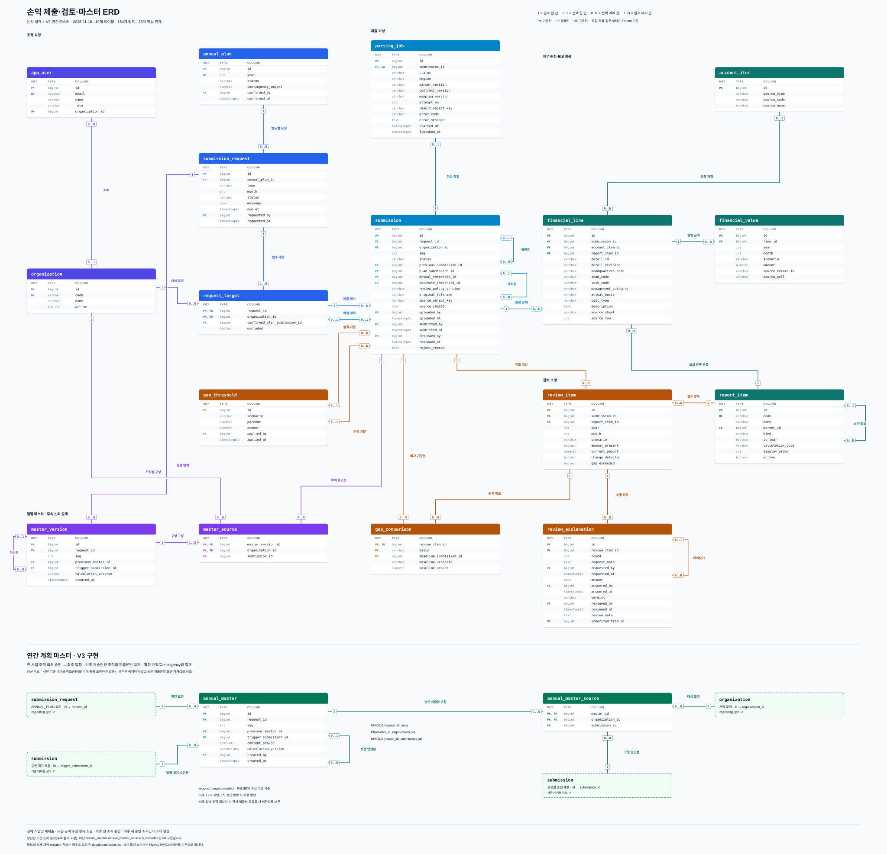

# 손익 제출·검토·마스터 ERD

## 문서 상태와 적용 범위

| 항목 | 내용 |
| --- | --- |
| 설계 버전 | 0.2 · 2026-11-16 |
| 상태 | 논리 ERD v0.2와 V1~V5 물리 구현 연결. API 0.9-draft 39개 중 36개 경로 구현. 실제 실행 검증은 [로컬 환경](local-environment.md)에서 별도 관리 |
| 적용 대상 | 조직별 연간 계획·월간 실적/추정의 전체 제출, 금액 수정 소명, 손익 Gap, 승인, 월별 마스터 |
| 관련 계약 | [DB 매핑](db-mapping.md), [현재 파서 출력 계약](../../parser/docs/development/output-contract.md) |
| 관련 업무 문서 | [도메인 규칙](../domain-rules.md), [업무 흐름도](../flow.md) |
| 화면 참고 | [조직 담당자 v3](https://www.figma.com/design/ZW7ZlgvtY4phycygZqir3z?node-id=202-196), [경영기획팀](https://www.figma.com/design/ZW7ZlgvtY4phycygZqir3z?node-id=2-235) |

합의한 업무 규칙과 논리 스키마는 이 문서, 파서 필드 연결은 [DB 매핑](db-mapping.md), 현재 파서의 반환값은 [출력 계약](../../parser/docs/development/output-contract.md)을 기준으로 한다. [도메인 규칙](../domain-rules.md)과 [업무 흐름도](../flow.md)는 이 설계를 요약한다. 직선 SVG는 이 문서의 테이블·필드·핵심 관계를 표현한다.

이전 ERD는 Git 이력에서 확인한다. 아래 논리 ERD와 V3~V5의 물리 구현 차이는 문서 끝의 구현 확장 절에서 관리한다. 원본 데이터나 실행 산출물은 문서에 포함하지 않는다. 기존 파서의 기술 마스터 생성·평가와 서비스의 승인 마스터 발행은 서로 다른 기능이다.

`bigint`, `varchar`, `numeric`, `timestamptz`는 논리 타입 표기다. 현재 제품은 PostgreSQL이며 상세 금액은 NUMERIC(30,6)이다. 문자열 길이·집계 정밀도·인덱스와 논리 도식의 차이는 Flyway V1~V5 및 하단 구현 확장을 기준으로 한다. 금액은 원 단위 정밀 십진수이며 이진 부동소수점을 사용하지 않는다.

### 초안 대비 반영한 변경

| 변경 영역 | 현재 반영 내용 |
| --- | --- |
| 항목과 원본 근거 | 원본 계정 `account_item`, 보고 분류 `report_item`, 상세행 `financial_line`, 월 금액 `financial_value`를 구분. 매출 관리분류·비용 실적집계기준으로 연결 |
| 비교 단위 | 조직·보고 항목·연월·시나리오로 검토. 팀·과제·셀 주소는 상세 근거로 보존. 확인된 손익 Gap은 OP에 적용 |
| 수정과 소명 | 기존 `change_reason`·`gap_item`·`gap_explanation`의 역할을 `review_item`·`gap_comparison`·`review_explanation`으로 정리. 금액 수정은 기준 이하·상쇄 변경도 소명 필수 |
| 재제출 | 조직의 전체 스냅샷을 새 제출본으로 보존. 숫자를 바꾸지 않는 소명 보완은 같은 제출본의 소명 회차로 처리 |
| 제출 대상과 연간 계획 | `request_target`에 필수 조직을 고정하고, 연간 확정 시 조직별 승인 계획본 참조를 고정 |
| 월별 마스터 | 최초에는 전 조직 승인 필요. 이후 새로 승인된 조직만 참조를 교체하고 나머지 조직의 기존 승인본 유지 |
| 파서 경계 | 원본 추출·정규화와 서비스의 DB 적재·수정 감지·승인 처리를 구분. V1~V5와 API 0.9에서 연결 |
| 도식 | 19개 테이블·154개 필드·33개 핵심 관계. 수평·수직 직선 SVG를 기본 도식으로 사용 |

기존 설계 v0.2 위에 V3 연간 PLAN 마스터, V4 월간 ACTUAL 마스터, V5 수정/Gap 소명·기준 이력을 물리 스키마로 연결한다. 연간 확정은 기존 계획·대상 참조를 사용한다. 파서 표준 출력 계약과 직선 SVG는 유지한다.

## 1. 확정한 업무 경계

1. 요청받은 조직은 파일 전체를 제출한다. 재제출도 전체 스냅샷이며 일부 행만 덮어쓰는 방식은 지원하지 않는다.
2. 모든 조직이 필수 제출 대상이다. 기간별 대상 조직 집합을 요청 시 고정하며, 일부 조직에 재요청해도 그 집합을 줄이지 않는다.
3. 보고값의 단위는 `조직 × 보고 항목 × 연월 × 시나리오`다. 원본 셀 좌표는 출처이며 버전 간 업무 식별키가 아니다.
4. 매출은 원본 관리분류, 비용은 원본 실적집계기준에 따라 보고 항목을 결정한다. 계정 코드만으로 보고 항목을 결정하지 않는다.
5. 팀·과제·계정 코드는 원천 상세에 보존한다. 확인한 답안지 수식에서 팀·과제는 별도의 Gap 평가 축이 아니다.
6. 매출·비용 세부 계정을 임의로 짝지어 손익을 만들지 않는다. 현재 확인된 손익 Gap 대상은 `총매출 - 총영업비용`으로 계산하는 영업이익이다.
7. 이미 제출한 금액을 수정하면 기준 금액·비율 이하라도 소명이 필수다. 동일 보고 항목 내 원천 금액 변경이 상쇄돼 합계가 같아도 수정 소명을 받는다.
8. 금액 변경과 손익 Gap이 같은 보고 항목에 발생하면 검토 대상 한 건과 소명 흐름 하나로 처리한다. 소명 보완은 파일·제출 회차를 바꾸지 않는다.
9. 해당 월 최초 마스터는 전 조직 승인 후 생성한다. 이후에는 기존 구성 중 새로 승인된 조직만 교체한다. 다른 조직의 새 제출본이 검토 중이어도 기존 승인본을 유지한다.
10. 검토 대기·반려 제출본은 마스터에 반영하지 않는다. 승인된 과거 월 수정도 해당 과거 월 마스터의 새 버전으로 반영한다.
11. 연간 계획과 전사 Contingency는 확정 후 잠근다. 조직별 손익 Gap에 전사 Contingency를 배분하지 않는다.

기존 규칙의 “기준 초과만 소명”은 금액 수정에 대해서는 위 7번으로 변경된다. 최초 연간 계획은 비교본이 없어 수정 소명·손익 Gap 대상이 아니며, 확정 전 연간 계획 재제출에서 바뀐 금액은 수정 소명 대상이다. 연간 계획에 손익 Gap 기준은 적용하지 않는다.

## 2. 수식에 근거한 보고 항목

아래는 읽기 전용으로 확인한 대표 `.xlsx`의 구조 근거다. 실제 금액이나 원본 행 전체를 복제하지 않는다. 수식 캐시는 저장값이며 Excel 전체 재계산을 수행한 결과가 아니다.

| 근거 | 확인 내용 | 설계 영향 |
| --- | --- | --- |
| 대표 조직 파일 `01_F10_사업부1_재무제표.xlsx`, `답안지_IFRS15後!J20:J21` | 매출 금액을 조직명과 관리분류 조건으로 `SUMIFS` | 매출의 보고 항목 연결 기준은 관리분류 |
| 같은 파일, `매출_세부_IFRS15後!B8:C9` | 같은 중분류 코드가 서로 다른 관리분류에 속함 | `account_item.report_item_id` 단일 연결을 두지 않음 |
| 같은 파일, `답안지_IFRS15後!J63` | 비용 금액을 조직명과 실적집계기준 조건으로 `SUMIFS` | 비용의 보고 항목 연결 기준은 실적집계기준 |
| 같은 파일, `OpEx_세부_IFRS15後!D7:L7` | 팀으로 조직을 확인하고, 과제명을 조회하며, 예산코드로 집계기준을 조회 | 원천 차원은 보존하되 모두를 Gap 키에 넣지 않음 |
| 같은 파일, `답안지_IFRS15後!J205` | `J10-J46`으로 영업이익 계산 | 매출·비용·파생값을 한꺼번에 합산하지 않음 |
| 두 번째 조직 `02_F12_사업부2_재무제표.xlsx`, 전체 마스터 `18_전체_마스터.xlsx`의 답안지 | 같은 집계 구조를 대조 | 조직 범위와 보고 항목의 역할 구분 |

현재 예산코드표에는 코드 중복도 있다. 따라서 원본 예산코드를 전역 UNIQUE로 강제하거나 원본 조회 결과를 코드 이름만으로 재해석하지 않는다. 수식으로 구한 분류가 충돌하거나 미확정이면 적재 전에 검토한다. `.xlsb` 원본과 다른 자유 양식의 수식은 이번 확인 범위가 아니다.

## 3. 전체 논리 ERD

기존 월간 업무 논리 설계 17개와 V3 연간 마스터 확장 2개를 합쳐 19개 테이블이다. 행위자 FK는 아래 컬럼에 표시하되 관계선은 업무 관계 중심으로 그린다. `NULL` 허용과 복합 UNIQUE는 뒤의 제약 표가 기준이다.

모든 연결선을 수평·수직 직선으로 배치한 SVG를 기본 도식으로 사용한다. 숫자 표기로 카디널리티를 표시하며, 원본을 열어 확대하면 전체 컬럼을 확인할 수 있다.



[SVG 원본 열기](../erd.svg)

```mermaid
erDiagram
    organization |o--o{ app_user : belongs_to
    annual_plan ||--o{ submission_request : schedules
    submission_request ||--|{ request_target : requires
    organization ||--o{ request_target : participates
    request_target ||--o{ submission : receives
    submission |o--o| request_target : confirmed_plan
    submission |o--o{ submission : previous_version
    submission |o--o{ submission : annual_plan_baseline
    submission ||--o| parsing_job : parses
    submission ||--o{ financial_line : contains
    account_item |o--o{ financial_line : identifies_source
    report_item |o--o{ report_item : parent
    report_item ||--o{ financial_line : classifies
    financial_line ||--o{ financial_value : has_months
    gap_threshold |o--o{ submission : pins_actual_rule
    gap_threshold |o--o{ submission : pins_estimate_rule
    submission ||--o{ review_item : requires_review
    report_item ||--o{ review_item : reviews
    review_item ||--o{ gap_comparison : compares_profit
    submission ||--o{ gap_comparison : baseline
    review_item ||--o{ review_explanation : has_rounds
    review_explanation |o--o{ review_explanation : inherited_from
    submission_request ||--o{ master_version : publishes
    master_version |o--o{ master_version : previous_version
    master_version ||--|{ master_source : fixes_sources
    organization ||--o{ master_source : contributes
    submission ||--o{ master_source : approved_source

    submission_request ||--o{ annual_master : publishes_plan
    submission ||--o{ annual_master : triggers_plan
    annual_master |o--o{ annual_master : follows_plan_version
    annual_master ||--|{ annual_master_source : freezes_plan
    organization ||--o{ annual_master_source : contributes_plan
    submission ||--o{ annual_master_source : supplies_plan
    organization {
        bigint id PK
        varchar code UK
        varchar name
        boolean active
    }
    app_user {
        bigint id PK
        varchar email UK
        varchar name
        varchar role "PLANNER or ORG_MANAGER"
        bigint organization_id FK "PLANNER has NULL"
    }
    annual_plan {
        bigint id PK
        int year UK
        varchar status "COLLECTING or CONFIRMED"
        numeric contingency_amount "NULL before confirmation"
        bigint confirmed_by FK
        timestamptz confirmed_at
    }
    submission_request {
        bigint id PK
        bigint annual_plan_id FK
        varchar type "ANNUAL_PLAN or MONTHLY_ACTUAL"
        int month "NULL for annual plan"
        varchar status "OPEN or CLOSED"
        text message
        timestamptz due_at "nullable"
        bigint requested_by FK
        timestamptz requested_at
    }
    request_target {
        bigint request_id PK, FK
        bigint organization_id PK, FK
        bigint confirmed_plan_submission_id FK "annual target only, nullable"
        boolean excluded "default false; legacy demo correction"
    }
    submission {
        bigint id PK
        bigint request_id FK
        bigint organization_id FK
        int seq "NULL in DRAFT"
        varchar status "DRAFT PENDING REJECTED APPROVED"
        bigint previous_submission_id FK "nullable"
        bigint plan_submission_id FK "nullable"
        bigint actual_threshold_id FK "nullable"
        bigint estimate_threshold_id FK "nullable"
        varchar review_policy_version
        varchar original_filename
        varchar source_object_key
        char source_sha256
        bigint uploaded_by FK
        timestamptz uploaded_at
        bigint submitted_by FK "nullable in DRAFT"
        timestamptz submitted_at "nullable"
        bigint reviewed_by FK "nullable"
        timestamptz reviewed_at "nullable"
        text reject_reason "nullable"
    }
    parsing_job {
        bigint id PK
        bigint submission_id FK, UK
        varchar status "QUEUED RUNNING NEEDS_REVIEW SUCCEEDED FAILED"
        varchar engine
        varchar parser_version
        varchar contract_version
        varchar mapping_version
        int attempt_no
        varchar result_object_key "nullable until complete"
        varchar error_code "nullable"
        text error_message "nullable"
        timestamptz started_at "nullable"
        timestamptz finished_at "nullable"
    }
    account_item {
        bigint id PK
        varchar source_type "REVENUE_CLASS or EXPENSE_BUDGET"
        varchar source_code "not globally unique"
        varchar source_name
    }
    report_item {
        bigint id PK
        varchar code UK
        varchar name
        bigint parent_id FK "nullable"
        varchar kind "REVENUE COST DERIVED"
        boolean is_leaf
        varchar calculation_code "OP for verified operating profit"
        int display_order
        boolean active
    }
    financial_line {
        bigint id PK
        bigint submission_id FK
        bigint account_item_id FK "nullable when source has no code"
        bigint report_item_id FK "mapping snapshot"
        varchar detail_id "nullable"
        varchar detail_revision "nullable"
        varchar headquarters_code "nullable"
        varchar team_code "nullable"
        varchar task_code "nullable"
        varchar management_category "nullable"
        varchar actual_basis "nullable"
        varchar cost_type "nullable"
        text description "nullable"
        varchar source_sheet
        int source_row
    }
    financial_value {
        bigint id PK
        bigint line_id FK
        int year
        int month
        varchar scenario "PLAN ACTUAL ESTIMATE"
        numeric amount
        varchar source_record_id
        varchar source_cell
    }
    gap_threshold {
        bigint id PK
        varchar scenario "ACTUAL or ESTIMATE"
        numeric percent
        numeric amount
        bigint applied_by FK
        timestamptz applied_at
    }
    review_item {
        bigint id PK
        bigint submission_id FK
        bigint report_item_id FK
        int year
        int month
        varchar scenario "PLAN ACTUAL ESTIMATE"
        boolean amount_present
        numeric current_amount "NULL only for verified removal"
        boolean change_detected
        boolean gap_exceeded
    }
    gap_comparison {
        bigint review_item_id PK, FK
        varchar basis PK "PLAN or PREVIOUS"
        bigint baseline_submission_id FK
        varchar baseline_scenario "PLAN ACTUAL ESTIMATE"
        numeric baseline_amount
    }
    review_explanation {
        bigint id PK
        bigint review_item_id FK
        int round
        text request_note "nullable for first answer"
        bigint requested_by FK "nullable"
        timestamptz requested_at "nullable"
        text answer "nullable until answered"
        bigint answered_by FK "nullable"
        timestamptz answered_at "nullable"
        varchar verdict "PENDING ACCEPTED REJECTED"
        bigint reviewed_by FK "nullable"
        timestamptz reviewed_at "nullable"
        text review_note "nullable"
        bigint inherited_from_id FK "nullable"
    }
    annual_master {
        bigint id PK
        bigint request_id FK "annual PLAN request"
        int seq
        bigint previous_master_id FK "nullable for first version"
        bigint trigger_submission_id FK
        char content_sha256
        varchar calculation_version
        bigint created_by FK
        timestamptz created_at
    }
    annual_master_source {
        bigint master_id PK, FK
        bigint organization_id PK, FK
        bigint submission_id FK
    }
    master_version {
        bigint id PK
        bigint request_id FK "monthly request"
        int seq
        bigint previous_master_id FK "nullable for first version"
        bigint trigger_submission_id FK
        varchar calculation_version
        timestamptz created_at
    }
    master_source {
        bigint master_version_id PK, FK
        bigint organization_id PK, FK
        bigint submission_id FK
    }
```

<details>
<summary>관계·컬럼 정의 원문</summary>



</details>

## 4. 테이블의 책임

| 영역 | 테이블 | 책임 |
| --- | --- | --- |
| 조직·권한 | `organization`, `app_user` | 조직 코드와 두 역할. 별도 역할·권한 매핑 엔진을 두지 않음 |
| 계획·요청 | `annual_plan`, `submission_request`, `request_target` | 연간 확정과 Contingency, 기간별 요청, 전체 필수 조직 집합 |
| 제출·파싱 | `submission`, `parsing_job` | 전체 파일의 버전·업무 상태와 파서 상태 분리 |
| 원천·보고 분류 | `account_item`, `report_item` | 원본 계정 식별과 보고 계층 분리 |
| 금액 | `financial_line`, `financial_value` | 선택 완료된 상세행과 월별 원 금액, 당시 보고 분류와 출처 |
| 검토 | `gap_threshold`, `review_item`, `gap_comparison`, `review_explanation` | 불변 기준, 수정·Gap 대상, 손익 비교본, 소명 회차 |
| 공식 마스터 | `master_version`, `master_source` | 월별 버전과 조직별 승인본 구성의 불변 스냅샷 |

`change_reason`, 별도 수정분 테이블, 화면별 아카이브·대시보드·버전차이 테이블을 두지 않는다. 알림은 현재 범위의 인터페이스로 발행하며 발송 실패가 업무 승인을 되돌리지 않는다. 전달 보장용 outbox, 저장형 보고서 이력, 첨부파일은 실제 요구가 확정될 때 검토한다. 생성 보고서는 사용한 마스터 ID 목록을 생성물 메타데이터에 기록한다.

## 5. 고유키·참조·불변 제약

| 대상 | 필수 제약 |
| --- | --- |
| 사용자 | `ORG_MANAGER`는 조직 필수, `PLANNER`는 조직 NULL. 조직 담당자의 모든 조회·수정은 본인 조직으로 제한 |
| 요청 | 연간 계획당 연간 요청 한 건, 연간 계획·월당 월간 요청 한 건. 연간은 month NULL, 월간은 1~12. NULL을 포함하는 UNIQUE의 실제 동작에 의존하지 말고 유형별 제약으로 구현 |
| 요청 대상 | PK `(request_id, organization_id)`. 첫 제출 전에 필수 조직 전체를 고정. 일부 재요청은 같은 요청과 대상 집합을 사용. 연간 확정 시 연간 대상의 confirmed_plan_submission_id에 같은 조직·같은 연간 요청의 승인본 하나를 고정. 월간 대상은 이 컬럼 NULL |
| 제출 소속 | `(request_id, organization_id)`가 `request_target`을 참조하는 복합 FK. 기존에 대상인 조직의 active 변경으로 과거 집합을 수정하지 않음 |
| 제출 회차 | 제출 완료본에 대해 UNIQUE `(request_id, organization_id, seq)`. seq 양수. DRAFT는 seq·submitted_by·submitted_at NULL, 나머지는 필수 |
| 검토 대기 | 기존 도메인대로 조직당 `PENDING` 최대 한 건. DB 조건부 유일성 또는 동등한 잠금·제약 필요. 연간·월간 병행은 아직 합의하지 않은 정책 변경 |
| 비교 기준본 | previous/plan/baseline은 같은 조직이어야 함. DRAFT는 기준본 불가. plan은 해당 연도 연간 request_target의 confirmed_plan_submission_id와 일치. 이전 회차는 현재 제출본보다 앞서야 함 |
| 원본 계정 | source_code 단독 UNIQUE 금지. 같은 원본 유형·코드·표시명을 재사용할 수 있으나, 이를 보고 분류 결정 키로 사용하지 않음 |
| 보고 항목 | 내부 code는 안정적인 업무 식별자. 사용 중인 항목의 종류·부모·계산 의미 변경 금지. 의미가 바뀌면 새 항목을 만들고 기존 항목을 비활성화. 순환 부모 관계 금지 |
| 상세행 | UNIQUE `(submission_id, source_sheet, source_row)`는 선택 완료된 원본행에 적용. detail_id 단독 UNIQUE 금지. report_item은 REVENUE/COST의 집계 가능한 말단 항목이어야 함. 코드를 찾지 못해도 보고 분류가 확인되는 경우와 보고 분류 자체가 미확정인 경우를 구별 |
| 월별 금액 | UNIQUE `(line_id, year, month, scenario)`. month 1~12, amount NOT NULL. 연간합계·소계·비율·파생 OP를 상세 fact에 중복 적재하지 않음 |
| 검토 항목 | UNIQUE `(submission_id, report_item_id, year, month, scenario)`. 변경/Gap 플래그가 하나 이상 참이면 필수 검토 대상. 둘 다 false인 행은 원본 수용 소명을 이어받은 ACCEPTED 회차가 있을 때만 허용하며 작성 필요 건수에서 제외. 조직은 제출본으로 결정 |
| 금액 존재 | amount_present=true이면 current_amount 필수. false이면 current_amount NULL, change_detected=true, gap_exceeded=false이며 완전성 검사로 허용된 선택 항목 제거에만 사용. 파싱 실패·필수 항목·OP 누락을 제거로 표현하지 않음 |
| Gap 비교 | PK `(review_item_id, basis)`. 확인된 OP 비교에만 사용. baseline_amount는 확인된 숫자이며 누락을 0으로 저장하지 않음. 비교에 사용한 모든 해당 기준을 보존하고 초과한 기준만 남기지 않음 |
| 소명 | UNIQUE `(review_item_id, round)`, round 양수. 현재 상태는 마지막 회차에서 판단. 최초 회차의 요청 필드는 NULL 허용, 보완 회차는 요청 사유·행위자·시각 필수. 답변이 있으면 공백이 아닌 본문·답변자·답변시각 모두 필수, 작성 전에는 셋 모두 NULL. ACCEPTED/REJECTED는 답변과 검토자·시각 필수 |
| 기준 이력 | ACTUAL/ESTIMATE 구분. percent·amount는 음수 불가. 적용마다 새 행을 생성하고 사용된 기준은 UPDATE 금지. actual_threshold_id는 ACTUAL 기준, estimate_threshold_id는 ESTIMATE 기준만 참조. 필요한 OP 비교의 기준 ID가 NULL이면 제출 차단 |
| 마스터 | UNIQUE `(request_id, seq)`. 월간 요청만 허용. previous_master는 동일 요청의 직전 버전이고 seq가 1 증가. trigger_submission은 다른 요청 월이어도 되지만 해당 대상 월의 완전한 ACTUAL을 가진 승인본이어야 함 |
| 마스터 구성 | PK `(master_version_id, organization_id)`. 해당 월 필수 조직과 정확히 같은 집합. 같은 조직의 승인본만 참조. 제출 요청 월과 마스터 대상 월은 달라도 됨 |
| 확정 데이터 | PENDING 이후 원본 파일·금융행/값·보고 분류·비교 기준과 검토 대상 변경 금지. 소명 회차와 업무 검토 상태만 허용된 전이로 변경 |

`version_label`과 마스터의 연월은 각각 요청 연도·월·회차에서 만든다. 조직별 같은 라벨이 생길 수 있으므로 라벨을 전역 UNIQUE로 삼지 않는다. 파일 SHA-256은 내용 식별용이고 제출 회차·재시도 멱등키가 아니다.

## 6. 제출·파싱·소명의 상태 전이

### 제출 준비와 회차

파일명·조직·열린 요청 검사 후 DRAFT를 만든다. 파일 다시 선택은 새 DRAFT로 처리하여 이전 파일의 파싱·소명을 섞지 않는다. 파싱 재시도는 같은 파일·초안에서 가능하며 `attempt_no`와 일치하는 결과만 채택한다. 파싱 상태를 제출 상태에 중복 저장하지 않는다.

회차는 최종 제출 트랜잭션에서 부여한다. DRAFT의 화면에는 예상 회차를 표시할 수 있으나 확정 식별자로 사용하지 않는다. 이는 기존 문서의 업로드 시점/제출 시점 표현을 정리한 설계 선택이다.

```text
DRAFT --검증과 필수 소명 완료--> PENDING
PENDING --전체 검토 수용 후 승인--> APPROVED
PENDING --제출본 자체 오류로 재제출 요청--> REJECTED
REJECTED --새 전체 파일 업로드--> 새로운 DRAFT
```

최종 제출은 조직 단위로 직렬화하여 열린 요청, 대상 조직, 재제출 요청의 일치, 파싱·집계 완전성, 필수 소명, PENDING 한 건 제한, 회차를 함께 검사한다. 과거 반려본과 승인본은 덮어쓰지 않는다.

현재 기준의 “이후 제출부터 적용”은 최종 제출 시점으로 해석한다. DRAFT에서 비교본·계획본·기준 ID를 선택해 미리 계산하되 최종 제출 때 최신 유효 ID를 재검사한다. 달라졌으면 재계산하여 필요한 소명을 다시 확인한 뒤 제출한다. PENDING이 된 이후의 기준 변경은 해당 제출본에 소급하지 않는다. 기준 적용과 최종 제출이 경합해도 한 시점의 기준만 선택하도록 트랜잭션을 설계한다.

### 소명 회차

첫 회차는 조직 담당자가 작성하므로 사전 요청자·요청 사유가 없다. DRAFT 동안 답변을 수정할 수 있고 제출 이후 답변을 덮어쓰지 않는다. 경영기획팀의 재요청은 현재 답변의 검토 결과를 REJECTED로 확정한 뒤 다음 회차를 만들며 요청 사유·행위자·시각을 기록한다. 이때 제출본은 계속 PENDING이다.

마지막 회차의 답변이 없으면 작성 대기, 답변이 있고 verdict=PENDING이면 검토 대기, ACCEPTED이면 수용으로 조회한다. `review_item`에 별도 변경 가능한 소명 상태를 중복 보관하지 않는다. 제출본 전체 반려의 `reject_reason`과 개별 소명 보완의 `request_note`를 구별한다.

이어받기는 같은 조직·보고 항목·연월·시나리오이고 원천 금액 구성이 같으며 이전 소명이 수용된 경우만 허용한다. 새 제출본에 검토 항목과 수용 회차를 함께 만들고 답변·답변자·답변시각·원본 수용 메타데이터를 보존하며 `inherited_from_id`로 원본 ACCEPTED 소명을 연결한다. 현재 회차에 사람이 새로 검토한 것처럼 기록하지 않고, 수용 메타데이터가 원본에서 이어졌음을 이 참조로 구분한다. 변경/Gap이 없는 이어받기 전용 항목은 작성 필요 건수에 포함하지 않는다. 상쇄된 원천 금액 변경에는 이어받기를 적용하지 않는다.

승인·반려·소명 재요청은 동일 제출본에 대한 잠금 아래 상태를 다시 확인한다. 승인은 PENDING 제출본의 모든 필수 검토 항목에 답변이 존재하고 마지막 회차가 ACCEPTED인 경우에만 가능하다. 필수 항목이 없으면 이 소명 조건은 충족한다. 승인된 제출본에 뒤늦은 재요청이 반영되거나, 미수용 소명이 있는 제출본이 승인되면 안 된다.

## 7. 수정 감지와 손익 Gap

### 수정 소명

이전 제출본에 존재하는 동일 연월·시나리오의 원천 금액을 비교한다. 월이 바뀌며 새로 생긴 ACTUAL을 이전 ESTIMATE의 수정으로 자동 간주하지 않는다. 이전 달 파일에 포함된 과거 ACTUAL이나 같은 대상 월 ESTIMATE를 바꾼 경우는 이미 제출한 금액의 수정이다. 연간 계획은 확정 전 같은 요청의 이전 PLAN을 비교한다.

비교본은 제출본의 `previous_submission_id`로 고정한다. 같은 달 재제출은 직전 제출 완료 회차이며 반려본도 포함한다. 새 달의 첫 제출은 이전 달 마지막 제출 완료본을 사용한다. DRAFT·실패 업로드는 제외하고, 직전본이 반려됐다는 이유로 마지막 승인본으로 조용히 대체하지 않는다.

변경 감지는 원천 셀 주소와 합계만으로 하지 않는다. 검증된 상세 업무키가 있으면 사용하고, 없거나 중복이면 원본 유형·분류·팀·과제·거래 의미와 월별 금액의 정규화된 다중집합을 비교한다. 좌표·행 순서·파일명·표시 단위는 제외하고 중복 개수는 보존한다. 내용이 다른 원천을 안전하게 대응할 수 없으면 자동 소명 이어받기를 중지하고 검토 필요로 둔다. 실제 키와 정규화 규격은 [DB 매핑](db-mapping.md)의 어댑터 구현 항목이다.

- 같은 보고 항목의 금액 증감이 상쇄돼 합계가 같아도 `change_detected=true`다.
- 행 재정렬·셀 이동만 있으면 금액 수정이 아니다.
- 전체 스냅샷에서 허용된 상세의 추가·삭제·보고 분류 이동도 해당 보고 항목의 변경 근거에 포함한다. 필수 항목이 사라지면 소명을 받기 전에 완전성 오류로 차단한다.
- 여러 상세 변경은 해당 보고 항목의 검토 한 건에 모으고, 원천별 이전/이후 금액을 근거로 조회한다.
- 자동 계산된 OP는 계산 결과 변화만으로 별도의 수정 소명을 중복 생성하지 않는다. 원천 매출·비용 항목에서 수정 소명을 받고, OP가 손익 Gap 기준을 넘을 때 OP 검토 건을 만든다.

수정만 있는 검토 항목에는 `gap_comparison`이 없어도 된다. 수정 기준본은 제출본의 previous 참조와 불변 금융 데이터에서 재현한다. 원천 변경내역 자체를 별도 영구 차이 테이블로 복제하지 않는다.

### 손익 Gap

`report_item.calculation_code=OP`인 확인된 영업이익에만 적용한다. REVENUE/COST의 변경 검토에 손익 기준을 억지로 적용하지 않는다. 조회 시 매출·비용·영업이익을 함께 보여 상쇄된 변화를 확인할 수 있게 한다.

| 대상 | 계획 비교 | 직전 비교 |
| --- | --- | --- |
| 해당 월 ACTUAL 첫 제출 | 확정 연간 계획의 같은 월 PLAN | 하지 않음 |
| 해당 월 ACTUAL 재제출 | 확정 연간 계획의 같은 월 PLAN | 같은 요청의 직전 ACTUAL |
| 미래 ESTIMATE | 별도 계획 비교 없음 | 직전본 같은 월 ESTIMATE. 1월 최초만 새해 PLAN으로 대체 |
| 파일에 포함된 과거 ACTUAL | 하지 않음 | 직전본 같은 월 ACTUAL |
| 연간 PLAN | 하지 않음 | 수정 감지만 수행 |

1월 최초 추정의 `basis=PREVIOUS`는 대체 비교를 뜻하며 `baseline_scenario=PLAN`이다. 2월 이후 직전본이 없거나 비교 대상이 누락된 경우 임의로 연간 계획 또는 0으로 대체하지 않는다. 필수 비교가 불가능하면 제출을 차단하고 기준 데이터부터 확인한다.

```text
gap_amount = current_amount - baseline_amount
gap_rate = gap_amount / abs(baseline_amount) * 100

baseline_amount != 0:
    abs(gap_rate) > threshold.percent AND abs(gap_amount) > threshold.amount
baseline_amount == 0:
    current_amount != 0 이면 초과, 둘 다 0이면 미초과
```

경계값과 같으면 “초과”가 아니다. 비율은 표시용 반올림 전 값으로 판정한다. 기준 0일 때 비율은 NULL/산정 불가로 표시한다. 일반 기준은 현재 검토 항목의 ACTUAL/ESTIMATE에 따라 제출본에 고정된 threshold ID를 사용한다. 두 비교가 존재하면 모두 보존하며 하나라도 초과하면 `gap_exceeded=true`다. 계산 가능한 차액·비율을 별도 수정 가능한 컬럼으로 중복 저장하지 않는다.

## 8. 파서 적재와 완전성

원본·모든 추출 후보·수식·단위 환산·진단·배제 근거는 파서 결과 참조에 둔다. 서비스 DB에는 업무키와 숫자, 분류, 범위가 확인되고 수정본 선택·중복 처리를 마친 월별 상세만 적재한다. 원본 상세 ID만으로 중복을 제거하거나 “마지막 행”을 자동 채택하지 않는다.

`financial_line`의 분류는 적재 당시의 스냅샷이다. 매출 관리분류와 비용 실적집계기준을 원본 계정 코드로 재구성하지 않는다. 사용된 보고 항목 의미와 파서 결과를 나중에 덮어쓰면 과거 마스터가 변하므로 금지한다.

완전성 검사는 파일에 포함된 조직·월·시나리오의 필수 상세 범위를 기준으로 한다. 확인된 일부 행만 합산한 뒤 성공으로 처리하지 않는다. 빈 값·수식 캐시 누락·해석 실패는 0이 아니다. 원본 조직과 로그인 조직이 다르면 차단한다. 요청 월 ACTUAL과 다음 달~12월 ESTIMATE, 연간 PLAN의 1~12월 범위가 충족돼야 한다. 과거 ACTUAL을 포함한다면 그 조직·월도 전체 스냅샷이어야 한다.

상세 fact에서 매출·비용을 집계하고 OP를 계산하는 경로를 공식 값으로 사용한다. 원본 답안지의 합계·OP는 정합성 검증에 사용한다. 같은 합계의 상세·소계·답안지 OP를 함께 더하지 않는다. 단위 정규화 후의 숫자를 비교하며 원본 캐시의 최신성이 증명됐다고 주장하지 않는다.

`parser/`의 표준 레코드에는 원본 상세 ID·수정번호와 업무필드 검증 결과가 있으며, 별도 benchmark에는 수정본 선택·기술 마스터 생성·평가 기능이 있다. 이 결과가 서비스의 제출 승인·요청별 완전성·`report_item_id` 매핑을 대신하지 않는다. 현재 서비스의 적재 어댑터와 V1~V5는 요청별 검증·수정/Gap 소명·연간 확정·연간/월간 승인 마스터를 연결한다. 파서의 기술 마스터와 별개이며 구체적인 연결과 논리·물리 차이는 [DB 매핑](db-mapping.md) 및 아래 구현 확장에서 관리한다.

## 9. 승인과 마스터 발행

연간 계획 확정은 모든 연간 대상 조직의 최종 승인본을 `request_target.confirmed_plan_submission_id`에 고정하고, Contingency·확정자·확정시각과 함께 원자적으로 처리한다. 미제출·검토 대기·재제출 요청 조직이 있으면 확정하지 않는다. 확정 이후 연간 요청의 재개방·새 제출·승인본 교체를 금지한다. 월간 비교는 이 고정된 조직 계획본만 사용한다.

### 최초 발행

대상 월의 요청에 고정된 모든 조직이 그 요청의 유효한 승인본을 보유해야 한다. 최신 제출 상태가 검토 대기·재제출 요청인 조직이 있으면 최초 발행하지 않는다. 미제출은 제출 행이 없는 상태이며 별도 가짜 제출 행을 만들지 않는다. 승인 수는 제출 건수가 아닌 조직 수로 센다.

마지막 조직 승인과 최초 발행 판정은 같은 월의 직렬화 범위 안에서 수행한다. 둘 이상의 동시 승인이 서로의 변경을 놓쳐 발행을 빠뜨리거나 같은 회차를 만들지 않게 한다.

### 후속 발행

1. 새 승인본의 ACTUAL 범위에서 이미 발행된 월별 최신 마스터와 해당 조직의 금액·원천 구성을 비교한다.
2. 변경된 월마다 이전 `master_source` 전체 집합을 새 버전에 복사한다.
3. 승인된 해당 조직의 참조만 새 제출본으로 바꾼다. 나머지 조직의 기존 승인본은 유지한다.
4. 해당 월의 전체 구성과 승인·완전성 조건을 검증하고 새 버전을 확정한다.

마스터 변경 판정은 OP 또는 전사 총액만 비교하지 않는다. 보고 항목별 매출·비용 및 원천 금액 구성이 바뀌면 상쇄돼 합계가 같아도 새 버전을 만든다. 원천 행 위치·파일명만 바뀌었거나 소명만 보완된 경우 새 마스터를 만들지 않는다. 숫자·구성이 같은 새 승인본은 승인 이력에 남기되 마스터 구성은 이전 참조를 유지할 수 있다.

3월 승인본이 1월 ACTUAL 전체를 수정하면 새 1월 마스터가 3월 제출본을 참조한다. 1월 데이터가 그 파일에 없으면 기존 1월 참조를 유지한다. 1월 일부 행만 있으면 완전성 오류다. 원래 1월 마스터가 없었다면 후속 교체로 생성 조건을 우회하지 않고 최초 발행 규칙을 적용한다. 한 제출본이 여러 과거 월을 바꾸면 영향 월별로 버전을 발행한다.

승인 처리와 영향 월 발행은 하나의 원자적 업무 처리로 설계한다. 여러 월을 잠글 때 연월 순서로 잠그고, 이미 승인된 같은 submission의 재호출은 기존 처리 결과를 반환해 중복 발행을 막는다. 물리 트랜잭션·인덱스는 DB 선택 후 구현한다. 홈은 월별 최신 승인 마스터의 ACTUAL을 사용하고 ESTIMATE를 섞지 않는다.

## 10. 화면과 조회 경로

| 화면 | 기본 조회 |
| --- | --- |
| 요청함·미제출 | `submission_request → request_target`와 해당 조직의 제출 상태 |
| 업로드·검증 | `submission(DRAFT) → parsing_job`과 결과 진단 |
| 수정 확인·소명 | `review_item → report_item`, previous 제출본의 금융 데이터, 소명 회차 |
| 손익 Gap 상세 | `review_item → gap_comparison`, 해당 조직·월의 매출·비용 원천 |
| 소명 보완 | 같은 review_item의 새 review_explanation 회차 |
| 제출 이력·반려 상세 | 제출본·previous 참조·전체 반려 사유·소명 회차의 담당자/시각 |
| 경영기획 전사 홈 | `master_version → master_source → submission → financial_line/value` |
| 보고서 | 명시한 마스터 ID 집합과 해당 버전의 수용 소명 |

화면의 “소명 대상”은 수정 소명과 손익 Gap을 함께 보여준다. 기존 와이어프레임의 매출/비용 개별 Gap 수치가 곧 이 설계의 손익 Gap을 뜻하지는 않는다. 매출·비용은 변경 전후와 근거를, OP는 손익 Gap을 표시한다. 승인 시 제출 버전 증가, 잠정 마스터, 주간 지표, 임의 Gap 제외는 이번 확정 범위에 포함하지 않는다.

## 11. 구현 시 확인할 사례와 남은 결정

다음은 실행한 테스트 결과가 아니라 구현 인수 조건이다.

| 사례 | 기대 결과 |
| --- | --- |
| 같은 계정 코드, 다른 관리분류 | 다른 report_item으로 집계 |
| 팀·과제만 다른 상세 | 원천은 구별하고 원본 집계 기준에 따라 같은 보고 항목으로 합산 가능 |
| 수정 금액이 Gap 기준 이하 | 수정 소명 필수 |
| 같은 보고 항목 내 원천 증감 상쇄 | change_detected=true, 소명 필수 |
| 행 재정렬만 발생 | 금액 수정 아님, 소명 추가 요구 없음 |
| 필수 금액 누락 | 0 치환 없이 제출 차단 |
| 과거 월 부분 수정 파일 | 전체 스냅샷 미충족으로 차단 |
| 초기 마스터에서 한 조직 미승인 | 발행 안 함 |
| 후속 마스터에서 A 승인, B는 재검토 중 | A 새 승인본과 B 기존 승인본으로 새 버전 |
| 마지막 두 조직 동시 승인 | 최초 마스터가 누락되거나 중복되지 않음 |
| 소명 보완 | 제출 회차·금융값·마스터 유지 |
| DRAFT 작성 중 기준 변경 | 재검증 후 소명을 확인하고 제출 |
| 승인본 재파싱·분류 변경 시도 | 기존 제출본과 마스터 불변 |

현재 PostgreSQL과 상세 NUMERIC(30,6), 지원 양식의 필수 기간·분류 검증 및 의미·금액 다중집합 비교를 구현한다. 추가 양식의 매핑·필수 범위·정규화, 운영 로그인, 마감·리마인드 및 운영 규모의 성능·보관 정책은 별도 확인 대상이다. 기간 중 조직 신설·폐지·코드 변경은 현재 필수 조직 집합을 임의로 바꾸지 않으며 별도 업무 정책이 필요하다. 연간 계획/월간 실적 동시 제출 완화, 매출·비용 자체에 대한 별도 Gap 기준, 미지원 양식·`.xlsb` 처리는 이번 합의로 추가 확정하지 않는다.

## 10. 구현 확장: 연간 PLAN 마스터(V3)

| 테이블·필드 | 구현 제약·책임 |
| --- | --- |
| `request_target.excluded` | NOT NULL DEFAULT FALSE. 제외된 대상의 FK·제출 이력을 유지하되 신규 제출·승인·대상 집계·최초 발행에서 제외 |
| `annual_master` | 연간 요청별 UNIQUE(request_id,seq), 양수 seq. 이전 버전·발행을 촉발한 승인 제출·작성자·시각·계산 정책·내용 지문 보존 |
| `annual_master_source` | PK(master_id,organization_id), UNIQUE(master_id,submission_id). 같은 연간 요청·조직의 검증된 APPROVED 전체 스냅샷 하나 |

처음에는 모든 비제외 대상 조직의 최신 완료본이 승인되어야 발행한다. 이후에는 이전 source 전체를 복사하고 방금 승인한 조직만 교체한다. 다른 조직의 새 검토 대기·반려는 이전 승인본을 유지한다. 보고 OP뿐 아니라 검증 당시 상세 의미·금액 지문으로 변경을 판정하며 같으면 기존 버전을 반환한다. `financial_value`를 중복 적재하지 않으며 이전 마스터의 source는 불변이다.

승인 헤더·마스터/source·멱등 응답은 같은 트랜잭션에 저장한다. 연간 계획 잠금이 다른 조직의 동시 승인을 직렬화한다. 조회는 고정 source의 검증 객체와 원 금액을 대조하고 BigDecimal로 합산한다. 확정 계획 참조와 Contingency는 발행으로 설정하지 않는다.

D100/D200 제외와 누락된 17개 사업조직 대상 보정은 local,demo의 수집 중이며 확정·발행 전인 요청에 한정한 기존 체험 자료 정정이다. 일반 조직 비활성화가 과거 대상 집합을 바꾸는 정책은 아니다. 확정·발행 이후 대상은 이 보정에서도 변경하지 않는다.

## 11. 구현 확장: 월 실적·소명(V4~V5)

V4는 `master_version`·`master_source`를 생성한다. 마스터 월은 고정 `request_id`의 월에서 얻으며 별도 중복 컬럼을 두지 않는다. 버전은 `(request_id, seq)` UNIQUE이고 `previous_master_id`, `trigger_submission_id`, `content_sha256`, `calculation_version`, 생성자·시각을 보존한다. source의 물리 PK는 `(master_id, organization_id)`다. 월별 의미 지문은 해당 ACTUAL 월의 원천 구성만 사용하고 이후 월의 추정이나 마감 안내 메타데이터가 바뀌었다고 과거 마스터를 새로 발행하지 않는다.

V5는 `gap_threshold`·`review_item`·`gap_comparison`·`review_explanation`을 생성한다. 검토 칸은 `(submission_id, report_item_id, year, month, scenario)` UNIQUE다. `source_fingerprint`·`context_fingerprint`·`current_round`·`active`를 두어 검증 문맥이 같은 초안 답변만 유지하고 새 비교의 답변으로 과거 답변을 잘못 채택하지 않는다. Gap 비교는 물리 ID와 `(review_item_id,basis)` UNIQUE를 함께 사용한다. 소명은 `(review_item_id,round)` UNIQUE이고 이전 수용 회차를 `inherited_from_id`로 참조한다.

직전 제출 ID는 `submission.previous_submission_id`, 확정 계획·기준 ID·정책은 불변 `submission_validation` 객체의 `comparisonContext`에 고정한다. 같은 정보를 submission 컬럼과 객체에 중복 저장하지 않는다. 기준 동시 적용은 업무 금액이 없는 단일행 기술 테이블 `gap_threshold_guard`로 직렬화한다. 이는 도식의 업무 엔티티 수에 포함하지 않는다. 검토 집계·차액·비율은 상세 `NUMERIC(30,6)`의 여러 행 합계를 수용하도록 더 넓은 정밀도로 저장한다. 세부 물리 타입은 V5가 기준이다.

연간 확정은 기존 `annual_plan`·`request_target.confirmed_plan_submission_id`를 사용한다. 확정 계획 참조·전사 Contingency·확정자/시각·요청 CLOSED가 같은 트랜잭션에서 저장된다. 월간 승인과 영향 월 마스터 발행도 같은 트랜잭션에 포함된다. ACTUAL만 월 마스터에 들어가며 ESTIMATE는 검증·소명 범위에만 남긴다.
