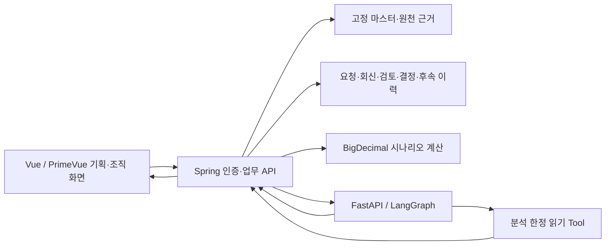

# 경영 의사결정 에이전트 · ERP 없는 업무 파일럿

## 최신 develop 통합 검증

2026-11-26 `origin/develop`의 `9bac28d`(PR #118) 위로 기능 브랜치를 재배치했다.
PR #114의 AI 보고서 5단계, #115·#116의 화면 밀도·계산기·원문 비교, #118의 월간 소명 검토 흐름을 유지한다.
Agent AI는 전용 `ai/app/decision_agent/` 안에 두고 기존 PDF AI 구현은 복제하거나 덮어쓰지 않았다.
공통 AI 진입점·모델 연결부만 확장하며 Agent와 기존 보고서 AI는 서비스의 일일 호출 한도를 공유한다.

최신 `shared_ui_copy`와 충돌하던 미적용 분석 migration을 `V20261126_0900`으로 변경했다.
패키징된 migration 9개의 버전이 중복되지 않고 분석→조사→업무 흐름의 생성 순서가 유지되는지 확인했다.
공통 밀도 CSS가 Agent 보고서 제목과 출처 링크를 덮는 부분은 보고서 내부 선택자로 한정해 보완했다.

- AI: Agent·기존 stateless 실행 108건, 기존 LLM·PDF 검토·보고서 계약 27건, 금액 단위 6개 사례 통과.
- 백엔드: `clean test bootJar` 성공. 171건 중 114건 통과, PostgreSQL 환경이 필요한 57건 생략, 실패 없음.
- 프론트: 테스트 187건·프로덕션 빌드 통과. Agent의 역할별 직접 경로와 기존 보고서·월간 경로 공존 검증 포함.
- DB 생성·연결·migration 적용과 실제 모델 호출은 이번 통합 회귀에서 수행하지 않았다. 아래 실제 API·브라우저 기록은 통합 전 기준이며 최종 통합본의 전체 업무 동선 검증으로 확대하지 않는다.

## 목적과 작업 범위

경영기획자가 연말 영업이익 목표와 보호 조건을 입력하고, 확정 마스터에서 고정한
연간 전망에 개선 후보를 적용해 의사결정서 초안을 만든다. 사용자에게 제공한
2026-11-25 방향성 및 화면 시안을 바탕으로 개발한다.

작업 브랜치는 `feat/common-pnl-decision-agent`, 기준은 develop `189f748`이다.
이 작업에서는 로컬 개발만 수행한다. 커밋·푸시·PR·배포는 수행하지 않는다.

기존 PLANNER와 ORG_MANAGER 역할로 목표 해석 제안, 근거 조사, 개선 요청·회신·검토,
시나리오, 외부 추진 결정 기록, 후속 전망 비교와 A4 의사결정 요약을 연결한다.
실제 임원의 인증·전자결재, 메일·메신저 발송, ERP 연결, 과제의 인과적 실현 성과 판정은
포함하지 않는다. 기존 제출·소명·확정 마스터를 수정하지 않는다.

## 대화형 Agent와 기존 업무 서비스 재사용

기획자는 확정 마스터를 선택한 뒤 분석을 저장하기 전에도 자연어로 질문할 수 있다.
저장 분석이 선택되어 있으면 목표·후보·계산 결과·요청 이력을 같은 문맥에서 조회한다.
LangGraph는 모델이 native tool call을 선택하면 해당 도구를 실행하고 관찰 결과를 돌려준 뒤,
추가 도구 선택 또는 답변 종료로 분기한다. 모든 질문에 같은 조회를 일괄 실행하지 않는다.

| 도구 | 재사용하는 기존 업무 기능 |
| --- | --- |
| 전사 손익·계획 대비 차이·조직 손익·워터폴 | 기존 HOME API와 같은 HomePnlQueryService |
| 수락 소명 | 이미 고정한 Research 근거 또는 기존 근거 조회의 읽기 기능 |
| 제출본 목록·버전 비교 | ArchiveQueryService·VersionComparisonService |
| 시나리오 미리 계산 | 저장 후보와 기존 DecisionScenarioCalculator, 결과 저장 없음 |
| 저장 없는 목표 검토 (`goal_preview`) | 선택한 연도의 고정 전망과 입력한 억원 목표를 기존 DecisionScenarioCalculator로 비교, 분석 저장 불필요 |
| 개선 요청 상태·요청 초안 | 기존 DecisionWorkflowService 및 저장 후보·가설 |
| 조회 원문 상세 읽기 (`observation_detail`) | 이번 실행의 성공 관찰 중 `/data` 아래 값을 제한된 페이지로 다시 읽음. 새 DB·URL·파일 조회 없음 |

Agent용 게이트웨이는 사용자·조직·연월·기준 마스터를 서버 문맥에서 주입한다.
AI가 임의 SQL이나 다른 사용자의 식별자를 지정하지 않는다. 전사 손익 계산을 AI 안에 복제하지 않고
기존 공개 API의 업무 서비스를 직접 호출한다. 같은 서버 안에서 자기 HTTP API를 다시 호출하지 않는다.

현재 전망은 선택한 master의 원천에 한정한다. HOME 서비스의 확정 연간 계획·전월 비교와 소명 상태는
조회 시점 기준임을 관찰에 명시한다. 기존 Research의 동일 제출본 PLAN 비교와 섞어서 같은 계획이라고
설명하지 않는다. 같은 도구·인자는 한 대화 턴 안에서 캐시한 관찰을 재사용한다.

모델은 먼저 로컬 `plan_analysis`로 현재 질문의 실제 부분 인용과 확인할 항목을 선언한다.
이후 필요한 조회 도구를 선택하고, 축약된 관찰만으로 설명이 부족하면 `observation_detail`로
같은 실행의 원문을 더 읽는다. 모델에는 실제 자료의 구조와 제한된 문맥, 축약 여부,
상세 읽기 경로를 제공한다. 공개 `observations`와 Spring 원장의 원문은 보존한다.

종료 때는 질문별 요약, 확인된 사실·근거 해석·검토 가설, 요구 항목의 해결 여부를 구조화한
`brief`를 작성한다. 각 설명의 `citationIds`를 AI 서비스가 실제 경로·원문으로 복원하고,
Spring이 현재 실행 원장과 다시 대조한다. 해석·가설에는 불확실성을, 미해결 항목에는
부족한 정보와 구체적인 확인 질문을 남긴다. 모든 요구 항목에 근거가 연결된 답변이 있어야
`COMPLETED`이며, 남은 질문이 있으면 `NEEDS_INPUT`으로 표시한다.

설명 문장은 모델이 작성하지만 금액·비율·개선 효과를 새로 만들지 못하며 실제 수치는
정밀 원문 인용에서 표시한다. 실제 인용한 이름과 정확히 같은 숫자 포함 조직명만 예외다.
계약 검증은 형식과 근거 연결을 검사하며, 해석의 진위나 가설의 실현 가능성을 보증하지 않는다.
화면에는 같은 `brief`를 대화와 오른쪽 보고서에 연결하고 각 설명의 출처를 표시한다.
모델의 내부 추론은 노출하지 않는다.
모델 미설정·장애는 UNAVAILABLE로 표시한다.
고정 순서의 표준 안내를 자율 Agent 실행 성공으로 표시하지 않는다.

대화 API는 조회·초안 반환만 수행하며 새로운 migration이나 대화 저장 테이블을 추가하지 않는다.
조직 요청 초안은 기존 확인 화면을 거쳐야 저장·전달된다.
시나리오 미리 계산도 기존 저장 후보만 사용하며 AI가 제안한 미검증 금액을 자동 편입하지 않는다.
`goal_preview`는 저장 분석 없이도 사용할 수 있다. 양수 목표를 억원 단위 십진 문자열로 받고,
정수부 16자리·소수부 8자리까지 허용해 최소 1원부터 기존 원 금액 24자리 상한까지 정확하게 변환한다.
목표 연도는 선택한 마스터로 고정한다. 부족액은 `max(0, 목표 - 전망)`, 초과액은
`max(0, 전망 - 목표)`이며, `forecastMeetsTarget`은 현재 전망이 목표 이상이라는 뜻이다.
이는 실적 달성이나 미래 실현을 뜻하지 않으며 결과의 `saved`는 `false`다.
상세 요청·도구 계약은 [대화형 Agent 도구 계약](agent-tool-contract.md), 계획·분석 설명·완료 판단은
[근거 기반 대화 분석 계약](agent-analysis-contract.md)을 따른다.

## 사용자 흐름

1. 기획자는 `/#/decision-agent`에서 경영 요청을 입력한다. 자연어로 목표 금액·연도·
   보호 조건을 제안받되, 직접 확인해야 입력에 반영된다. 직접 입력도 가능하다.
2. 확정 월간 마스터와 연말 목표를 선택해 분석 기준을 고정한다. 확정 마스터가 없거나
   연간 자료가 불완전하면 분석을 생성하지 않는다.
3. **근거 조사·제안**에서 동일 원천 제출본의 손익과 수락된 소명을 조회한다.
   Agent는 출처 인용과 확인 질문이 있는 가설을 제안한다. 금액·시점은 미정이며 계산에
   자동 편입되지 않는다. 수락 소명은 과거 사유이지 미래 개선 효과의 증명이 아니다.
4. 기획자가 가설 또는 직접 입력한 후보를 선택해 요청 초안을 저장하고 전달을 확인한다.
   **조직의 앱 내 요청함**에만 노출되며 외부 메시지는 전송하지 않는다.
5. 해당 조직은 `/#/org-improvements`에서 가능/불가를 회신한다. 가능하면 금액·발생 월·
   실행 비용·기반영분·분류·중복 묶음·증빙을 제출한다. 불가도 사유와 근거를 남긴다.
6. 기획자는 회신을 채택·보완 요청·반려한다. 채택 시 검토 후보로 편입하고 분석 버전을
   올리며 과거 계산을 무효화한다. 새 시나리오 실행으로 효과·제약·남은 Gap을 검증한다.
7. 최신 계산의 검토된 적격 과제에 한해 기획자가 외부 추진 결정을 기록한다.
   결정자 이름·근거·기한을 입력하며, 이것은 임원 본인의 인증된 전자결재가 아니다.
8. 조직은 실행 경과를 기록하고 같은 연도의 더 늦은 확정 마스터를 연결한다.
   비교값은 **조직 전체 연간 전망 변화**이며 해당 과제의 실현액으로 단정하지 않는다.
9. 의사결정서에 조건부 전망·남은 Gap·근거·조직 검토·결정·후속 기록을 표시한다.
   A4 브라우저 인쇄를 제공하며 파일을 자동 저장하지 않는다. 요약은 후보 3건·업무 2건을
   표시하고 초과 시 전체 건수와 상세 화면 위치를 안내한다.

자연어에만 적은 임의 제약까지 강제 검증하는 것은 아니다. 실제 계산은 확인한 보호 분류와
구조화된 후보 필드에 따른다. 모델 실패·정보 부족은 미정 또는 TEMPLATE로 표시한다.

## 책임과 호출 관계

- Spring: 역할·조직·소유권, 멱등성, revision 경합, 기준 고정, 금액·제약 검증과 저장을 맡는다.
- LangGraph: 고정 카탈로그에서 근거 선택 → 제한된 Tool 조회 → 가설 생성 → 출처 검증을 수행한다.
  시나리오 설명은 백엔드가 계산한 숫자에 연결한다. 임의 SQL·저장·승인 도구는 없다.
- 모델: 목표와 확인 질문을 제안한다. 출처 없는 인용·다른 조직 근거·가설의 확정 금액과
  시점은 거부한다. 모델 부재·실패는 TEMPLATE 또는 한계가 표시된 빈 제안으로 처리한다.
- Vue: 십진 문자열의 입력·표시, 사람의 명시적 확인, 역할별 요청함과 회의 요약을 맡는다.
  브라우저는 Spring API만 호출한다.

## 분석 기준 고정

기존 보고서 뷰의 `master-YYYY-MM`은 월의 최신 master를 가리키므로 분석의
불변 ID로 사용하지 않는다. 실제 master ID와 그 master_source의 조직별 제출본을
선택하고 생성 시점의 원천 ID·조직·금액·연월과 기준 마스터 발행 시각(`asOf`)을
분석 스냅샷에 보존한다. 분석을 생성한 시각은 `createdAt`으로 별도 기록한다.

연간 전망은 동일한 제출본 범위의 `1월~기준월 ACTUAL`과
`기준월 다음 달~12월 ESTIMATE`의 합이다. PLAN이나 다른 제출 버전을 섞지 않는다.
승인된 전망은 기준 자료가 확정됐다는 뜻이며 미래 실현을 보장하는 뜻이 아니다.

새 마스터 발행이나 조직 정보 변경으로 기존 분석을 자동 갱신하지 않는다.
다른 기준을 사용하려면 새 분석을 생성한다. 이전 회의와의 자동 비교는 P0에 포함하지 않는다.

## 후보 입력 및 계산 계약

금액은 원 단위 십진 문자열이다. 브라우저 Number나 float를 업무 계산에 쓰지 않는다.
기간은 기준 마스터의 연말까지로 한정하며, 기준월까지 이미 ACTUAL인 기간의
개선 후보는 추가 전망에 반영하지 않는다.

| 필드 | 의미 |
| --- | --- |
| `id`, `organizationId`, `title` | 분석 내 고유 후보와 기준에 포함된 조직 |
| `type=NET_PROFIT` | 실행 비용과 기존 반영분 차감 **전** 직접 증익액 |
| `type=REVENUE` | 추가 매출에 `contributionMarginPercent`를 적용한 이익 기여액 |
| `amountWon` | 직접 증익 또는 추가 매출. 유형에 따라 의미를 구분 |
| `implementationCostWon` | 새 실행으로 발생하는 추가 비용 |
| `embeddedEffectWon` | 기준 전망에 이미 반영된 이익 효과. 원 매출액이 아님 |
| `recognitionMonth` | 효과를 인식하는 월 |
| `category` | REVENUE·PROCUREMENT·OPERATIONS·HEADCOUNT·RND·UNKNOWN |
| `duplicateGroup` | 같은 계약·수주 등 중복 또는 상호 배타 후보를 묶는 사용자 식별자 |
| `evidenceStatus` | ASSUMPTION 또는 REVIEWED. REVIEWED도 실현·추진 승인 상태가 아님 |
| `evidenceNote`, `evidenceRef` | 검토 설명과 근거 식별자/참조. 참조된 외부 자료를 자동 검증하지 않음 |

산식:

- 직접 증익 순효과 = amountWon − implementationCostWon − embeddedEffectWon
- 매출 순효과 = amountWon × contributionMarginPercent ÷ 100
  − implementationCostWon − embeddedEffectWon
- 근거 검토 전망 = 기준 전망 + 적격 REVIEWED 후보 순효과
- 가정 포함 전망 = 기준 전망 + 모든 적격 후보 순효과
- 잔여 Gap = max(0, 목표 − 각 시나리오 전망)

가정 포함 시나리오는 REVIEWED 후보도 포함한다. 두 시나리오의 효과를 다시 더하지 않는다.
목표 충족률은 전망/목표의 비율이며 달성 확률이 아니다.

다음 후보는 제외 이유와 함께 표시한다.

- 선택한 보호 조건에 해당하는 인력/R&D 후보
- 보호 조건이 있는데 영향 분류가 UNKNOWN인 후보
- 기준월 이전·현재월 또는 해당 연도 밖의 후보
- 비어 있지 않은 동일 duplicateGroup을 가진 복수 후보: 모두 제외하고 사용자가 정리
- 비용과 기존 반영분을 차감한 순효과가 양수가 아닌 후보

숫자나 근거 필드 누락은 임의의 0이나 검토 완료로 채우지 않는다. REVIEWED에는
근거 설명과 참조가 필요하다. 동일 계약을 서로 다른 그룹으로 입력한 경우까지 자동으로
의미를 판단하지 않으므로 중복 그룹은 기획자의 검토 책임으로 표시한다.

## 상태·동시성·저장

- 분석 생성: 선택한 기준을 저장하고 후보 없는 초안을 만든다.
- 후보 수정: expectedRevision이 일치할 때만 저장하고 이전 계산·설명을 무효화한다.
- 분석 실행: 현재 revision의 후보로 계산·설명을 저장한다. 완료는 계산/초안 생성 완료다.
- 생성·수정·실행에는 기존 Idempotency-Key 계약을 사용한다.
- 분석은 작성한 PLANNER만 조회·변경할 수 있다. 다른 사용자의 ID로 접근해도 공개하지 않는다.
- 모델 호출 실패는 계산 실패로 바꾸지 않는다. 설명 생성 방식과 한계를 결과에 기록한다.

## 근거 조사와 권한 경계

처음 조사할 때 원천 ID·조직별 금액이 생성 당시 스냅샷과 같은지 다시 확인한다.
다르면 새 분석을 요청하고, 같으면 근거 본문을 불변 저장한다. 이후 발굴은 같은 근거로
가설만 갱신한다. 조회 범위는 손익 상위 100항목과 수락 소명 최대 50개다.
손익 비교 계획은 **동일 제출본의 12개월 PLAN**이며 별도 연간 계획 마스터가 아니다.
12개월이 완전하지 않으면 계획·차이는 null로 두고 비교하지 않는다.

AI에는 근거 카탈로그와 해당 분석·revision의 180초짜리 읽기 권한만 전달한다.
내부 토큰과 단기 권한을 모두 확인한 Tool이 최대 20개 참조를 반환한다.
권한은 실행 종료 시 폐기되며 모델 프롬프트·브라우저·저장 JSON에 노출하지 않는다.
현재 권한은 프로세스 메모리에 있으므로 AI 콜백이 동일 백엔드 인스턴스에 도착해야 한다.
현재 단일 replica 전제를 넘겨 확장하려면 공유 권한 저장소 또는 동일 인스턴스 라우팅이 필요하다.

요청은 기획자 소유권 및 조직 범위를 검사하고, 조직에는 실제 전달 이력이 있는 자기 조직
요청만 공개한다. 전달하지 않고 취소한 초안은 조직에서 볼 수 없다. 원천과 기존 이벤트는
불변이며 변경마다 revision과 이벤트를 추가한다. 멱등 재전송도 현재 역할·범위를 확인한다.

반려·추진 보류·취소는 요청에 연결된 후보를 제거하고 계산을 무효화한다. 이후 사용자가
후보를 별도로 바꿨다면 자동 덮어쓰지 않고 충돌로 중단한다. 과제 결정에는 당시 분석 버전과
후보 순효과를 보존한다. 이력 보존은 승인 자체의 정당성이나 외부 증빙 진위를 인증하지 않는다.

## 공개·내부 API

공통 prefix는 `/api/v1/decision-agent`다. 전체 계약은
[분석 OpenAPI](../api/decision-agent.yaml)와 [조사·업무 OpenAPI](../api/decision-workflow.yaml)를 따른다.

| API 그룹 | 기능 |
| --- | --- |
| `/baselines`, `/analyses`, `/analyses/{id}` | 확정 기준 목록, 분석 생성·목록·조회 |
| `/analyses/{id}/candidates`, `/analyses/{id}/runs` | 후보 저장 및 계산·설명 생성 |
| `/goal-proposals` | 확인용 자연어 목표 제안 |
| `/analyses/{id}/research`, `/analyses/{id}/discover` | 고정 조사 조회 및 가설 발굴 |
| `/analyses/{id}/work-items` | 후보 또는 가설에서 요청 초안 생성 |
| `/work-items`, `/work-items/{id}` | 역할 범위에 맞는 요청 목록·상세 |
| `/work-items/{id}/issue`, `/replies`, `/reviews` | 앱 내 전달·조직 회신·기획 검토 |
| `/work-items/{id}/decisions`, `/progress`, `/cancel` | 외부 결정 기록·후속 경과·취소 |
| `/work-items/{id}/followup-baselines` | 같은 조직·연도의 더 늦은 확정 기준 |

내부 FastAPI는 `/v1/decision-agent/compose`, `/interpret-goal`, `/discover`를 제공한다.
Spring의 내부 읽기 Tool은 `/internal/decision-agent/evidence/read`다. 모든 내부 경로는
공유 토큰 검사를 사용하며 읽기 Tool은 분석 한정 단기 권한도 검사한다.
Compose 설정의 `REPORT_AI_URL`, `AI_BACKEND_URL`, `REPORT_AI_TOKEN`으로 왕복 연결한다.

## 구현 범위와 후속 확장

- 현재: 확정 기준·목표, 근거 조사, 확인 전 가설, 앱 내 조직 요청·회신·검토, 정밀 계산,
  외부 결정 기록, 후속 전망 비교, A4 회의 요약.
- 다음: 실제 임원 역할·결재선·알림 연동, 회의 간 분석 비교, 과제별 실현액 귀속,
  비동기 실행·페이지네이션·다중 인스턴스 Tool 권한 저장.
- ERP 확장: Adapter 조직·계정·실적 대사, SSO와 역할 매핑, ERP 화면 통합.

기존 NL2SQL·PDF 편집·보고서 기능은 별도 업무 도구로 유지한다. 불변 기준을 지원하지
않는 최신 조회를 분석에 자동 혼합하지 않는다.

## 검증 기준

- 합성 기준 920억, 목표 1,050억, 적격 효과 35/25/15억에서 조건부 전망 995억·잔여 55억.
- 정밀 소수·큰 금액, 비용 차감, 부분 반영, 매출×공헌이익률의 결과 일치.
- 근거 미확인 후보와 검토 후보를 구분하고 보호 조건·중복·기간 오류를 반영.
- 확정 기준 부재와 결측을 차단. 새 master가 기존 분석 수치를 변경하지 않음.
- 타 사용자·조직 담당자 접근, stale revision, 중복 요청·경합 검증.
- 모델 부재·장애·임의 숫자/문장 주입에서 숫자를 유지하고 TEMPLATE로 안내.
- 화면에서 저장되지 않은 후보와 지난 결과가 섞이지 않음.
- 권한·상태 검증으로 자기 조직 요청만 회신. 원본 파일·기존 마스터는 변경하지 않음.
- 보완·불가·반려·취소·stale revision 및 미검토 후보 추진 결정 차단.
- 후속 기준 변화와 과제의 인과적 실현 성과를 구분. 인쇄 복제 DOM 정리.

## 실행 검증 기록

2026-11-25 로컬 검증. 기존 설치 경로는 읽기만 사용했으며 새 설치·빌드 출력·캐시·
로그·테스트 DB·원본 Data 변경은 수행하지 않았다. 아래 통과는 전체 운영 연동 완료를
의미하지 않는다.

| 대상 | 결과 | 실제 확인 범위 |
| --- | --- | --- |
| 프론트 입력·API 계약 | 7개 통과 | 큰 금액·소수 원 단위 변환, 후보·근거·월·공헌이익률 검증, 한국어 제외 사유, 멱등 헤더와 저장 후 revision 전달 |
| Vue SFC | 3개 메모리 컴파일 통과 | 새 패널·PrototypeApp·NavIcon의 script/template/style. 브라우저 렌더링 검증은 아님 |
| 백엔드 계산 | 5개 실행 통과 | 920억→995억/잔여55억, 근거 검토·가정 구분, 소수14자리, 비용·반영분 차감, 중복·보호·기간 제외, 입력 오류 |
| 백엔드 신규 코드 | 관련 21개 Java 소스 메모리 컴파일 통과 | 신규 main7·test3와 직접 참조 기존11. 캐시 jar만 읽고 class 출력은 메모리에 보관 |
| AI 순수 규칙·스키마·HTTP 경계 | 17개 통과 | 입력/결과 연결, 금액 원문 보존, 모델 선택 계약, 내부 토큰, 실제 수신 256KiB 제한과 오류 응답 |
| AI LangGraph 런타임 | 4개 생략 | 기존 Python 환경에 LangGraph·LangChain 의존성이 없음 |
| API 명세 | 통과 | 두 OpenAPI YAML 파싱 및 내부·상대 파일 참조 694개 해소 |
| 변경 검사 | 통과 | git diff --check, 새 Python 함수의 명세·구문 검사 |

AI HTTP 검증은 실제 라우트 함수들을 AST에서 불러온 FastAPI ASGI 앱에 설명 실행기
대역을 주입했다. 실제 그래프·모델 연결이나 전체 FastAPI 앱 시작을 검증했다고 보지 않는다.
백엔드 서비스4개·PostgreSQL 통합3개 테스트는 작성·컴파일만 했다. 통합 테스트에는
소유권·PLANNER 권한, 강등 후 멱등 재전송 거부, revision 충돌, 불변 기준과 월/행 결측을 포함한다.

위 기록은 최초 P0 검증 당시의 결과다. 후속 사용자 승인에 따라 아래 설치·빌드·화면
검증을 추가했다. 독립 테스트 DB 생성 승인은 철회되었으며 운영 DB는 조회 전용으로만
허용된다. 당시 검증에서는 운영 DB 연결·쓰기·마이그레이션을 실행하지 않았다.
이후 운영 DB의 읽기 연결 검증은 아래 별도 기록과 같이 진행했다.

### 2026-11-26 확장 검증

- 백엔드 전체 Gradle 테스트: 114건 중 59건 통과, DB가 필요한 55건 생략, 실패 0건.
  신규 계산·분석 서비스·근거 권한·조사·업무 권한/전이 테스트를 포함한다.
- AI 전체 회귀: 185건 통과, DB 관련 59건 생략, 56개 subtest 통과.
  의사결정·조사 대상 44건과 실제 LangGraph 런타임을 포함한다. PostgreSQL 자동 생성·연결과
  실제 모델 호출을 대역으로 차단했으며 실환경 DB·모델 검증은 아니다.
- 프론트 전체 계약·컴포넌트 테스트: 115건 통과(Agent 관련 15건 포함). Vite 프로덕션 빌드 성공.
- API 명세: YAML 3개와 로컬·상대 참조 827개 해소, 중복 키·경로 변수·응답 DTO 일치 검증 통과.
- 브라우저 검증: 합성 API 37회로 목표 제안·분석 생성·근거 조사·요청 전달·조직 회신·기획자 채택·
  계산·추진 결정 기록·후속 기준 연결을 통과했다. 콘솔/페이지 오류 0건, 데스크톱·모바일
  수평 넘침 없음. 인쇄 DOM 생성과 afterprint 정리 통과. A4 인쇄 높이는 일반 754px,
  긴 제목·원천 20건·후보 8건·업무 6건의 요약 검사 1,034px로 10mm 여백의 출력 높이
  약 1,047px 안에 들어왔다. 후보 3건·업무 2건·원천 6건의 요약 상한을 적용한다.
  실제 DB를 경유한 통합 검증은 아니다.

승인한 생성 경로는 작업 폴더의 `frontend/node_modules`, `frontend/dist`, `backend/build`,
`/private/tmp/pl-agent-verification/`다. 원본 `Data/`는 사용·변경하지 않았다.

### 대화형 도구 호출 확장 검증

- 기존 HOME의 전사 손익·계획 대비 차이·조직 손익·워터폴 서비스를 직접 재사용한다.
  제출 이력·비교, 저장 후보 계산, 요청·회신 상태도 기존 서비스와 권한 검사를 사용한다.
- 실제 native SDK 메시지 변환 → LangGraph → HTTP Tool 계약을 무네트워크 대역으로 검증했다.
  첫 관찰의 계획 차이가 없으면 종료하고, 차이가 있으면 조직 차이 조회를 추가하는 두 경로가 통과했다.
- 최종 백엔드 전체 회귀는 141건 중 86건 통과, DB 관련 55건 생략, 실패 0건.
  Agent 서비스·권한·원장·인용 24건, 내부 Controller 인증 2건,
  공통 AI 클라이언트 토큰·실제 HTTP 직렬화 3건을 포함한다.
- AI 전체 회귀 206건 통과, DB 관련 59건 생략, 85개 subtest 통과. 신규 native 왕복·가드·API
  경계 21건과 기존 ask_json·이미지 입력 계약을 포함한다. 실제 DB·모델 제공자는 대체했다.
- 프론트 전체 125건 통과·프로덕션 빌드 성공. 새 출처 표에서 발견한 PrimeVue ColumnGroup의
  부모 key 충돌에 의한 본문 열 중복을 수정하고 재현 테스트를 추가했다.
- 합성 API 브라우저 검사에서 마스터만 선택한 조회, 후속 이력, 모델 사용 불가, 지연 응답 차단,
  기준별 이력 분리, 요청 초안의 수동 확인, 자동 계산 없는 화면 이동을 확인했다.
  공개 ID를 숫자 문자열로 맞추고 실제 호출·관찰·인용 계약에 맞는 응답으로 재검증했다.
  1440px·390px에서 가로 넘침·콘솔 오류 없음. 실제 모델이나 DB 연결 검증은 아니다.
- 공통 `ReportAiClient`에 Boot JSON mapper를 연결해 assistant·compose·discover의 기준 날짜가
  ISO 문자열로 전송되도록 수정했다. 루프백 HTTP로 실제 요청 직렬화·헤더·응답 처리를 검증했다.
  AI 정성 요약의 Unicode 숫자 검사도 Spring과 일치시켰으며 관련 AI 21건을 다시 통과했다.
- OpenAPI YAML 4개와 상대·로컬 참조 889개 검증 통과.
- SQL·저장·발송·승인 도구는 등록하지 않았다. 대화 요청은 멱등 저장을 수행하지 않는다.
  모델 부재·실패를 성공으로 표시하지 않고, 실제 관찰과 실패 상태만 남긴다.

## 실행과 검증 한계

로컬 모델 설정은 Git에서 제외한 `ai/.env`에서 읽는다. `OPENAI_MODEL=gpt-4o-mini`이며
`OPENAI_API_KEY`는 사용자가 직접 입력한다. 설정 파일은 소유자만 읽고 쓸 수 있도록 권한 600을 적용했다.
2026-11-26 사용자가 키를 입력한 뒤 기존 `llm.ask_tools` 경로로 실제 `gpt-4o-mini`의
합성 `connection_check` 도구 호출 1건을 확인했다(입력 66·출력 14토큰, 재시도 없음).
이는 모델 연결 검증이며 업무 DB를 경유한 전체 Agent 검증과 구분한다.

새 기능 저장에는 세 신규 Flyway migration이 필요하다. **마이그레이션 파일만 작성했으며
운영 DB에는 적용하지 않았다.** 일반 백엔드 시작 시 Flyway가 실행될 수 있으므로 현재
운영 DB의 읽기 검증에서는 Flyway·SQL 초기화·자동 업무 작업을 끄고 DB 세션과
커넥션 풀을 읽기 전용으로 강제한 별도 로컬 프로세스를 사용한다. 기존 운영 DB를 읽는
검증과 신규 분석·회신 저장 검증은 별개다. 후자는 허용된 쓰기 환경이 생긴 뒤 수행한다.

2026-11-26 기존 Docker 로컬 DB의 읽기 전용 메타데이터 확인 결과, 해당 DB는 이전
`V1__submission_parser_foundation`~`V11__review_requirement_policy` 계열이다. 현재 초기 스키마와
감사 컬럼·제출 필드·파일 저장 구조가 다르며, 최신 백엔드는 `account_item.created_at` 누락으로
스키마 검증에서 중단됐다. 이 DB에는 위 세 신규 migration만 추가하는 것으로 충분하지 않다.
사용자는 DB 변경 없이 화면 확인을 선택했으므로 DB 갱신·Flyway repair·독립 DB 생성 없이
합성 API를 사용한 화면 미리보기로 전환했다. 미리보기는 실제 모델·업무 데이터 연결 검증이 아니다.

이후 실제 연결 요청에 따라 모델 연결을 확인하고 운영 접속 경로를 점검했으나, 저장된
Kubernetes API 주소가 DNS 조회에 실패해 운영 DB에는 접속하지 못했다. 기존 Docker DB의
읽기 전용 집계에서는 월간 master와 승인된 원천의 연간 매출·비용 범위를
확인했다. 금액이나 개인 원문을
출력하지 않았다. 당시 남아 있던 접속 경로와 대상 DB의 기본 스키마 문제는 아래
RDS 연결 검증에서 해소했다. 구형 Docker DB의 스키마는 변경하지 않았다.

### RDS 읽기 연결 검증

2026-11-26 사용자가 최신 클러스터 접속 설정을 실행한 뒤 `skala-pg`의 `p1-2`
네임스페이스 접속에 성공했다. 기존 `pg-tunnel` Pod를 재사용하여
`127.0.0.1:25432`에서 RDS로 포워딩하고 PostgreSQL SSL `require` 연결을 확인했다.
클러스터 리소스·ServiceAccount·토큰을 새로 만들거나 변경하지 않았다.
`k8s/dev/rds-agent-tunnel.yaml`은 개발용 대체 구성이며 이번에는 적용하지 않았다.

- 사용자 로컬 `backend/.env`의 접속 정보를 사용한다. 비밀번호·API 키·인증 토큰은
  Git·검증 보고서에 기록하지 않는다.
- DB 세션 `transaction_read_only=on`, Hikari `read-only=true`, Hibernate `validate`를
  적용했다. Flyway·SQL 초기화·파서 sweeper·미회신 알림 스케줄은 비활성화했다.
- 실제 RDS의 기본 업무 스키마 검증과 최신 로컬 백엔드 기동에 성공했다.
  `decision_agent_analysis` 테이블은 없으며 신규 migration은 적용하지 않았다.
- 실제 로그인 API와 확정 기준 목록 조회가 성공했다. 원천 목록과 버전 식별자는 공개 문서에 복사하지 않는다.
- 로컬 확인 경로는 Vue `5174` → 읽기 전용 프록시 `18081` → Spring `18080`이다.
  AI는 `18000`에서 실행되며 Tool callback은 같은 Spring 프로세스 `18080`으로 돌아온다.
- 프록시는 조회·메모리 로그인·저장 없는 대화만 전달하고 다른 변경 요청을 거부한다.
  저장 분석 목록에는 테이블 미적용 안내를 반환하며, 확정 마스터 기반 조회 대화는
  독립적으로 사용할 수 있다.
- 최초 실제 질문에서는 GPT-4o-mini가 전사 손익·계획 차이·조직 손익 Tool을 선택하고
  실제 Spring callback 조회 네 건을 완료했다. 그러나 종료 답변 검증에 실패하여
  모델 호출 한도 상태로 끝났다. HTTP 200이나 Tool 조회 성공만으로 대화 완료로
  판정하지 않았다.
- 종료 검증 오류를 원문 없는 고정 코드로 구분하고, 모델에 이유별 수정 안내와
  남은 호출 예산을 제공했다. 재실행에서 `SUMMARY_NUMERIC` 거절을 확인했고,
  합성 문장 검사로 기존 한국어 금액 식이 `전사 조직`의 `사 조`를 오탐하는 문제를
  재현했다. 실제 답변 원문·금액·인증 값은 진단 로그에 남기지 않았다.
- 한국어 금액 단위 뒤의 문맥 검사를 Python·Java에 동일하게 적용해 조직·조정·조건
  문구의 오탐을 해소했다. 실제 금액·비율·Unicode 숫자 차단은 유지한다.
  AI 관련 회귀 69건과 백엔드 Agent mock 테스트 26건이 통과했고 bootJar를 다시 빌드했다.
- 실제 브라우저에서 `현재 연간 영업이익 전망을 알려줘.` 질문을 실행했다.
  GPT-4o-mini의 네 번 선택 중 실제 전사 손익 Tool 한 건을 호출했고, 최종 응답은
  `MODEL / COMPLETED`로 수치 인용 세 건과 출처 화면까지 연결됐다.
  이는 합성 API가 아닌 기존 RDS·업무 API·실제 모델의 전체 조회 경로 검증이다.

위 최초 연결 단계에서는 복합 질문이 네 번 조회 후 숫자 설명과 인용 경로를 수정하다
모델 여섯 회 한도에 도달했다. 당시 단일 전망 질문의 정성 설명도 영업비용의 계획 대비
증가 방향을 오해하게 표현했다. 이 내용은 아래 보완 이전의 실패 기록이며 현재 결론과 구분한다.

### 이전 복합 질문 보완과 실제 API 통합 검증 기록

2026-11-26의 구조화 분석 설명 도입 전에는 조회 자료의 해석과 종료 인용의 생성을 다음과 같이 분리했다.
아래 실제 API 결과는 당시 근거 ID 선택형 종료 계약의 검증 기록이다. 현재 `brief` 계약의 실제 모델 검증과 구분한다.

- `company_pnl`은 기존 HOME 응답의 상세 행까지 공개 원문으로 유지하면서 `summary`를 추가한다.
  기존 KPI의 원 단위 문자열과 계획 차이로 증감·유불리를 계산한다. 비용 증가는 불리,
  비용 감소는 유리하게 판정하며, 매출·영업이익은 반대 방향으로 판정한다.
  계획 비교값이 없으면 영으로 대체하지 않고 `missing`·`MISSING`·`UNKNOWN`을 표시한다.
- `organization_pnl`은 기존 조직 ID를 그대로 사용한다. 영업이익 계획 차이의 부호를 유지한
  내림차순과 절댓값 내림차순을 별도 배열로 제공한다. 최대 계획 미달 조직을 최대 개선 조직으로
  설명하지 않는다. 조직 행·계획값의 누락을 표시하고, 기존 조회가 제공하지 않는 조직별
  매출·비용 계획 차이는 추정하지 않는다.
- 당시 큰 전사 상세 행은 모델용 투영에서만 제외하고, 모델은 근거 ID와 답변 유형을 선택했다.
  이 종료 방식은 현재 계획·자율 조회·상세 읽기·구조화 `brief`로 확장했다. 후속 질문도
  이전 대화 내용을 사실 근거로 재사용하지 않고 이번 실행에서 조회한 관찰로 답한다.
- `goal_preview`는 입력 목표와 고정 연간 전망을 기존 정밀 계산기로 비교한다.
  목표 설정 요청은 저장 없는 검토로 응답하며 분석 생성·변경이나 DB 쓰기를 수행하지 않는다.

실제 RDS를 읽기 전용으로 연결한 최신 Spring과 실제 `gpt-4o-mini` API를 사용해 아래 질문을
순서대로 실행했다. 세 응답 모두 `MODEL / COMPLETED`였으며 실제 도구 호출과 성공 관찰의
인용을 확인했다. 응답 시간은 이번 각 한 번의 실행에서 관찰한 값이며 성능 보장 수치가 아니다.

| 순서 | 질문 | 응답 시간 | 실제 호출 도구 | 인용 수 |
| --- | --- | --- | --- | --- |
| 1 | 각 조직의 계획대비 확인하고 목표액 900억으로 잡아 | 6.0초 | `organization_pnl`, `goal_preview` | 7 |
| 2 | 지금까지 확인한거만 정렬해봐 | 4.4초 | `organization_pnl`, `goal_preview` | 7 |
| 3 | 어느 조직의 계획대비 이익이 큰지 확인하고 소명사유 보여줘 | 4.2초 | `organization_pnl`, `approved_explanations` | 6 |

사용자가 입력한 목표 900억 원이 정확히 `90000000000`원으로 변환되는지,
부족액·초과액이 `Decimal` 계산과 일치하는지, `saved=false`인지 확인했다.
세 번째 응답은 승인 소명 10건을 반환했다. 이는 기존 소명의 조회이며 새로운 개선 과제의
검증·승인이나 효과 실현을 뜻하지 않는다. 실제 원천 금액·소명 본문·개인정보·비밀값은
이 문서에 기록하지 않는다.

이번 변경 검증은 AI 관련 테스트 76건, 백엔드 Agent mock 테스트 32건,
프론트 테스트 130건이 모두 통과했다. 백엔드 `bootJar` 빌드도 성공했다.
실제 DB를 변경하는 통합 테스트·migration은 실행하지 않았다.
브라우저에서 최신 Agent 화면·마스터 선택·질문 입력 영역까지 확인했다. 이후 사용자와 브라우저 제어가
겹쳐 질문 전송과 결과 표시는 확인하지 못했다. **이 세 질문의 완료 기록은 실제 API 통합 검증에 한정한다.**
세 사례의 통과를 전체 질문의 해석 품질이나 운영 성능 검증 완료로 확대하지 않는다.

중계 연결은 네트워크 변경 중 한 번 종료되어 동일한 기존 Pod로 다시 연결했다.
화면 확인 중에는 포트포워딩과 로컬 서버가 계속 실행되어 있어야 한다.

### 읽기 전용 목표 폼 보완

`요청에서 목표 제안 읽기`는 기존에 업무 분석을 저장하지 않더라도 컨트롤러의 멱등 실행에서
DB 응답 기록을 생성했다. 따라서 읽기 전용 프록시가 이 요청을 차단한 것은 단순 경로 누락만의
문제가 아니었다. `/goal-proposals`를 로그인·PLANNER 권한·입력 검증을 유지하는 저장 없는 해석으로
변경했다. 기존 멱등 헤더는 무시하고, 같은 키를 재전송해도 DB 기록을 생성하거나 재생하지 않는다.

프론트는 저장 분석 목록의 정확한 `READ_ONLY_PREVIEW` 코드를 인식하면 저장 분석 목록과 실행 진행
표시를 숨긴다. 시작 버튼은 `저장 없이 목표 비교`로 바뀌며 폼에서 선택한 마스터·목표를 기존 대화
API로 전송한다. 현재 화면은 같은 결과를 오른쪽 단일 보고서에도 연결한다. 보호 비용·개선 효과 검증은 이 목표 비교에 포함하지 않는다. 작성 중인 질문이나
진행 중인 대화를 덮어쓰지 않으며, 일반 환경에서는 기존 저장 분석 흐름을 유지한다.

실제 읽기 전용 RDS·GPT-4o-mini 연결에서 `1000억` 목표 해석은 2.1초에 `MODEL`로 완료했고,
목표 폼이 생성한 전망·조직 비교 질문은 5.2초에 `MODEL / COMPLETED`로 완료했다.
사용자 입력 목표의 정확한 원 변환, 부족액·초과액, `saved=false`를 확인했다. 무인증 목표 해석은
401, 로컬 프록시의 분석 저장 요청은 403으로 거부됐다. 응답 시간은 각각 한 번 관찰한 값이다.
목표 해석 컨트롤러·서비스 mock 테스트 12건도 통과했다. 실제 원천 금액·인증값은 기록하지 않는다.

프론트 테스트 135건과 빌드가 통과했다. Safari에서 기획자 로그인 후 `1000억` 입력 → 목표 제안
읽기 → `1,000억 원·2026년` 제안 확인 → 목표 입력에 반영 → 확정 마스터 선택 → `저장 없이 목표
비교`까지 직접 실행했다. `근거 조회 완료`와 실제 목표·부족액·초과 전망액 표, 조직별 계획 차이
표가 화면에 표시되는 것을 확인했다. 분석 저장·후보 생성·승인·발송은 수행하지 않았다.

새 분석·후보·회신·시나리오 저장 및 추진 결정은 이 환경에서 검증하거나 허용하지 않는다.
운영 데이터와 원본 `Data/`는 변경하지 않았다.

### 조회 결과를 한 장의 보고서로 표시

조회 전용 화면은 왼쪽 목표 입력과 오른쪽 단일 보고서를 먼저 배치하고, 상세 대화는 아래에
유지한다. `DecisionPreviewReport.vue`는 하나의 흰 보고서 안에 질문별 요약, 현재 전망·목표·
부족액 또는 초과 전망액, 조직별 계획 차이 최대 5개, 사실·해석·검토 가설과 각 출처,
요구 항목별 해결 여부·부족한 정보·확인 질문을 표시한다. 질문에 대한 모델 요약과
백엔드의 현재 전망·목표 비교 판단은 구분한다. `brief`가 없는 이전 응답은 기존 실제 수치와 출처만 표시한다.
여러 번 중첩한 카드 대신 얇은 구분선을 사용하며 금액과 단위의 정렬을 통일한다.

`decision-preview-result.js`는 기존 대화 API가 반환한 같은 기준의 성공 관찰을 화면에 투영한다.
별도 데이터 조회나 손익 계산을 추가하지 않는다. 실제 금액 문자열의 정밀도를 유지하며,
소명 미조회와 조회 결과 0건, 목표 대비 차이와 계획 대비 차이를 구분한다. 승인 소명을
조회하지 않은 상태를 개선 근거가 검증된 상태로 표시하지 않는다.

폼의 마스터·연도·목표 또는 선택 분석 revision이 바뀌거나 새 요청을 실행 중이면 이전 숫자·출처·분석 설명을 숨긴다.
실행 일부가 실패해도 같은 기준에서 성공한 관찰은 부분 결과로 남긴다. 출처 버튼은 해당
대화 실행 ID와 관찰 ID를 함께 사용하므로 다른 문답에서 재사용된 관찰 ID를 열지 않는다.
보고서에 표시한 조회 시각은 실제 응답에서 받은 값만 사용한다.

구조화 분석 설명을 추가하기 전 프론트 전체 테스트 148건과 빌드가 통과했다. 당시 여백·금액 단위 정렬 보완에 대해 보고서
SSR 3건과 빌드를 다시 확인했다. Safari에서 실제 읽기 전용 RDS·GPT-4o-mini 연결로 목표 비교를
실행해 오른쪽 보고서의 핵심 판단·정밀 금액·조직 표가 채워지고 근거 버튼에 동일한 원문이
열리는 것을 확인했다. 목표 입력을 변경하면 이전 결과가 숨겨지고 같은 입력으로 되돌리면
해당 결과가 복원되는 것도 확인했다. 화면·원문 금액과 비밀값은 문서나 검증 파일에 저장하지 않았다.
이 보고서는 저장 없는 전망 검토이며, 개선 과제의 검증·추진 승인이나 실적 달성을 의미하지 않는다.

### 요구 항목·근거 설명·미해결 질문 연결

현재 구조화 분석 계약은 요구 항목 최대 6개와 설명 최대 8개를 받는다. 각 설명은 같은 실행의
성공 근거 1~4개를 연결하며, 전체 인용은 중복 없이 최대 32개다. 계획의 항목 ID·사용자 부분 인용·
확인 질문은 종료 때 바꿀 수 없다. 근거 없는 제안은 사실·가설 목록에 남기지 않고 미해결 항목의
부족한 정보와 확인 질문으로 돌린다. 조회 자료가 없어도 근거 없는 수치 대신 확인 질문을 반환할 수 있다.

모델의 계획·종료 형식이 틀리면 같은 실행에서 수정할 수 있도록 안전한 오류 코드와
허용된 필드 경로·오류 종류만 돌려준다. 오류의 입력값·원문 자료·임의 필드명은 복구 안내나 로그에
남기지 않는다. 실패·호출 한도에는 실제 성공 관찰을 보존하되 완료로 바꾸지 않는다.
프론트에서도 같은 기준의 정상 관찰과 잘못된 `brief`가 함께 오면 설명만 숨기고 `FAILED`와
“조회 자료는 확보했지만 분석 설명을 확인하지 못했습니다.”를 표시한다. 원문 수치·출처는
부분 보고서로 유지하며, 마스터·분석 revision 불일치는 계속 응답 자체를 거부한다.

후속 대화에는 이전 요구 항목의 질문·상태와 종류별 번호가 있는 짧은 설명을 문맥으로 보낸다.
“두 번째 가설을 더 확인해 줘” 같은 참조를 이어갈 수 있지만, 인용·관찰 원문·원문 수치는 재전송하지
않으며 이전 설명을 현재 사실 근거로 사용하지 않는다. 전체 문맥은 메시지당 2,000자 상한을 유지한다.

현재 단위 검증은 AI 회귀 100건, 백엔드 Agent 검증 45건,
프론트 전체 157건이 통과했고 프론트 빌드가 성공했다. 근거 변조·미해결 완료 처리·가설의 불확실성·
상세 읽기·설명 실패 시 관찰 보존·기준 변경 후 이전 설명 숨김을 검증했다.
실제 GPT-4o-mini·읽기 전용 RDS 왕복에서 조직·목표 조회와 보고서 수치 표시는 확인했다.
그러나 근거 없는 finding의 빈 인용과 설명 문장에 생성한 수치 때문에 종료 검증이 반복 실패했다.
안전한 오류 위치·복구 안내에 더해 native 계획·종료에 strict 계약과 정성 문장 pattern을 적용했다.
구조화 답변 생성이 호출별 20초 제한에 걸린 것을 확인하여 호출별 상한을 40초로 조정했다.
전체 70초·모델 6회·실제 도구 8회 제한은 유지했다. 이후 실제 GPT-4o-mini·읽기 전용 RDS에서
조직/목표 복합 질문은 23.2초에 `COMPLETED`, 근거가 부족한 개선액 질문은 11.6초에
`NEEDS_INPUT`과 부족 자료·확인 질문을 반환했으며 두 응답 모두 프론트 계약 검증을 통과했다.

계획의 requestQuote 합집합이 요청의 의미 있는 문자 범위를 덮는지도 검사하도록 보완했다.
최종 Safari 검증에서는 조직 비교·목표 비교·우선 확인 요청의 3개 항목 표시와 실제 분석 설명,
오른쪽 단일 보고서, 문장별 인용 펼침 및 같은 실행의 원문/기준 대화상자 연결을 확인했다.
구조 검증 통과가 해석 품질을 보증하지는 않는다. 일부 문장은 조직을 일반적으로 지칭하고
개선 가설도 포괄적인 수준이어서 실무 판단 품질은 사용자 피드백과 추가 사례 평가가 필요하다.

사용자 승인으로 로컬 일일 한도를 2026-11-26 한국 시간에 한해 60회로 적용했다.
기존 사용량은 유지했으며 `AI_DAILY_CALL_LIMIT_EXPIRES_ON`과 복구값 설정으로
2026-11-27 00:00 KST부터 요청별 적용 한도가 30회로 돌아간다. 운영 DB·원본 Data 변경과
커밋·푸시·PR은 수행하지 않았다. 실제 원문 숫자·소명·인증값은 검증 산출물에 저장하지 않았다.

기존 서비스 실행 절차는 [로컬 환경](local-environment.md)을 따른다. 쓰기가 허용되고
마이그레이션을 검증한 환경에서 기획자는 목표 의사결정 Agent, 조직은 개선 검토·실행
메뉴를 사용한다. 확정된 월간 마스터가 있어야 하며 가짜 기준·효과를 제품에 자동 삽입하지 않는다.
기존 의사결정서·근거 조사에서 AI 미연결·실패 시 서버는 TEMPLATE와 한계를 반환한다.
대화형 도구 Agent는 이 경우 UNAVAILABLE을 반환하며 자율 실행에 성공했다고 표시하지 않는다.

기존 저장형 분석 발굴·실행은 현재 동기식이며 AI 호출 중 같은 분석 행을 잠근다. 호출 지연은 같은
분석 수정 대기로 이어질 수 있다. 새 대화형 Agent는 AI HTTP 대기 중 DB 트랜잭션을 보유하지 않는다.
실환경의 SQL·마이그레이션·트랜잭션 경합, 실제 모델의
제안 품질, ERP 자료 대사와 임원 결재는 이번 단위·합성 및 읽기 전용 API 검증만으로 완료라고 보지 않는다.
