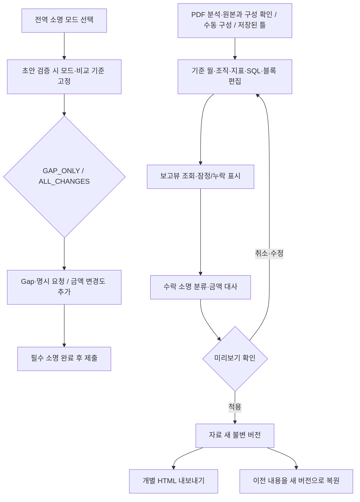

# PRD v8.5 설정·반려 항목·명시 비교 요청·소명 정책

현재 API 계약에 추가하는 V9·V11 범위다. 소스 작성과 실행 검증은 구분하며, 검증 기록은 아래에 명시한다. 원본 `Data/`, 기존 요청 대상 집합, 금융값, 공식 마스터를 수정하지 않는다.

## 공통 계약

- 아래 경로는 `/api/v1` 접두사를 사용한다.
- 설정은 `PLANNER` 전용이다. 본인 확인 API는 두 역할 모두 사용할 수 있다.
- 모든 쓰기는 `Idempotency-Key`를 요구한다. 동일 명령 재전달은 최초 성공 응답과 `Idempotency-Replayed: true`를 반환한다.
- 기존 대상 수정은 조회한 `expectedStateToken`을 요구하며 충돌 시 `409 RESOURCE_CHANGED`다.
- `CommandExecutor`가 행위자의 `app_user` 행을 잠그고 활성·역할·조직을 재검사한다. 사용자 확인의 토큰 대조와 시각 저장도 이 잠금 아래 실행한다.
- ID는 문자열, 금액은 십진 문자열, 시각은 UTC ISO 8601이다. 허용되지 않은 JSON 필드·쿼리는 400이다.

## 설정 API

| 경로 | 메서드·입력 | 응답·규칙 |
| --- | --- | --- |
| `/settings/organizations` | GET | `{items:[OrganizationSetting],nextCursor:null}` |
| `/settings/organizations` | POST `{code,name,active?}` | 201. code는 영문·숫자·밑줄·하이픈 1~80자, name 1~200자. active 기본 true |
| `/settings/organizations/{id}` | PATCH `{expectedStateToken,name?,active?}` | code 불변, 삭제 API 없음. 열린 요청의 제외되지 않은 필수 조직을 비활성화하면 `409 ORGANIZATION_IN_USE` |
| `/settings/users` | GET `organizationId?,role?,active?` | `{items:[UserSetting],nextCursor:null}` |
| `/settings/users` | POST `{email,name,role,organizationId?,active?}` | 201. 이메일 320자, 이름 200자. ORG_MANAGER는 활성 조직 필수, PLANNER는 organizationId null/생략. 이메일 중복은 `409 EMAIL_ALREADY_EXISTS` |
| `/settings/users/{id}` | PATCH `{expectedStateToken,name?,role?,organizationId?,active?}` | 이메일 불변. 본인 기획 권한 제거/비활성은 `409 SELF_ACCESS_CHANGE`. 소속·역할 변경 시 최초 확인 초기화 |
| `/settings/message-templates` | GET | 비활성 이력을 포함한 `{items:[MessageTemplate],nextCursor:null}` |
| `/settings/message-templates` | POST `{name,type,message}` | 201. type은 ANNUAL_PLAN/MONTHLY_ACTUAL/EXPLANATION, name 200자·message 5000자 이하. EXPLANATION은 실제 소명 요청 계약과 같은 4000자 이하 |
| `/settings/message-templates/{id}` | PATCH `{expectedStateToken,name?,type?,message?,active?}` | 변경 이력을 남기며 기존 요청의 메시지는 바꾸지 않음 |
| `/settings/message-templates/{id}` | DELETE `{expectedStateToken}` | 200. active=false로 논리 삭제하며 DB 행·과거 감사 기록 유지 |

`OrganizationSetting`은 `{id,code,name,active,stateToken}`이다. `UserSetting`은 `{id,email,name,role,organization:{id,code,name}|null,active,confirmedAt,stateToken}`이다. `MessageTemplate`은 `{id,name,type,message,active,updatedAt,stateToken}`이다.

조직 추가는 미래 요청 생성에 영향을 주며 이미 생성한 `request_target`을 확장하지 않는다. 조직 설정은 기존 마스터의 구성 조직 ID나 고정 제출본을 바꾸지 않는다. 계정 비활성화는 삭제가 아니므로 과거 행위자 참조를 보존한다. 현재 계정 표시 이름과 조직 이름은 조회 시 현행 표시명을 사용할 수 있다.

## 최초 소속·역할 확인

- GET `/auth/profile-confirmation`: `{actor:{id,email,name,role,organization},confirmed,confirmedAt,stateToken}`.
- POST 같은 경로: `{expectedStateToken}`. 화면에서 확인한 서버의 현재 소속·역할에 동의했다는 시각만 저장한다.
- 사용자가 역할·조직을 직접 지정하거나 승격할 수 없다. 소속 정보가 틀렸을 때는 기획자의 사용자 설정 변경을 거친다.
- 확인은 UI 진입 절차를 지원하는 기록이다. 별도의 운영 이메일/SSO 제공자 구현을 의미하지 않는다. 기존 인증·DB 권한 검사는 계속 적용된다.

## 항목별 반려

기존 `POST /submissions/{id}/decisions`의 REJECT 본문에 선택 `rejectionItems` 배열을 추가한다. 전체 `note`는 계속 필수다. APPROVE에는 note와 rejectionItems를 보내지 않는다.

각 항목은 `{reviewItemId?,reportItemId?,year?,month?,scenario?,basis?,source?:{sheet,cell},reason}`다.

- `reviewItemId`를 선택하면 서버가 보고 항목·연월·시나리오를 결정한다. 함께 보낸 키가 다르면 400이다.
- reviewItemId가 없으면 reportItemId·year·month·scenario가 필수이며 해당 검증 제출에 존재해야 한다.
- reason은 1~2000자, 항목 수는 최대 100개다. 같은 보고 항목·기간·원천·비교의 중복 선택을 거부한다.
- source는 현재 제출의 해당 보고 항목·기간에 적재된 실제 셀이어야 한다. 임의 셀 주소나 다른 제출의 review ID를 저장하지 않는다.
- basis는 PLAN/PREVIOUS다. 검토 항목의 저장 비교를 우선 사용하고, 비교 없는 항목은 검증 당시 comparisonContext에서 확인된 기준만 사용한다. 기준이 없으면 금액을 0으로 만들지 않고 null로 보존한다.
- 클라이언트가 기준값·현재값을 제출하지 않는다. 서버가 확인한 보고 합계와 원천 금액을 같은 반려 트랜잭션에서 스냅샷으로 저장한다. 한 항목이라도 잘못되면 전체 반려를 롤백한다.

`SubmissionView.rejectionItems`는 `[{id,reviewItemId,reportItem:{id,code,name,kind},year,month,scenario,basis,baselineSubmissionId,baselineScenario,baselineAmount,currentAmount,amountScope:"REPORT_ITEM",source,sourceAmount,reason}]`다. 반려 외 상태와 구형 항목 없는 반려는 빈 배열이다.

`currentAmount`·`baselineAmount`는 **보고 항목 합계**이고 `sourceAmount`는 선택한 단일 원천 셀 값이다. 서로 다른 단위의 금액을 셀 전후 비교로 표시하지 않는다. 과거 반려 조회는 저장된 이름·금액·사유를 반환하며 현재 카탈로그와 금액으로 재계산하지 않는다.

## 임의 비교에 대한 명시 소명 요청

POST `/submissions/{id}/comparison/explanation-requests`:

`{expectedStateToken,baselineSubmissionId,baselineScenario,scenario,month,reportItemIds:[id],note,dueAt}`

- 기획자만 가능하며 현재 제출은 PENDING이어야 한다. 기준은 같은 조직·연도의 최종 제출본이며 DRAFT는 거부한다.
- 기존 비교 서비스가 양쪽 원본·검증 무결성을 확인한다. 양쪽 금액을 확인할 수 있는 1~100개 중복 없는 보고 항목만 요청할 수 있다.
- note는 1~4000자, dueAt은 시간대를 포함한 필수 시각이다. 제외된 요청 대상·오래된 제출 토큰을 거부한다.
- 자동 Gap 검토 항목이 없으면 명시 요청용 검토 항목을 생성한다. 기존 검토 건이면 과거 소명 행을 수정하지 않고 새 회차를 만든다. 비활성 검토 행은 되살리지 않는다.
- `review_item.workflow_state=REQUESTED`로 필수 소명에 포함한다. 현재 회차 답변과 수용 전 제출 승인은 차단된다.
- 기존 `gap_comparison`, 검증 객체의 자동 Gap 기준, 금융값, 과거 마스터를 변경하지 않는다.

응답은 `{items:ReviewItemView[],submission:SubmissionView}`다. 각 `explanations[]`에 nullable `requestComparison`을 추가한다. 값은 요청 당시 `{submissionId,baselineSubmissionId,reportItem,year,month,scenario,baselineScenario,baselineAmount,currentAmount,gapAmount,gapRate,valueStatus,baselineEvidenceUrl,currentEvidenceUrl}` 스냅샷이다. 같은 소명의 보완 요청과 변경 없는 수용 소명 이어받기도 해당 문맥을 보존한다.

명시 요청은 **보고 항목·월·시나리오 단위**다. 개별 원천 셀별 독립 승인/소명 모델로 확대된 것은 아니다. 원천 셀은 연결된 양쪽 financial-values와 source-cells에서 확인한다.

## 전체 변경·Gap 소명 정책 선택

전역 정책은 연간 PLAN과 월간 ACTUAL/ESTIMATE에 공통으로 적용한다. 기본은 기존 정책 2.0과 같은 `GAP_ONLY`다. 임계값은 기존 `/gap-thresholds`에서 별도로 관리한다.

| 경로 | 입력 | 응답·규칙 |
| --- | --- | --- |
| GET `/review-policy/current` | 없음 | `{id,requirementMode,appliedBy,appliedAt,stateToken}`. 두 역할 조회 가능. 초기 정책 appliedBy는 null |
| POST `/review-policy` | `{expectedStateToken,requirementMode}` + 멱등키 | 기획자 전용. 201 새 이력. 토큰 충돌은 409 RESOURCE_CHANGED |
| POST `/review-policy/preview` | `{requestId,requirementMode}` | 기획자 전용 읽기. 연간·월간 요청 모두 지원하며 설정을 저장하지 않음 |

- `GAP_ONLY`: Gap 초과 또는 기획자의 명시 요청이 필수다. 기준 미달 원천 변경은 비교 근거로 남는다.
- `ALL_CHANGES`: 위 조건에 원천 금액 구성 변경을 추가한다. 보고 항목의 합계가 상쇄되어 같아도 원천 구성 변경을 검토한다. 연간 재제출의 금액 변경도 필수다. 같은 시나리오의 기준 원천이 없는 최초 제출은 변경으로 만들지 않는다.
- 필수 단위는 보고 항목·월·시나리오다. 원천 셀마다 독립 소명 회차가 생기는 구조는 아니다. `EXCLUDED` 항목은 두 모드 모두 필수에서 제외한다.
- 검증 객체의 `comparisonContext.reviewPolicyId/requirementMode`와 검토의 `requirement_mode`에 모드를 고정한다. `ReviewItemView.requirementMode`는 고정 모드다.
- 새 전역 설정은 이미 최종 제출한 PENDING/APPROVED/REJECTED의 근거·필수 여부·소명 회차를 바꾸지 않는다. DRAFT는 설정 변경 후 STALE이며 다시 검증해야 제출할 수 있다. 재검증은 새 문맥의 회차를 만들고 과거 답변 이력을 보존한다.
- 검증·최종 제출과 설정 적용은 동일 정책 guard를 잠근다. 제출 조건 확인과 상태 전이 사이에 다른 정책이 끼어들지 않는다.
- V11 이전 검토의 nullable `requirement_mode`는 원래 `review_policy_version`으로 해석한다. 1.0의 변경 필수와 2.0의 Gap/명시요청 필수는 소급 변경하지 않는다.

미리보기는 요청에서 제외되지 않은 조직별 **최신 제출완료본**의 저장된 변경·Gap·명시요청에 후보 모드를 적용한다. `{requestId,requirementMode,sourceSubmissionIds,changedItemCount,gapExceededItemCount,explicitlyRequestedItemCount,requiredItemCount,requiredOrganizationCount,excludedItemCount,evaluatedAt}`를 반환한다. 필수 수는 조건들의 합집합이며 `excludedItemCount`는 사용자가 검토 제외한 항목 수다. 새로운 임계값이나 미검증 초안의 금융값을 재평가하지 않으며, 실제 재검증의 신규 데이터 결과를 예측하는 수치로 표시하지 않는다.

## 소명 정책·보고 작성 흐름

설정 변경은 완료 제출의 정책을 바꾸지 않는다. 반려 항목은 반려 명령과 함께 고정하고, 임의 비교 소명 요청은 해당 회차의 비교 기준을 보존한다. 조직·담당자 설정 이력과 최초 소속 확인은 업무 데이터 수정과 별도다. 보고 작성의 상세 계약은 [보고 작성 문서](report-authoring.md)를 따른다.

## 저장 구조와 함수 책임

| 소스·주요 함수 | 호출·입출력·부작용 |
| --- | --- |
| `settings/SettingsController` 모든 HTTP 함수 | ActorResolver.current → SettingsService. 쿼리·멱등 헤더를 받아 JSON을 반환. 직접 DB·파일 쓰기 없음 |
| `SettingsService.organizations/users/templates/confirmation` | 조회 DTO와 stateToken 반환. 역할 검사 후 DB 읽기만 수행 |
| `SettingsService.createOrganization/updateOrganization/createUser/updateUser` | CommandExecutor → guard → 입력·현재 토큰·활성 소속 검사 → 설정과 audit 저장. 공식 대상 집합은 보존 |
| `SettingsService.createTemplate/updateTemplate` | 문구와 불변 audit 저장. 기존 요청 변경/발송 없음 |
| `SettingsService.confirm` | CommandExecutor 사용자 잠금 → 현재 확인 토큰 대조 → profile_confirmed_at 저장 |
| `SettingsService.organizationView/userView/templateView/organizationFor` | DB 행을 외부 DTO로 변환·소속 조건 검증. userView와 organizationFor만 조직 DB 읽기 |
| `SettingsService.guard/audit/expect/requireChange/fields/text/bool/role/templateType/token/fingerprint/json/rows/one/required/insert/result/now/invalid/conflict` | 공통 잠금·감사·입력 검증·정밀 DTO·오류 변환. 각 함수의 Args/Returns/Raises/Side Effects는 코드 명세 기준 |
| `SubmissionRejectionService.save/items/snapshot` | Workflow.decide → save로 반려 근거 검증·저장. SubmissionService.submissionView → items로 불변 조회 |
| `SubmissionRejectionService.validation/hasValue/amount/value/fields/text/stringId/integer/decimal/rows/json/invalid` | 검증 객체·실제 source 조회와 입력 변환. 파일 접근·금융값 변경 없음 |
| `SubmissionWorkflowService.DecisionInput` | 선택 rejectionItems JSON을 검사하고 기존 3인자 호출도 유지. REJECT 트랜잭션에 반려 항목 저장을 포함 |
| `ComparisonExplanationService.request` | SubmissionComparisonController.request → 사용자/조직/제출 잠금 → ReviewService.compareSubmissions → 새 회차·이벤트 저장 → 검토/제출 DTO |
| `ComparisonExplanationService.fields/text/integer/rows/insert/json/invalid/conflict` | 허용 입력 검사·조회·생성·JSON/오류 변환. 파일 접근 없음 |
| `ReviewComparisonService.requestComparison` | 저장 JSON을 nullable JsonNode로 변환. ReviewService.explanation에서 호출 |
| `ReviewService.explanation/decide`, `ReviewComparisonService.save` | 명시 비교를 회차별 반환하고 보완/이어받기 시 보존. 자동 Gap 계산 기준은 변경하지 않음 |
| `ReviewPolicyController.current/preview/apply` | 인증 사용자 → 쿼리 검증 → 정책 서비스. apply만 멱등 응답을 반환 |
| `ReviewPolicyService.current/latest/view` | 현재 정책·행위자와 토큰 조회. DB 읽기만 수행 |
| `ReviewPolicyService.apply` | 기획 권한 → CommandExecutor → 정책 guard → 토큰 → 새 정책 이력. 과거 제출을 갱신하지 않음 |
| `ReviewPolicyService.preview/validateMode/fingerprint` | 후보 모드 검증·고정 검토의 필수 합집합 집계·메모리 해시. 저장 없음 |
| `ReviewComparisonService.context/save`, `ReviewService.requirementMode/required/requiredSql` | 검증 당시 정책을 고정하고 DTO·목록·미답변·승인 준비에 동일 모드 사용. 구형 모드는 정책 버전으로 해석 |

V9는 `app_user.profile_confirmed_at/settings_revision`, `organization.settings_revision`, `review_explanation.request_comparison_json`, `settings_guard`, `request_message_template`, `settings_audit_event`, `submission_rejection_item`을 추가한다.

V11은 `review_policy_guard`, 불변 이력 `review_policy`, nullable `review_item.requirement_mode`를 추가한다. 기본 정책은 GAP_ONLY이며 기존 검토행을 마이그레이션 중 갱신하지 않는다.

## 검증 소스

- `SettingsIntegrationTests`: 기획자 권한, 본인 확인·멱등, 역할 승격 차단, 소속 변경 재확인, 자기 권한 제거 차단, 문구 변경 이력·토큰 충돌·논리 삭제, 기존 요청 대상 보존.
- `SubmissionWorkflowTests` 추가: 반려 근거 불변·재전달 중복 방지, 허위 원천 반려 전체 롤백, 명시 비교가 자동 Gap/과거 수용 소명을 보존하며 새 필수 회차를 생성, DRAFT 비교 기준 거부.
- `ReviewWorkflowTests` 추가: 모드 권한·멱등·오래된 토큰, 기존 정책 불변, 후보 필수 합집합·제외, 연간 검증 모드 고정·재검증 회차 보존. `SubmissionIntegrationTests` 추가: 실제 HTTP에서 초안 STALE·재검증·필수 답변·최종 제출 후 모드 고정·수용 전 승인 차단.
- 테스트는 합성 H2 메모리와 서비스 대역을 사용한다. 실제 원본·운영 DB·외부 이메일은 사용하지 않는다.
- 2026-11-18: JavaCompiler의 클래스 출력을 ByteArrayOutputStream에 보관하여 전체 main/test 타입 컴파일을 통과했다. `SubmissionWorkflowTests`의 반려·명시 비교 신규 4개를 포함한 관련 JUnit 39개가 메모리 실행에서 통과했다.
- 같은 날 실제 V1~V9 SQL과 SettingsService/CommandExecutor를 사용한 독립 H2 메모리 smoke에서 최초 확인·멱등, 권한 승격 차단, 소속 변경 재확인, 문구 CRUD·감사·오래된 토큰 거부, 기존 요청 조직 집합 보존·필수 조직 비활성 차단을 통과했다. `SettingsIntegrationTests`의 HTTP 계층 실행과 독립 서비스 smoke는 구분한다.
- 위 검증은 source-file 모드의 stdin Java·기존 의존성 읽기·메모리 클래스와 DB·콘솔만 사용했다. Gradle 빌드·테스트 보고서·임시 파일을 생성하지 않았다.

최종 검증은 [2026-11-18 실행 기록](local-environment.md#2026-11-18-prd-v85-개발-검증)의 Java 194개 중 192개 통과·선택 검사 2개 제외·실패 0개를 따른다.
