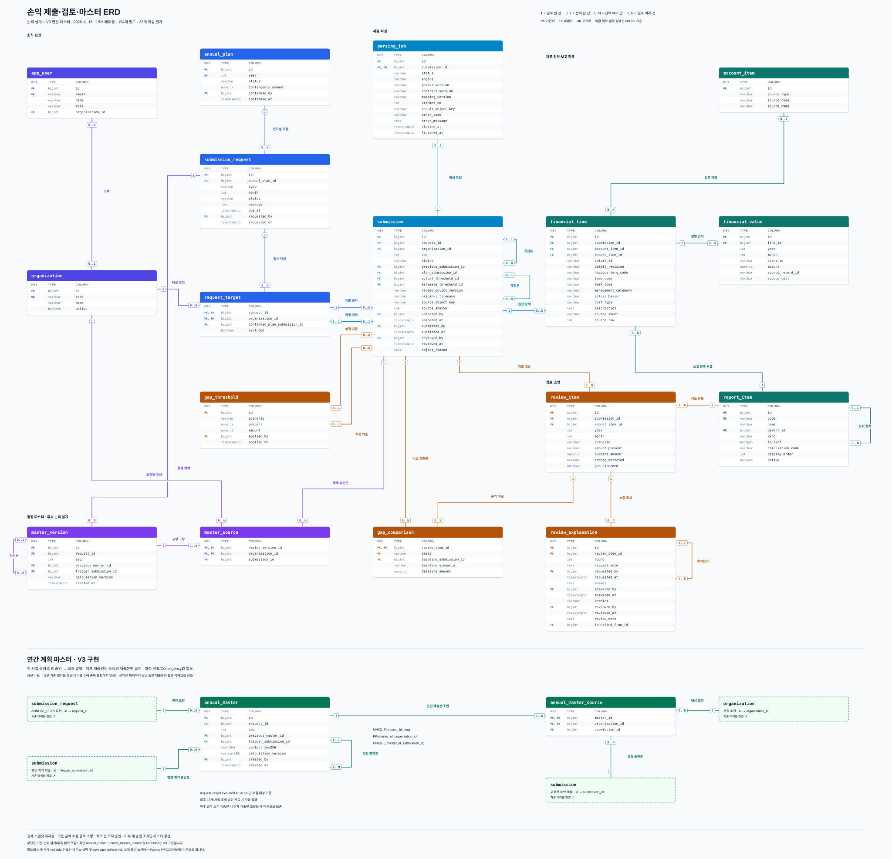

# 손익 제출·검토·마스터 ERD

설계 v0.2 · 2026-11-16. 전체 재제출, 모든 금액 수정의 소명, 전 조직 최초 승인과 이후 승인 조직별 마스터 교체를 반영한 논리 설계입니다. DB 마이그레이션은 포함하지 않습니다.

[직선 SVG 원본](erd.svg) · [테이블·컬럼·제약과 확정 규칙](development/erd.md) · [파서 결과와 DB 매핑](development/db-mapping.md)

17개 테이블·141개 필드·27개 핵심 관계입니다. 연결선은 수평·수직 직선이며 행위자 FK는 컬럼에 표시합니다. 이전 초안은 Git 이력에서 확인할 수 있습니다.
