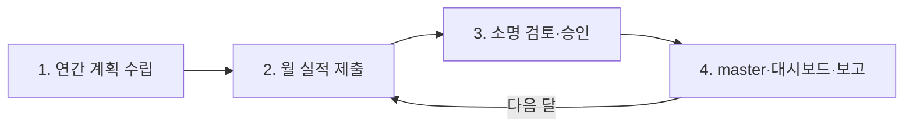
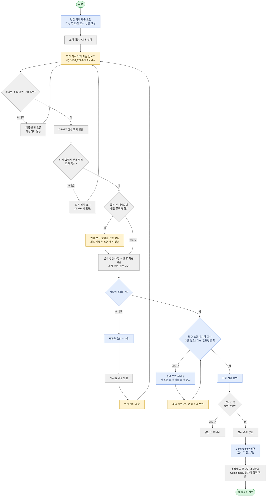
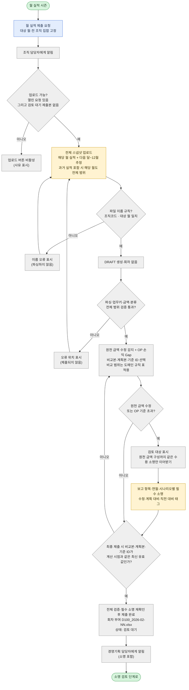
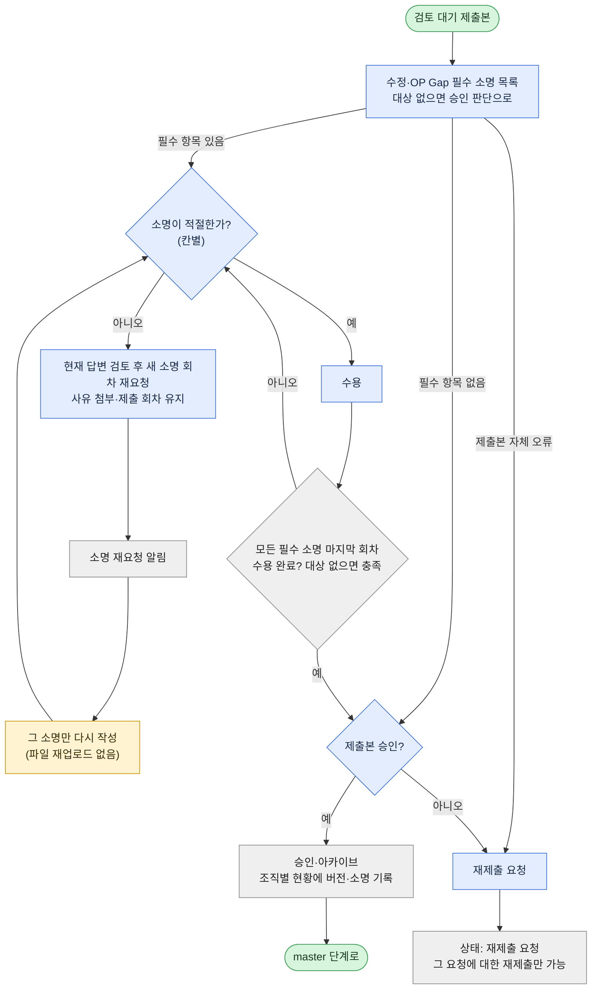
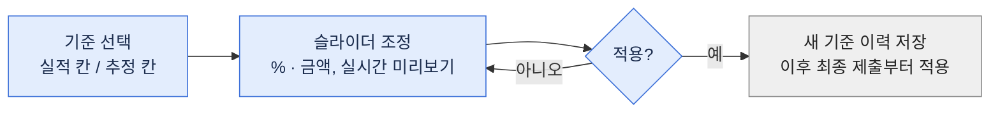
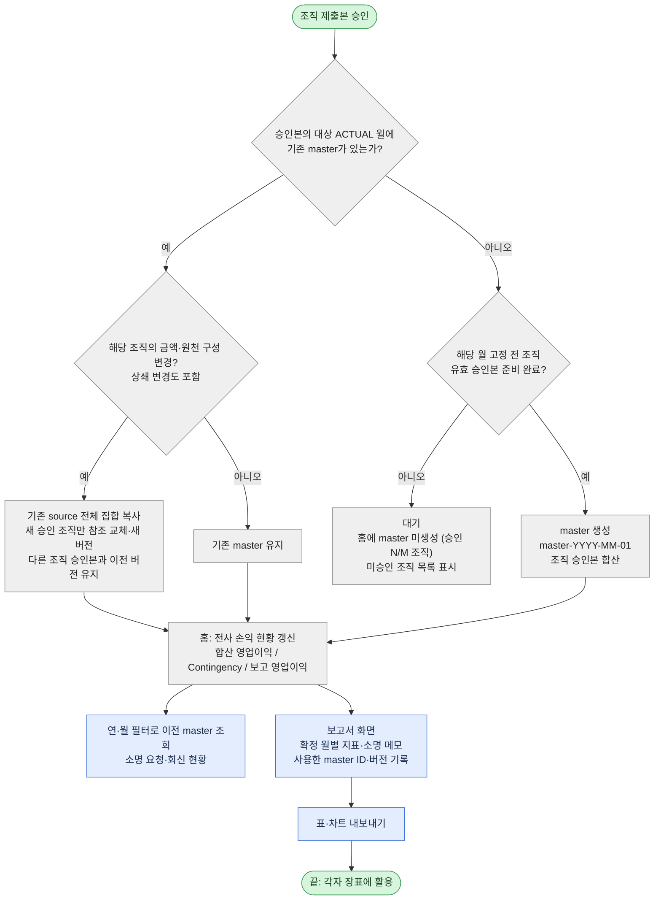
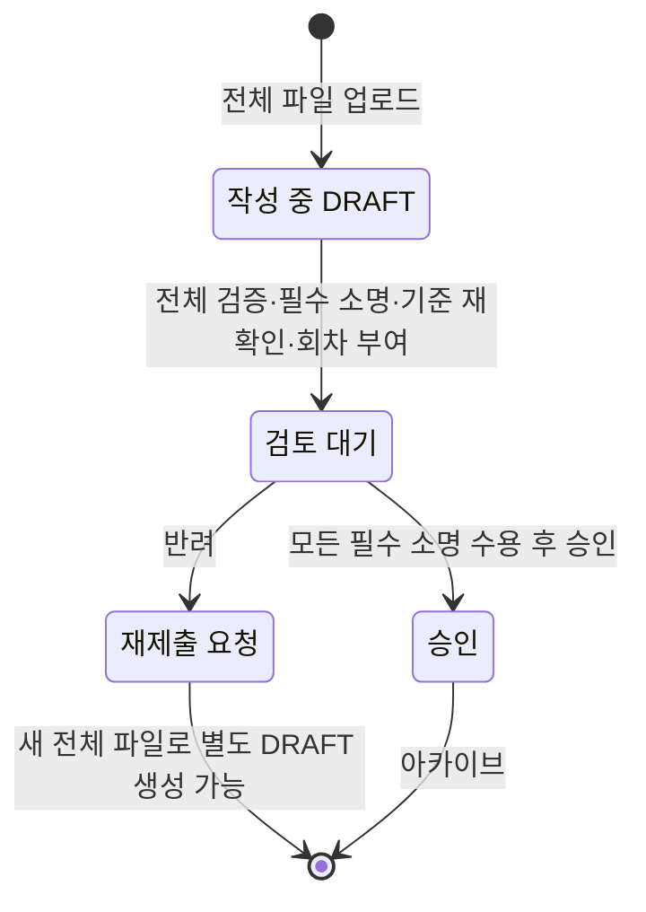
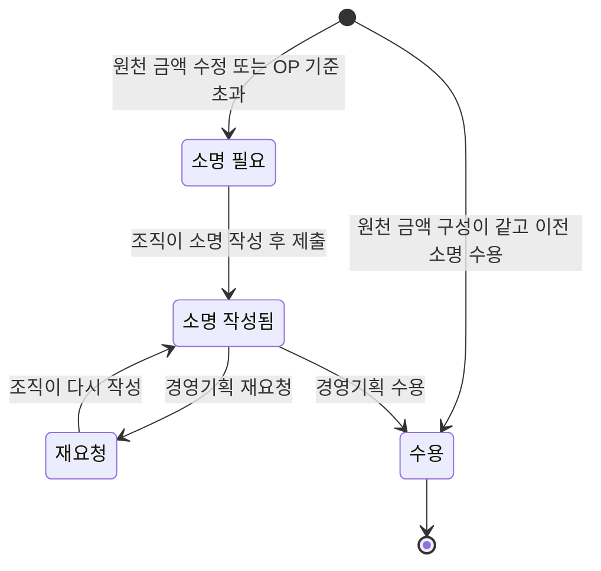

# 업무 흐름도

[도메인 규칙](domain-rules.md)과 [논리 ERD v0.2](development/erd.md)의 업무 흐름입니다. 파서의 기술 마스터 조립과 서비스의 승인 마스터 발행을 구분하며, 이 흐름의 백엔드 구현 완료를 뜻하지 않습니다.

**색 구분**

| 색 | 주체 |
| --- | --- |
| 파랑 | 경영기획 담당자 |
| 노랑 | 조직 담당자 |
| 회색 | 시스템 (자동 처리) |

## 전체 단계

## 1. 연간 계획 수립

## 2. 월 실적 제출

## 3. 소명 검토·승인

### Gap 기준 설정 (경영기획 담당자, 수시)

## 4. master·대시보드·보고

승인본에 포함된 ACTUAL 월마다 위 분기를 적용합니다. 과거 월도 해당 조직·월의 전체 스냅샷이 필요합니다. 승인과 영향 월 발행은 원자적으로 처리하며, 동시 승인의 중복·누락 발행을 방지합니다. 홈은 ACTUAL만 사용합니다.

## 상태

### 제출본

### 검토 항목 — 금액 수정·손익 Gap 소명

